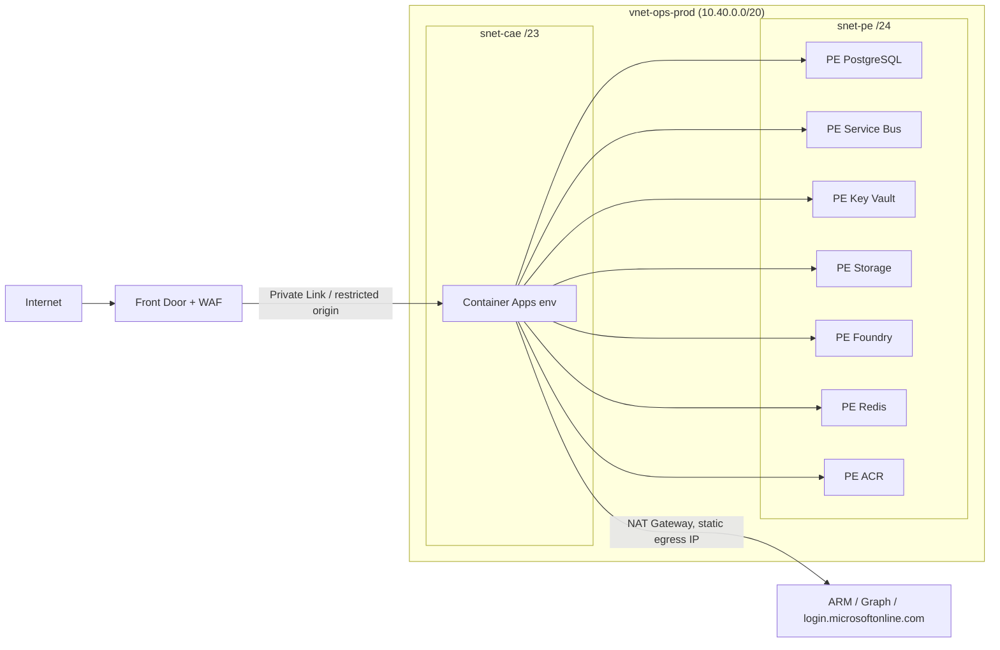

# Azure Integrations

| | |
|---|---|
| Status | Draft v0.1 (2026-11-16) |
| SDKs | `Azure.ResourceManager.*`, `Azure.ResourceManager.ResourceGraph`, `Azure.ResourceManager.CostManagement`, `Azure.Monitor.Query`, `Azure.Identity`, `Azure.Messaging.ServiceBus`, `Azure.Storage.Files.DataLake` |
| Related | [TARGET_ARCHITECTURE.md](TARGET_ARCHITECTURE.md), [DATABASE_DESIGN.md](DATABASE_DESIGN.md) |

This document covers two things:

- **Part A**: how the platform reads from and acts on **customer** Azure estates.
- **Part B**: the Azure services the platform itself **runs on**.

---

## Part A: Customer Azure integrations

## 1. Access model: Azure Lighthouse

Customers delegate subscriptions (or resource groups) to Antire's tenant through an **Azure Lighthouse** offer. The offer is an ARM/Bicep template deployed by the customer, or published as a Managed Service offer in Partner Center/Marketplace.

### 1.1 Authorizations in the offer

| Principal (in Antire tenant) | Role in customer scope | Kind | Used by |
|---|---|---|---|
| `uami-ops-collector` (managed identity) | Reader | permanent | Inventory, Resource Graph, Advisor, Policy |
| `uami-ops-collector` | Monitoring Reader | permanent | Metrics, alerts, Log Analytics query (+ Log Analytics Reader on workspaces) |
| `uami-ops-collector` | Cost Management Reader | permanent | Cost queries & exports |
| `uami-ops-collector` | Security Reader | permanent | Defender for Cloud |
| `uami-ops-automation` | Virtual Machine Contributor | permanent | Start/stop/resize VM actions |
| `uami-ops-automation` | Tag Contributor | permanent | Tag governance actions |
| `uami-ops-automation` | Monitoring Contributor | permanent | Deploy alert rules/action groups |
| `uami-ops-automation` | Managed Services Registration assignment Delete Role | permanent | Lets Antire remove its own delegation at offboarding |
| `grp-ops-l2-azure` (Antire security group) | Contributor | **eligible** (Lighthouse JIT, max 8 h, MFA + approval) | Human break-fix |
| `grp-ops-reader` | Reader | permanent | Technicians |

- Owner and User Access Administrator are **never** delegated permanently. Where a customer needs them, they are granted as eligible with approval.
- Lighthouse activity shows up in the customer's Activity Log with Antire's tenant as the caller, which gives the customer transparency.
- The platform detects delegations by listing `Microsoft.ManagedServices/registrationAssignments` from Antire's tenant (`GET /subscriptions` returns delegated subscriptions too). It writes them to `inventory.azure_subscriptions` with `delegated_via_lighthouse = true`.

### 1.2 Credentials

Collectors and automation run as **Antire-tenant managed identities**. With Lighthouse, ARM calls go straight to customer subscriptions with a token from Antire's own tenant, so ARM needs no cross-tenant token exchange (Graph does; see GRAPH_API_INTEGRATIONS.md).

```csharp
var credential = new ManagedIdentityCredential(
    ManagedIdentityId.FromUserAssignedClientId(opts.CollectorClientId));
var arm = new ArmClient(credential);   // singleton
```

### 1.3 Onboarding template (excerpt)

`infra/lighthouse/offer.bicep` (deployed at subscription scope by the customer):

```bicep
targetScope = 'subscription'
param mspTenantId string = '<antire-tenant-id>'
param authorizations array   // principalId, roleDefinitionId, principalIdDisplayName
param eligibleAuthorizations array

resource def 'Microsoft.ManagedServices/registrationDefinitions@2022-10-01' = {
  name: guid('antire-ops', mspTenantId)
  properties: {
    registrationDefinitionName: 'Antire Managed Operations'
    managedByTenantId: mspTenantId
    authorizations: authorizations
    eligibleAuthorizations: eligibleAuthorizations
  }
}
resource assign 'Microsoft.ManagedServices/registrationAssignments@2022-10-01' = {
  name: guid('antire-ops-assignment', subscription().id)
  properties: { registrationDefinitionId: def.id }
}
```

---

## 2. Integration catalog

Legend for **Mode**: `S` is a scheduled pull, `E` is event-driven (Event Grid or alert webhook), `O` is on demand (UI or AI tool), `W` is a write (Action Pipeline).

### 2.1 Inventory: Azure Resource Graph (primary)

Resource Graph is the backbone because one KQL query covers **all delegated subscriptions across all customers**. The platform splits results by `tenantId` and `subscriptionId`, which map to `customer_id`.

| Data | ARG table / query | Mode | Frequency | Target |
|---|---|---|---|---|
| All resources | `resources \| project id, name, type, kind, location, resourceGroup, subscriptionId, tenantId, sku, tags, properties` (trimmed per type) | S | 1 h full, paged by `$skipToken` | `inventory.azure_resources` |
| Resource containers | `resourcecontainers` (subscriptions, RGs, management groups) | S | 1 h | `inventory.azure_subscriptions` |
| Changes | `resourcechanges \| where properties.changeAttributes.timestamp > ago(1h)` | S | 15 min | `inventory.resource_changes` |
| Advisor recommendations | `advisorresources \| where type == 'microsoft.advisor/recommendations'` | S | 24 h | `cost.recommendations`, `security.findings` (by category) |
| Policy compliance | `policyresources \| where type == 'microsoft.policyinsights/policystates'` | S | 6 h | `security.findings` (`source = azure.policy`) |
| Defender assessments | `securityresources \| where type == 'microsoft.security/assessments'` | S | 6 h | `security.findings` |
| Defender secure score | `securityresources \| where type == 'microsoft.security/securescores'` | S | 24 h | `security.score_snapshots` |
| Patch status | `patchassessmentresources` | S | 24 h | `security.findings` (`missing_critical_updates`) |
| Backup coverage | `recoveryservicesresources` + VMs without a protected item | S | 24 h | `security.findings` (`BCK-001`) |
| Orphans | Disks with `diskState == 'Unattached'`, public IPs without `ipConfiguration`, NICs without a VM, empty App Service plans | S | 24 h | `cost.recommendations` (`delete_orphan`) |

Practical notes:

- Limit `subscriptions` per request (ARG accepts up to about 1,000 subscription IDs per query; batch beyond that) and use `options.resultFormat = objectArray`.
- ARG is throttled per user/principal (quota headers `x-ms-user-quota-remaining`). Spread queries out and back off using `x-ms-user-quota-resets-after`.
- Resource Graph data is near-real-time (minutes). For guaranteed freshness after a write action, the automation worker re-reads the resource through ARM directly.

### 2.2 Cost Management (FinOps)

| Data | API | Mode | Frequency | Target |
|---|---|---|---|---|
| Daily actual and amortized cost (bulk) | **Cost Management Exports** in **FOCUS** format, daily month-to-date, to an Antire-owned ADLS container. Created per customer billing scope via `Microsoft.CostManagement/exports` | S (export) → E (blob created → Event Grid) | daily | ADLS `curated/cost/…` → `cost.daily_costs` |
| Ad-hoc breakdowns (UI or AI) | `POST {scope}/providers/Microsoft.CostManagement/query` (grouping by ServiceName, ResourceGroup, tag) | O | — | not stored |
| Forecast | `POST {scope}/providers/Microsoft.CostManagement/forecast` | S | daily | `cost.budgets` evaluation |
| Native anomaly alerts | Scheduled actions `kind=InsightAlert` per subscription → email or Logic App → webhook to ops-api | E | — | `cost.anomalies` (`method = azure.anomaly-alert`) |
| Budgets (customer-visible) | `Microsoft.Consumption/budgets` deployed by action `azure.budget.ensure` | W | — | mirrors `cost.budgets` |
| Reservations and savings plans in place | `Microsoft.Capacity/reservationOrders` (requires reservation reader access, often via CSP/billing), `Microsoft.BillingBenefits/savingsPlanOrders` | S | 24 h | `cost.commitments` |
| Commitment recommendations | `Microsoft.Consumption/reservationRecommendations`, benefit recommendations (`Microsoft.CostManagement/benefitRecommendations`) | S | 24 h | `cost.recommendations` (`reservation`, `savings_plan`) |
| Retail prices (for what-if) | `https://prices.azure.com/api/retail/prices` (public) | O / cached | weekly | cache |

**Billing scope reality check.** Which scope works depends on how the customer buys Azure:

| Customer agreement | Cost scope the platform uses | Note |
|---|---|---|
| **CSP via Antire** (preferred) | Antire's partner billing account / customer scope (`/providers/Microsoft.Billing/billingAccounts/{partner}/customers/{id}`) | Antire sees partner cost and can see retail; best margin visibility. Requires Antire billing roles. |
| MCA (customer-owned) | Subscription scope via Lighthouse (Cost Management Reader) | Exports must be configured per subscription |
| EA | Subscription scope via Lighthouse; or the customer grants EA enrollment reader | Amortized cost needs `metric=AmortizedCost` |
| Pay-as-you-go | Subscription scope via Lighthouse | Same as MCA |

**Platform-side anomaly detection.** The `cost` processor runs a seasonal z-score over 28 days per (customer, service) and per subscription, and flags deviations above 3σ with a minimum absolute change (for example, NOK 500/day). An anomaly starts AI explanation (cost query + `resourcechanges` + Activity Log) and optionally opens an incident.

**Cost recommendation rules (Antire rules on top of Advisor):**

| Code | Rule | Action type |
|---|---|---|
| `COST-001` | VM avg CPU < 5 % and max < 20 % for 14 days (Monitor metrics) | `azure.vm.resize` or `azure.vm.schedule_shutdown` |
| `COST-002` | Non-prod VMs running 24×7 | `azure.vm.schedule_shutdown` (business hours) |
| `COST-003` | Unattached managed disks > 14 days | `azure.disk.snapshot_and_delete` |
| `COST-004` | Unassociated public IPs | `azure.publicip.delete` |
| `COST-005` | Premium SSD on stopped/deallocated VMs | `azure.disk.change_sku` |
| `COST-006` | Storage accounts with hot tier and no reads in 30 days | `azure.storage.lifecycle_policy` |
| `COST-007` | Old snapshots > 90 days | `azure.snapshot.delete` |
| `COST-008` | Steady-state compute with no reservation or savings plan coverage | advisory only (purchase is a commercial decision) |
| `COST-009` | App Service plans with 0 apps | `azure.appserviceplan.delete` |
| `COST-010` | Log Analytics ingestion spikes or tables on the wrong plan (Analytics vs Basic) | advisory |

Realized savings are measured by comparing `cost.daily_costs` for the target resource 30 days before and after implementation. They are stored in `cost.recommendations.realized_savings` and reported to the customer.

### 2.3 Monitoring

| Data | API / mechanism | Mode | Target |
|---|---|---|---|
| Fired alerts (customer-configured and Antire-deployed) | **Action group webhook** (Common Alert Schema) → `POST https://ops-api/hooks/azure-monitor/{customerKey}`, authenticated with Entra auth on the webhook (secure webhook) | E | `monitoring.alerts` |
| Alert state backfill | `Microsoft.AlertsManagement/alerts` (Alerts Management API) | S (15 min) | reconcile `monitoring.alerts` |
| Metrics (rightsizing, dashboards) | `Azure.Monitor.Query.MetricsClient` (batch metrics API, many resources per call) | S daily + O | aggregates only, kept in `cost.recommendations.evidence` |
| Logs | `LogsQueryClient` against customer Log Analytics workspaces (Lighthouse grants Log Analytics Reader) | O (AI tool `query_log_analytics`, validated read-only KQL) | not stored |
| Activity Log | `resourcechanges` (ARG) + Activity Log API for caller identity | S 15 min | `inventory.resource_changes.changed_by` |
| Resource health | `Microsoft.ResourceHealth/availabilityStatuses` / ARG `healthresources` | S 5 min | `monitoring.alerts` (`source = azure.resourcehealth`) |
| Azure service health | ARG `servicehealthresources` | S 15 min | `monitoring.service_health_events` |

**Antire monitoring baseline** (deployed per customer by action `azure.monitoring.ensure_baseline` from a Bicep module):

- An action group `ag-antire-ops` with the secure webhook to the platform.
- Activity log alerts for Service Health and Resource Health on the customer's subscriptions.
- Metric alerts for VM availability, disk-full prediction, App Service HTTP 5xx and SQL DTU/vCore saturation. Thresholds are parameterized per customer tier.
- Optionally, **Azure Monitor Baseline Alerts (AMBA)** policy initiatives for customers on a landing-zone pattern.

### 2.4 Security (Defender for Cloud and Sentinel)

| Data | Mechanism | Mode | Target |
|---|---|---|---|
| Defender plans enabled | `Microsoft.Security/pricings` per subscription | S 24 h | `security.findings` (`SEC-AZ-001` Defender CSPM/Servers off) |
| Recommendations | ARG `securityresources` assessments (see 2.1) | S | `security.findings` |
| Security alerts | **Continuous export** → Event Hub in the customer tenant is complex cross-tenant, so prefer ARG `securityresources \| where type == 'microsoft.security/locations/alerts'` every 5 min, plus Graph `alerts_v2` (Defender XDR also includes Defender for Cloud alerts once integrated) | S 5 min | `monitoring.alerts` |
| Regulatory compliance | `Microsoft.Security/regulatoryComplianceStandards` | S 24 h | reports (ISO 27001, CIS, NSM grunnprinsipper mapping) |
| Sentinel (if customer has it) | Lighthouse + Sentinel Reader; incidents via `Microsoft.SecurityInsights/incidents` | S 5 min | `monitoring.incidents` |

Antire Azure security baseline (initial set):

| Code | Check |
|---|---|
| `AZ-001` | Defender CSPM (foundational at minimum) enabled on all subscriptions |
| `AZ-002` | No storage accounts with public blob access or shared-key-only access where avoidable |
| `AZ-003` | No NSG rules allowing 0.0.0.0/0 on 22/3389 |
| `AZ-004` | Key Vaults with soft-delete + purge protection |
| `AZ-005` | Diagnostic settings to Log Analytics for Key Vault, NSG flow logs/VNet flow logs, Entra (if licensed) |
| `AZ-006` | VMs with backup configured (prod) |
| `AZ-007` | No Owner role assignments to guest or external accounts |
| `AZ-008` | Resource locks on prod critical RGs (customer-defined) |
| `AZ-009` | Mandatory tags present (`owner`, `environment`, `costCenter`) |

### 2.5 Event-driven change capture

| Source | Mechanism | Why |
|---|---|---|
| Resource writes/deletes | **Event Grid system topic** of type `Microsoft.Resources.Subscriptions` in each customer subscription, deployed by the onboarding Bicep. It delivers to a Service Bus queue in Antire's subscription. | Near-real-time inventory & drift; triggers re-read of that resource |
| Cost export completed | Event Grid `BlobCreated` on Antire's ADLS | Starts cost ingest |
| Policy state changes | Event Grid `Microsoft.PolicyInsights.PolicyStates` system topic | Immediate non-compliance findings |

Cross-tenant Event Grid delivery to a Service Bus endpoint in another tenant uses **delivery with managed identity**. The system topic's identity needs `Azure Service Bus Data Sender` on Antire's queue, granted cross-tenant through an Entra multi-tenant app, or a webhook to ops-api with Entra auth. **Decision:** use a webhook to `ops-api/hooks/eventgrid` with Entra-protected delivery. It is simpler across tenants, and ops-api forwards to Service Bus.

### 2.6 Write operations (Action Pipeline)

| Action code | ARM operation | Risk | Dry run |
|---|---|---|---|
| `azure.vm.start` / `deallocate` | `VirtualMachineResource.PowerOnAsync` / `DeallocateAsync` | low (non-prod) / medium (prod) | check current power state, dependencies via tags |
| `azure.vm.resize` | update `HardwareProfile.VmSize` (requires restart) | medium | check SKU availability in region and quota |
| `azure.vm.schedule_shutdown` | `Microsoft.DevTestLab/schedules` auto-shutdown, or Antire scheduler | low | — |
| `azure.disk.snapshot_and_delete` | create snapshot → delete disk | medium | list what will be deleted; retain snapshot 30 days |
| `azure.publicip.delete` | delete | medium | verify unassociated |
| `azure.tag.apply` | `TagResource` merge | low | diff |
| `azure.policy.assign` | `PolicyAssignmentResource` create (audit effect first) | high | what-if |
| `azure.monitoring.ensure_baseline` | Bicep deployment at subscription scope | medium | **ARM what-if** (`WhatIfAsync`) |
| `azure.budget.ensure` | `Microsoft.Consumption/budgets` | low | diff |
| `azure.defender.enable_plan` | `Microsoft.Security/pricings` PUT | high (cost impact) | estimated monthly cost from pricing |

Every template-based change runs **ARM what-if** first and stores the result in `automation.actions.dry_run_result`, which approvers see.

### 2.7 Optional and future

| Integration | Value | Phase |
|---|---|---|
| **Azure Update Manager** (`Microsoft.Maintenance/maintenanceConfigurations`) | Patch scheduling as a managed service | 4 |
| **Azure Arc** | Extend inventory, patching and Defender to customer on-prem servers | 5 |
| **Azure Backup** management | Backup policy compliance + restore runbooks | 4 |
| **Microsoft Sentinel** multi-tenant (Lighthouse) | SOC offering | later |
| **Partner Center API** | CSP customer list, subscriptions, invoices, NCE license orders, linking cost to resale price | 4 |
| **NetSuite** | Push monthly usage and service lines for invoicing | 5 |

---

## Part B: Platform hosting on Azure

## 3. Resource layout

```
Antire tenant
└── Management group: mg-antire-ops
    ├── sub-ops-nonprod        (dev, test)
    │   ├── rg-ops-dev-core      shared: VNet, Key Vault, App Config, Log Analytics
    │   ├── rg-ops-dev-app       Container Apps env + apps, ACR (shared)
    │   ├── rg-ops-dev-data      PostgreSQL, Storage (ADLS), Service Bus, Redis
    │   └── rg-ops-dev-ai        Foundry resource + Claude deployments
    └── sub-ops-prod
        └── (same layout with -prod-)
```

| Environment | Tenant | Notes |
|---|---|---|
| `dev` / `test` | `8d320841-6abc-4e05-bfd3-ef710a0a0177` (sandbox tenant) | Hosts the dev/test platform subscription and works as the test customer tenant for Graph and Lighthouse integration tests. Needs an M365 trial or developer licence (E5) for the Graph modules. |
| `prod` | Antire's production tenant | The platform's subscriptions sit under Antire's company tenant. The app registrations used today (`3af5c92b-…`) must be reconciled with this before go-live. |

Naming: `{type}-ops-{env}-{region}-{nn}`, for example `ca-ops-api-prod-noe-01` and `psql-ops-prod-noe-01`.

## 4. Service inventory

| Service | SKU (prod start) | Purpose | Notes |
|---|---|---|---|
| **Azure Container Apps** (workload profiles env) | Consumption + 1 × D4 dedicated profile for workers | All .NET services | Internal env in VNet; ingress only from Front Door |
| **Azure Container Registry** | Premium (private endpoint, geo-rep optional) | Images | Shared between environments; Defender for Containers scanning |
| **Azure Front Door** | Standard (Premium if Private Link origin required) | TLS, WAF, routing `/` → SPA, `/api` → ops-api | WAF managed rule set + rate limiting |
| **Azure Database for PostgreSQL Flexible Server** | General Purpose D4ds, zone-redundant HA, 256 GB, geo-backup | System of record | Entra auth only; pgvector, pg_cron enabled |
| **Azure Storage (ADLS Gen2)** | StorageV2 HNS, ZRS | Raw snapshots, cost exports, reports | Lifecycle rules; immutable container for audit export |
| **Azure Service Bus** | Premium 1 MU (private endpoint, sessions) | Commands, ingest, outbox dispatch | Standard is OK for dev |
| **Azure Managed Redis** | Balanced B1 | Rate limiting, cache, SignalR backplane | |
| **Azure Key Vault** | Standard, RBAC mode | Remaining secrets (Teams webhook, Partner Center), certificates | |
| **Azure App Configuration** | Standard | Settings + feature flags (module rollout per customer) | |
| **Log Analytics + Application Insights** | Pay-as-you-go, 30 d interactive retention | Platform telemetry | Basic logs plan for verbose tables |
| **Microsoft Foundry** (AI Services resource) | Claude model deployments (`claude-opus-5-5`; `claude-haiku-5-5` optional) | Agent inference | Check regional availability; private endpoint; MI auth; per-deployment quota |
| **Embedding model** (Foundry) | Azure-hosted embedding model | RAG embeddings into pgvector | Dimension set in config |
| **Azure Communication Services – Email** | — | Outbound notifications | |
| **Event Grid** | system topics | Change capture (§2.5) | |
| **Managed identities** | user-assigned: `uami-ops-api`, `uami-ops-collector`, `uami-ops-automation`, `uami-ops-ai`, `uami-ops-deploy` | Per-unit least privilege | FICs to multi-tenant Graph apps |

## 5. Networking



- **NAT Gateway** gives one static egress IP. Customers can allow-list it in Conditional Access for workload identities (Entra Workload ID premium) and in firewalls.
- Private DNS zones are linked to the VNet for every private endpoint.
- No public network access on data services in prod.

## 6. Identity and RBAC (platform subscription)

| Identity | Roles (platform scope) |
|---|---|
| `uami-ops-api` | Service Bus Data Sender; Key Vault Secrets User; App Configuration Data Reader; Storage Blob Data Reader (reports); Postgres role `ops_api`; Cognitive Services User on the Foundry resource (if the API calls AI directly) |
| `uami-ops-collector` | Service Bus Data Sender; Storage Blob Data Contributor (`raw`, `curated`); Postgres `ops_worker`; Lighthouse principal in customer scopes (§1.1); FIC → Graph Reader app |
| `uami-ops-automation` | Service Bus Data Receiver/Sender; Postgres `ops_worker`; Lighthouse write principal; FIC → Graph Operator app |
| `uami-ops-ai` | Cognitive Services User (Foundry); Postgres `ops_ai`; Service Bus Data Sender (proposed actions) |
| `uami-ops-deploy` (GitHub OIDC FIC) | Contributor on platform RGs; AcrPush; Postgres `ops_migrator` |
| Humans | Reader by default; Contributor through **PIM** with approval; no standing Owner |

## 7. Infrastructure as code and delivery

```
infra/
├── main.bicep                  # per environment, subscription scope
├── modules/
│   ├── network.bicep
│   ├── containerapps.bicep
│   ├── postgres.bicep
│   ├── servicebus.bicep
│   ├── storage.bicep
│   ├── keyvault.bicep
│   ├── monitoring.bicep
│   ├── foundry.bicep
│   └── identities.bicep
├── env/
│   ├── dev.bicepparam
│   ├── test.bicepparam
│   └── prod.bicepparam
├── lighthouse/offer.bicep      # customer-side
└── customer-baseline/          # monitoring + policy baseline deployed into customers
```

GitHub Actions pipeline:

1. **PR:** build, unit tests, `bicep lint` + `what-if` against dev, CodeQL, container scan.
2. **main:** build images (tag = git SHA) → push ACR → deploy `dev` → run EF migration job (Container Apps job) → smoke tests → deploy `test` → E2E against the sandbox tenant.
3. **Release tag:** manual approval → `prod`, with Container Apps revision traffic split 10 % → 100 %.
4. Authentication: GitHub OIDC → `uami-ops-deploy` (no stored Azure credentials).

## 8. Platform cost estimate (prod, order of magnitude)

| Item | Approx. monthly (NOK) |
|---|---|
| Container Apps (dedicated D4 + consumption) | 3,500–6,000 |
| PostgreSQL GP D4ds HA + storage + backup | 7,000–9,000 |
| Service Bus Premium 1 MU | 7,000 |
| Front Door Standard + WAF | 1,000–2,500 |
| Redis, Key Vault, App Config, Storage, ACR | 2,000–3,500 |
| Log Analytics / App Insights (≈ 20–40 GB/month) | 1,500–3,500 |
| AI inference (Foundry; depends heavily on usage; set budget alerts) | 2,000–15,000 |
| **Total** | **≈ 25,000–45,000** |

Savings for dev/test: Service Bus Standard, Burstable Postgres without HA, Container Apps consumption only (scale to zero), no Front Door (Container Apps ingress directly). This brings dev/test to roughly NOK 3,000–5,000 per month.

> Prices are indicative and must be validated with the Azure Pricing Calculator for Norway East before budgeting. The platform should monitor its own cost with the same cost module (Antire as customer #0).
