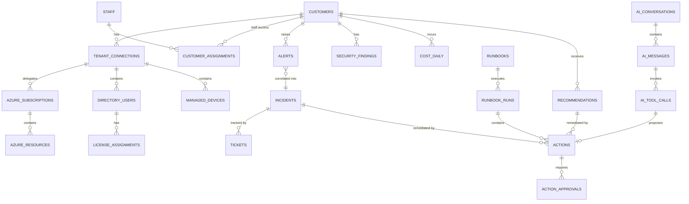

# Database Design

> **⚠ Product model changed (2026-11-16).** This design assumes an MSP with `customer_id`, `tenancy` schema and RLS per customer. That model has been **dropped**. The implemented model is simpler: the existing EF Core tables (PascalCase, `int` keys) get a **`TenantId`** (the Entra tenant of the signed-in user) via `ITenantOwned`, with **EF global query filters** and automatic stamping in `AppDbContext`. **[UTVIDELSESPLAN.md](UTVIDELSESPLAN.md) is the governing plan.** New tables follow that pattern, not the schemas below.
>
> **Still useful as reference:** table ideas for inventory, security findings, cost, automation actions and audit (read `customer_id` as `TenantId`), partitioning and retention (§6).

| | |
|---|---|
| Status | Draft v0.1 (2026-11-13) |
| Engine | Azure Database for PostgreSQL – Flexible Server (PostgreSQL 17+), extensions: `pgvector`, `pg_partman` (or native partitioning + job), `pg_cron`, `pgcrypto` |
| ORM | EF Core 10 + Npgsql (existing) |
| Related | [TARGET_ARCHITECTURE.md](TARGET_ARCHITECTURE.md) |

---

## 1. Storage strategy

| Store | Holds | Why |
|---|---|---|
| **PostgreSQL** (system of record) | Customers, tenants, normalized inventory, findings, alerts/incidents, tickets, actions, audit, daily cost aggregates, AI metadata + embeddings | Relational integrity, RLS, rich reporting, team already uses it |
| **ADLS Gen2** (`raw`, `curated` containers) | Raw API snapshots (gzip JSON), Cost Management exports (FOCUS Parquet), report PDFs | Cheap, immutable history, replay/reprocess capability |
| **Azure Managed Redis** | Graph/ARM token-bucket state, short-lived caches, SignalR backplane | Ephemeral; never source of truth |
| **Log Analytics** | Platform telemetry; (optionally) per-customer workspaces queried in place | Don't copy customer logs — query them where they live |
| *Deferred:* **Azure Data Explorer / Fabric** | High-cardinality metrics & long-range cost analytics | Introduce only when Postgres partitions exceed comfortable size (≈ >500 GB hot data or heavy ad-hoc analytics) |

---

## 2. Conventions

| Topic | Rule |
|---|---|
| Schemas | One per module: `tenancy`, `inventory`, `monitoring`, `security`, `cost`, `automation`, `itsm`, `ai`, `audit`, `ingest`, `reporting` |
| Naming | `snake_case` tables/columns (Npgsql `UseSnakeCaseNamingConvention()`); plural table names |
| Primary keys | `uuid` generated in app with `Guid.CreateVersion7()` (time-ordered → index-friendly). Existing `int` keys kept for migrated ITSM tables until phase 1 cut-over, then add `uuid` public IDs |
| Tenant key | Every tenant-owned table has `customer_id uuid not null` as **first column of every composite index** |
| Timestamps | `timestamptz`, UTC; `created_at`, `updated_at` (trigger or EF interceptor); external timestamps as `observed_at`, `source_updated_at` |
| Enums | Stored as `text` with `CHECK` constraint, English codes (`new`, `in_progress`, `resolved`). Display labels (Norwegian/English) in the SPA. No Postgres native enums (painful migrations) |
| Soft delete | Only where business needs it (`deleted_at`). Inventory uses `is_present` + `last_seen_at` instead |
| Flexible attributes | `jsonb` column `properties` for source-specific fields; promote to columns when queried often. GIN index only when needed |
| Concurrency | `xmin` as EF concurrency token on mutable aggregates (tickets, actions) |
| Natural keys | Unique `(customer_id, source, external_id)` for anything ingested — enables idempotent upsert (`INSERT … ON CONFLICT DO UPDATE`) |

---

## 3. Multi-tenancy & row-level security

### 3.1 Model

```
customer (Antire's client company)
 └── tenant_connection (Entra tenant; usually 1, sometimes several)
       ├── azure_subscription (via Lighthouse)
       └── m365 services (via GDAP + app consent)
```

### 3.2 RLS

Application filters are the first line (EF global query filter on `customer_id`). RLS is the safety net:

```sql
-- Run once per tenant-owned table (generated by migration helper)
ALTER TABLE inventory.azure_resources ENABLE ROW LEVEL SECURITY;
ALTER TABLE inventory.azure_resources FORCE ROW LEVEL SECURITY;

CREATE POLICY customer_isolation ON inventory.azure_resources
  USING (
    customer_id = ANY (string_to_array(current_setting('app.customer_ids', true), ',')::uuid[])
    OR current_setting('app.bypass_rls', true) = 'on'
  );
```

- The API sets `app.customer_ids` per connection/transaction via an EF `DbConnectionInterceptor` (`SET LOCAL app.customer_ids = '…'`) from the authorized `TenantContext`.
- Workers processing a single customer set exactly one ID.
- `app.bypass_rls` is only allowed for the `ops_platform_admin` DB role (cross-customer reporting jobs) — application roles `ops_api`, `ops_worker` cannot set it (enforced with a `SECURITY DEFINER` check function or simply by not granting the role used for cross-tenant jobs to app identities).
- Database login: **Entra ID authentication** for managed identities (no passwords).

---

## 4. Schema overview



---

## 5. Table definitions

DDL below is indicative (EF migrations are the source of truth). `-- RLS` marks tenant-owned tables.

### 5.1 `tenancy`

```sql
CREATE TABLE tenancy.customers (
  id              uuid PRIMARY KEY,
  name            text NOT NULL,
  short_code      text NOT NULL UNIQUE,              -- e.g. 'ANT', 'ACME'
  org_number      text,                              -- Norwegian org.nr
  status          text NOT NULL DEFAULT 'onboarding'
                  CHECK (status IN ('onboarding','active','suspended','offboarded')),
  service_tier    text NOT NULL DEFAULT 'standard',  -- maps to SLA & feature set
  erp_customer_ref text,                             -- NetSuite/PSA id (optional)
  timezone        text NOT NULL DEFAULT 'Europe/Oslo',
  created_at      timestamptz NOT NULL DEFAULT now(),
  updated_at      timestamptz NOT NULL DEFAULT now()
);

CREATE TABLE tenancy.tenant_connections (           -- RLS
  id                  uuid PRIMARY KEY,
  customer_id         uuid NOT NULL REFERENCES tenancy.customers(id),
  entra_tenant_id     uuid NOT NULL UNIQUE,
  primary_domain      text NOT NULL,
  gdap_relationship_id text,
  gdap_expires_at     timestamptz,
  reader_app_consented_at   timestamptz,
  operator_app_consented_at timestamptz,
  lighthouse_status   text NOT NULL DEFAULT 'none'
                      CHECK (lighthouse_status IN ('none','pending','active','revoked')),
  health_status       text NOT NULL DEFAULT 'unknown',  -- last connectivity check
  health_checked_at   timestamptz,
  created_at          timestamptz NOT NULL DEFAULT now()
);

CREATE TABLE tenancy.customer_assignments (         -- who at Antire may see/act on which customer
  customer_id   uuid NOT NULL REFERENCES tenancy.customers(id),
  staff_id      uuid NOT NULL REFERENCES itsm.staff(id),
  role          text NOT NULL,                      -- Ops.Reader | Ops.Technician | Ops.Operator | ...
  valid_from    timestamptz NOT NULL DEFAULT now(),
  valid_to      timestamptz,
  PRIMARY KEY (customer_id, staff_id, role)
);

CREATE TABLE tenancy.customer_settings (            -- RLS; per-customer policy knobs
  customer_id   uuid PRIMARY KEY REFERENCES tenancy.customers(id),
  business_hours jsonb NOT NULL,                    -- for auto-approval windows, SLA clocks
  notification_channels jsonb NOT NULL DEFAULT '{}',
  protected_principals uuid[] NOT NULL DEFAULT '{}',-- break-glass accounts never touched by automation
  feature_flags jsonb NOT NULL DEFAULT '{}'
);
```

### 5.2 `inventory`

```sql
CREATE TABLE inventory.azure_subscriptions (        -- RLS
  id                 uuid PRIMARY KEY,
  customer_id        uuid NOT NULL,
  tenant_connection_id uuid NOT NULL REFERENCES tenancy.tenant_connections(id),
  subscription_id    uuid NOT NULL UNIQUE,
  display_name       text NOT NULL,
  state              text NOT NULL,
  environment        text CHECK (environment IN ('prod','nonprod','sandbox','unknown')),
  offer_type         text,
  delegated_via_lighthouse boolean NOT NULL DEFAULT false,
  last_seen_at       timestamptz NOT NULL
);

CREATE TABLE inventory.azure_resources (            -- RLS
  id               uuid PRIMARY KEY,
  customer_id      uuid NOT NULL,
  subscription_id  uuid NOT NULL,
  resource_id      text NOT NULL,                   -- full ARM ID, lower-cased
  resource_group   text NOT NULL,
  type             text NOT NULL,                   -- microsoft.compute/virtualmachines
  kind             text,
  name             text NOT NULL,
  location         text,
  sku              jsonb,
  tags             jsonb NOT NULL DEFAULT '{}',
  properties       jsonb NOT NULL DEFAULT '{}',     -- trimmed ARG projection
  is_present       boolean NOT NULL DEFAULT true,
  first_seen_at    timestamptz NOT NULL,
  last_seen_at     timestamptz NOT NULL,
  source_changed_at timestamptz,
  UNIQUE (customer_id, resource_id)
);
CREATE INDEX ON inventory.azure_resources (customer_id, type);
CREATE INDEX ON inventory.azure_resources USING gin (tags jsonb_path_ops);

CREATE TABLE inventory.resource_changes (           -- RLS; partitioned monthly
  customer_id  uuid NOT NULL,
  resource_id  text NOT NULL,
  change_type  text NOT NULL,                       -- create|update|delete
  changed_at   timestamptz NOT NULL,
  changed_by   text,                                -- from Resource Graph resourcechanges / activity log
  diff         jsonb,
  PRIMARY KEY (customer_id, resource_id, changed_at)
) PARTITION BY RANGE (changed_at);

CREATE TABLE inventory.directory_users (            -- RLS; replaces Graph sync into Employees for customers
  id                 uuid PRIMARY KEY,
  customer_id        uuid NOT NULL,
  entra_object_id    uuid NOT NULL,
  user_principal_name text NOT NULL,
  display_name       text,
  given_name         text,
  surname            text,
  mail               text,
  department         text,
  job_title          text,
  employee_id        text,
  user_type          text,                          -- Member | Guest
  account_enabled    boolean NOT NULL,
  created_datetime   timestamptz,
  last_sign_in_at    timestamptz,                   -- signInActivity
  last_non_interactive_sign_in_at timestamptz,
  mfa_registered     boolean,                       -- from userRegistrationDetails
  mfa_methods        text[],
  is_privileged      boolean NOT NULL DEFAULT false,-- derived from role assignments
  on_premises_sync   boolean,
  is_present         boolean NOT NULL DEFAULT true,
  last_seen_at       timestamptz NOT NULL,
  UNIQUE (customer_id, entra_object_id)
);

CREATE TABLE inventory.directory_groups (           -- RLS
  id uuid PRIMARY KEY, customer_id uuid NOT NULL, entra_object_id uuid NOT NULL,
  display_name text NOT NULL, group_types text[], security_enabled boolean, mail_enabled boolean,
  is_role_assignable boolean, membership_rule text, member_count int,
  is_present boolean NOT NULL DEFAULT true, last_seen_at timestamptz NOT NULL,
  UNIQUE (customer_id, entra_object_id)
);

CREATE TABLE inventory.directory_role_assignments ( -- RLS; privileged access tracking
  customer_id uuid NOT NULL, principal_object_id uuid NOT NULL, role_definition_id uuid NOT NULL,
  role_name text NOT NULL, assignment_type text NOT NULL CHECK (assignment_type IN ('active','eligible')),
  scope text NOT NULL DEFAULT '/', start_at timestamptz, end_at timestamptz, last_seen_at timestamptz NOT NULL,
  PRIMARY KEY (customer_id, principal_object_id, role_definition_id, scope, assignment_type)
);

CREATE TABLE inventory.subscribed_skus (            -- RLS; tenant license pool
  customer_id uuid NOT NULL, sku_id uuid NOT NULL, sku_part_number text NOT NULL,
  enabled_units int NOT NULL, consumed_units int NOT NULL, warning_units int, suspended_units int,
  unit_price_nok numeric(12,2),                     -- from price list / CSP, for license cost
  observed_at timestamptz NOT NULL,
  PRIMARY KEY (customer_id, sku_id)
);

CREATE TABLE inventory.license_assignments (        -- RLS
  customer_id uuid NOT NULL, entra_object_id uuid NOT NULL, sku_id uuid NOT NULL,
  assigned_via text NOT NULL CHECK (assigned_via IN ('direct','group')),
  disabled_plans uuid[] NOT NULL DEFAULT '{}',
  last_seen_at timestamptz NOT NULL,
  PRIMARY KEY (customer_id, entra_object_id, sku_id, assigned_via)
);

CREATE TABLE inventory.managed_devices (            -- RLS; Intune
  id uuid PRIMARY KEY, customer_id uuid NOT NULL, intune_device_id uuid NOT NULL,
  entra_device_id uuid, device_name text, os text, os_version text,
  compliance_state text, management_state text, ownership text,
  primary_user_object_id uuid, last_sync_at timestamptz, encrypted boolean,
  is_present boolean NOT NULL DEFAULT true, last_seen_at timestamptz NOT NULL,
  UNIQUE (customer_id, intune_device_id)
);

CREATE TABLE inventory.policies (                   -- RLS; CA policies, Intune configs, Azure policy assignments
  id uuid PRIMARY KEY, customer_id uuid NOT NULL,
  source text NOT NULL,                             -- 'entra.conditionalAccess' | 'intune.compliance' | 'azure.policyAssignment' ...
  external_id text NOT NULL, display_name text, state text,
  definition jsonb NOT NULL,                        -- full JSON for drift diff
  definition_hash text NOT NULL,
  last_seen_at timestamptz NOT NULL,
  UNIQUE (customer_id, source, external_id)
);
```

### 5.3 `monitoring`

```sql
CREATE TABLE monitoring.alerts (                    -- RLS; partitioned monthly by raised_at
  id             uuid NOT NULL,
  customer_id    uuid NOT NULL,
  source         text NOT NULL,   -- azure.monitor | defender.cloud | defender.xdr | entra.idprotection | m365.servicehealth | intune | platform
  external_id    text NOT NULL,
  severity       text NOT NULL CHECK (severity IN ('info','low','medium','high','critical')),
  title          text NOT NULL,
  description    text,
  resource_ref   text,            -- ARM id / object id / service name
  status         text NOT NULL CHECK (status IN ('open','acknowledged','resolved','suppressed')),
  raised_at      timestamptz NOT NULL,
  resolved_at    timestamptz,
  fingerprint    text NOT NULL,   -- for dedup/correlation
  incident_id    uuid,
  ai_summary     text,
  raw            jsonb,
  PRIMARY KEY (customer_id, id, raised_at),
  UNIQUE (customer_id, source, external_id, raised_at)
) PARTITION BY RANGE (raised_at);

CREATE TABLE monitoring.incidents (                 -- RLS
  id              uuid PRIMARY KEY,
  customer_id     uuid NOT NULL,
  number          bigint NOT NULL,                  -- per-customer human id (INC-ACME-1042)
  title           text NOT NULL,
  severity        text NOT NULL,
  status          text NOT NULL CHECK (status IN ('new','triaged','in_progress','mitigated','resolved','closed')),
  category        text,                             -- availability | security | cost | change | ...
  assigned_staff_id uuid REFERENCES itsm.staff(id),
  opened_at       timestamptz NOT NULL,
  acknowledged_at timestamptz,
  resolved_at     timestamptz,
  sla_due_at      timestamptz,
  root_cause      text,
  ai_triage       jsonb,                            -- structured: probable cause, evidence ids, suggested actions
  UNIQUE (customer_id, number)
);

CREATE TABLE monitoring.service_health_events (     -- RLS; M365 service health per tenant
  customer_id uuid NOT NULL, external_id text NOT NULL, service text NOT NULL,
  classification text, status text, title text, start_at timestamptz, end_at timestamptz,
  last_modified_at timestamptz, details jsonb,
  PRIMARY KEY (customer_id, external_id)
);
```

### 5.4 `security`

```sql
CREATE TABLE security.findings (                    -- RLS; unified posture findings
  id              uuid PRIMARY KEY,
  customer_id     uuid NOT NULL,
  source          text NOT NULL,  -- defender.cloud.assessment | securescore.control | baseline.check | entra.recommendation
  check_id        text NOT NULL,  -- e.g. 'CA-001-require-mfa-admins' or Defender assessment key
  target_ref      text NOT NULL,  -- resource id / object id / 'tenant'
  title           text NOT NULL,
  severity        text NOT NULL,
  status          text NOT NULL CHECK (status IN ('open','resolved','risk_accepted','not_applicable')),
  first_detected_at timestamptz NOT NULL,
  last_evaluated_at timestamptz NOT NULL,
  resolved_at     timestamptz,
  evidence        jsonb,
  remediation     jsonb,          -- links to action type + params
  risk_acceptance_id uuid,
  UNIQUE (customer_id, source, check_id, target_ref)
);

CREATE TABLE security.score_snapshots (             -- RLS; daily trend
  customer_id uuid NOT NULL, kind text NOT NULL,    -- 'm365.secureScore' | 'defender.cloud.secureScore' | 'antire.baseline'
  snapshot_date date NOT NULL, current_score numeric(8,2), max_score numeric(8,2),
  breakdown jsonb,
  PRIMARY KEY (customer_id, kind, snapshot_date)
);

CREATE TABLE security.baselines (                   -- Antire security baseline definitions (global, versioned)
  id uuid PRIMARY KEY, code text NOT NULL, version int NOT NULL,
  title text NOT NULL, description text, severity text NOT NULL,
  check_definition jsonb NOT NULL,                  -- evaluated by processor (e.g. JSONPath over CA policies)
  remediation_action_type text,
  UNIQUE (code, version)
);

CREATE TABLE security.customer_baselines (          -- RLS; which baselines apply per customer
  customer_id uuid NOT NULL, baseline_id uuid NOT NULL REFERENCES security.baselines(id),
  enabled boolean NOT NULL DEFAULT true, parameters jsonb NOT NULL DEFAULT '{}',
  PRIMARY KEY (customer_id, baseline_id)
);

CREATE TABLE security.risk_acceptances (            -- RLS
  id uuid PRIMARY KEY, customer_id uuid NOT NULL, finding_check_id text NOT NULL, target_ref text,
  reason text NOT NULL, accepted_by text NOT NULL,  -- customer contact name/email
  approved_by_staff_id uuid NOT NULL, expires_at timestamptz NOT NULL, created_at timestamptz NOT NULL
);

CREATE TABLE security.risky_identities (            -- RLS; Entra ID Protection
  customer_id uuid NOT NULL, entra_object_id uuid NOT NULL, risk_level text, risk_state text,
  risk_detail text, last_updated_at timestamptz,
  PRIMARY KEY (customer_id, entra_object_id)
);
```

### 5.5 `cost`

Cost data uses the **FOCUS** schema vocabulary (FinOps Open Cost & Usage Specification) so Azure and M365/CSP costs can be combined.

```sql
CREATE TABLE cost.daily_costs (                     -- RLS; partitioned monthly by charge_date
  customer_id        uuid NOT NULL,
  charge_date        date NOT NULL,
  billing_account_id text,
  subscription_id    uuid,
  resource_group     text,
  resource_id        text,                           -- nullable for non-resource charges
  service_category   text,                           -- FOCUS ServiceCategory
  service_name       text,                           -- FOCUS ServiceName
  meter_category     text,
  region             text,
  charge_category    text NOT NULL,                  -- Usage | Purchase | Tax | Credit | Adjustment
  pricing_category   text,                           -- OnDemand | Commitment | Spot
  billed_cost        numeric(18,6) NOT NULL,
  effective_cost     numeric(18,6) NOT NULL,         -- amortized
  list_cost          numeric(18,6),
  currency           char(3) NOT NULL,
  tags               jsonb NOT NULL DEFAULT '{}',
  ingest_run_id      uuid NOT NULL,
  PRIMARY KEY (customer_id, charge_date, subscription_id, resource_id, meter_category, charge_category, pricing_category)
) PARTITION BY RANGE (charge_date);

-- Fast dashboard rollups
CREATE MATERIALIZED VIEW cost.monthly_by_customer_service AS
SELECT customer_id, date_trunc('month', charge_date)::date AS month, service_name,
       sum(effective_cost) AS effective_cost, currency
FROM cost.daily_costs GROUP BY 1,2,3,5;

CREATE TABLE cost.budgets (                         -- RLS
  id uuid PRIMARY KEY, customer_id uuid NOT NULL, scope text NOT NULL,  -- 'customer' | subscription id | tag filter
  scope_filter jsonb, period text NOT NULL CHECK (period IN ('monthly','quarterly','annual')),
  amount numeric(18,2) NOT NULL, currency char(3) NOT NULL,
  thresholds int[] NOT NULL DEFAULT '{80,100,120}', created_at timestamptz NOT NULL
);

CREATE TABLE cost.anomalies (                       -- RLS
  id uuid PRIMARY KEY, customer_id uuid NOT NULL, detected_at timestamptz NOT NULL,
  scope text NOT NULL, charge_date date NOT NULL,
  expected_cost numeric(18,2), actual_cost numeric(18,2), deviation_pct numeric(8,2),
  method text NOT NULL,                             -- 'zscore-28d' | 'azure.anomaly-alert'
  status text NOT NULL DEFAULT 'open', ai_explanation text, incident_id uuid
);

CREATE TABLE cost.recommendations (                 -- RLS; unified savings opportunities
  id                uuid PRIMARY KEY,
  customer_id       uuid NOT NULL,
  source            text NOT NULL,  -- azure.advisor | reservation.api | antire.rule (idle disk, unused license, ...)
  external_id       text NOT NULL,
  category          text NOT NULL,  -- rightsize | shutdown | delete_orphan | reservation | savings_plan | license_reclaim | storage_tier
  target_ref        text NOT NULL,
  title             text NOT NULL,
  est_monthly_savings numeric(18,2),
  currency          char(3),
  confidence        text,
  status            text NOT NULL CHECK (status IN ('open','planned','implemented','dismissed','expired')),
  action_type       text,           -- links to automation action
  action_params     jsonb,
  first_seen_at     timestamptz NOT NULL,
  last_seen_at      timestamptz NOT NULL,
  realized_savings  numeric(18,2),  -- measured after implementation
  UNIQUE (customer_id, source, external_id)
);

CREATE TABLE cost.commitments (                     -- RLS; reservations & savings plans in place
  customer_id uuid NOT NULL, commitment_id text NOT NULL, kind text NOT NULL, -- reservation | savings_plan
  scope text, sku text, term text, quantity numeric, expires_at timestamptz,
  utilization_pct_30d numeric(5,2), last_seen_at timestamptz NOT NULL,
  PRIMARY KEY (customer_id, commitment_id)
);
```

### 5.6 `automation`

```sql
CREATE TABLE automation.action_types (              -- registry mirrored from code at startup
  code text PRIMARY KEY,                            -- 'entra.user.disable', 'azure.vm.deallocate', ...
  version int NOT NULL, risk_level text NOT NULL CHECK (risk_level IN ('low','medium','high','critical')),
  target_kind text NOT NULL, param_schema jsonb NOT NULL, supports_dry_run boolean NOT NULL,
  supports_compensation boolean NOT NULL, required_permission text NOT NULL
);

CREATE TABLE automation.policies (                  -- RLS (customer_id NULL = global default)
  id uuid PRIMARY KEY, customer_id uuid, action_type_pattern text NOT NULL,  -- glob: 'azure.vm.*'
  condition jsonb,                                  -- e.g. {"env":"nonprod","outsideBusinessHours":true}
  decision text NOT NULL CHECK (decision IN ('auto_approve','require_approval','deny')),
  required_approvals int NOT NULL DEFAULT 1, approver_role text, priority int NOT NULL DEFAULT 100
);

CREATE TABLE automation.actions (                   -- RLS; the governed write unit
  id                uuid PRIMARY KEY,
  customer_id       uuid NOT NULL,
  action_type       text NOT NULL REFERENCES automation.action_types(code),
  target_ref        text NOT NULL,
  params            jsonb NOT NULL,
  justification     text NOT NULL,
  origin            text NOT NULL CHECK (origin IN ('user','schedule','rule','ai','runbook')),
  requested_by      text NOT NULL,                  -- staff upn | 'system:rule:<id>' | 'ai:conversation:<id>'
  status            text NOT NULL CHECK (status IN ('proposed','pending_approval','approved','rejected','queued','running','succeeded','failed','compensated','cancelled','expired')),
  policy_decision   jsonb,
  idempotency_key   text NOT NULL,
  dry_run_result    jsonb,
  result            jsonb,
  before_snapshot   jsonb,
  after_snapshot    jsonb,
  error             text,
  related_incident_id uuid, related_recommendation_id uuid, related_finding_id uuid,
  related_ticket_id uuid, runbook_run_id uuid,
  created_at timestamptz NOT NULL, executed_at timestamptz, completed_at timestamptz,
  expires_at timestamptz,                           -- unapproved proposals expire
  UNIQUE (customer_id, idempotency_key)
);

CREATE TABLE automation.action_approvals (          -- RLS
  action_id uuid NOT NULL REFERENCES automation.actions(id), approver_staff_id uuid NOT NULL,
  decision text NOT NULL CHECK (decision IN ('approved','rejected')), comment text, decided_at timestamptz NOT NULL,
  PRIMARY KEY (action_id, approver_staff_id)
);

CREATE TABLE automation.runbooks (
  id uuid PRIMARY KEY, code text NOT NULL, version int NOT NULL, title text NOT NULL,
  definition jsonb NOT NULL,                        -- parsed from YAML in Git
  git_sha text NOT NULL, is_active boolean NOT NULL DEFAULT true,
  UNIQUE (code, version)
);

CREATE TABLE automation.runbook_runs (              -- RLS
  id uuid PRIMARY KEY, customer_id uuid NOT NULL, runbook_id uuid NOT NULL REFERENCES automation.runbooks(id),
  inputs jsonb NOT NULL, status text NOT NULL, started_by text NOT NULL,
  started_at timestamptz NOT NULL, completed_at timestamptz, related_ticket_id uuid
);

CREATE TABLE automation.schedules (                 -- RLS; cron-triggered runbooks/actions
  id uuid PRIMARY KEY, customer_id uuid NOT NULL, cron text NOT NULL, timezone text NOT NULL,
  target_kind text NOT NULL CHECK (target_kind IN ('runbook','action')), target_code text NOT NULL,
  params jsonb NOT NULL, enabled boolean NOT NULL DEFAULT true, next_run_at timestamptz
);
```

### 5.7 `itsm` (migrated from current schema)

```sql
CREATE TABLE itsm.staff (                           -- Antire employees (from current Employees + Responsibilities)
  id                uuid PRIMARY KEY,
  legacy_employee_id int UNIQUE,                    -- migration bridge
  entra_object_id   uuid UNIQUE,
  employee_number   text UNIQUE,
  first_name text NOT NULL, last_name text NOT NULL, email text NOT NULL,
  department text, job_title text,
  start_date date NOT NULL, end_date date,
  status text NOT NULL CHECK (status IN ('active','terminated')),
  created_at timestamptz NOT NULL, updated_at timestamptz NOT NULL
);

CREATE TABLE itsm.staff_skills (                    -- was EmployeeResponsibilities
  staff_id uuid NOT NULL REFERENCES itsm.staff(id) ON DELETE CASCADE,
  category text NOT NULL, can_be_assigned boolean NOT NULL DEFAULT true,
  PRIMARY KEY (staff_id, category)
);

CREATE TABLE itsm.category_groups (                 -- was TicketCategoryGroups
  category text NOT NULL, entra_group_id uuid NOT NULL,
  PRIMARY KEY (category, entra_group_id)
);

CREATE TABLE itsm.tickets (                         -- RLS
  id                uuid PRIMARY KEY,
  legacy_id         int UNIQUE,
  customer_id       uuid NOT NULL,
  number            bigint NOT NULL,                -- per-customer
  type              text NOT NULL DEFAULT 'incident'
                    CHECK (type IN ('incident','service_request','access_request','change','problem')),
  category          text NOT NULL,
  title             text NOT NULL,
  description       text NOT NULL,
  status            text NOT NULL CHECK (status IN ('new','in_progress','waiting_customer','resolved','closed')),
  priority          text NOT NULL CHECK (priority IN ('low','normal','high','critical')),
  reporter_kind     text NOT NULL CHECK (reporter_kind IN ('staff','customer_user','system')),
  reporter_ref      text,                           -- staff id / directory_users.entra_object_id / 'system'
  assigned_staff_id uuid REFERENCES itsm.staff(id), -- single assignee field (fixes G7)
  incident_id       uuid,
  sla_due_at        timestamptz,
  created_at timestamptz NOT NULL, updated_at timestamptz NOT NULL, resolved_at timestamptz,
  UNIQUE (customer_id, number)
);

CREATE TABLE itsm.ticket_comments (                 -- RLS
  id uuid PRIMARY KEY, customer_id uuid NOT NULL, ticket_id uuid NOT NULL REFERENCES itsm.tickets(id),
  author_kind text NOT NULL, author_ref text NOT NULL, body text NOT NULL,
  is_internal boolean NOT NULL DEFAULT true, created_at timestamptz NOT NULL
);

CREATE TABLE itsm.access_requests (                 -- RLS; was AccessRequests, now linked to actions
  id uuid PRIMARY KEY, legacy_id int UNIQUE, customer_id uuid NOT NULL, ticket_id uuid REFERENCES itsm.tickets(id),
  subject_object_id uuid,                           -- user receiving access
  subject_display_name text NOT NULL,
  system_name text NOT NULL, target_group_id uuid,  -- Entra group granting access (if automatable)
  reason text NOT NULL, approver_ref text NOT NULL,
  status text NOT NULL CHECK (status IN ('pending_approval','approved','rejected','fulfilled','failed')),
  action_id uuid REFERENCES automation.actions(id),
  created_at timestamptz NOT NULL, decided_at timestamptz, fulfilled_at timestamptz
);
```

### 5.8 `ai`

```sql
CREATE TABLE ai.conversations (                     -- RLS
  id uuid PRIMARY KEY, customer_id uuid NOT NULL, started_by_staff_id uuid NOT NULL,
  trigger text NOT NULL CHECK (trigger IN ('chat','alert_triage','finding_explain','cost_explain','report')),
  related_ref text, title text, created_at timestamptz NOT NULL, closed_at timestamptz
);

CREATE TABLE ai.messages (                          -- RLS
  id uuid PRIMARY KEY, customer_id uuid NOT NULL, conversation_id uuid NOT NULL REFERENCES ai.conversations(id),
  seq int NOT NULL, role text NOT NULL, content jsonb NOT NULL,  -- full content blocks (incl. tool_use/tool_result)
  model text, input_tokens int, output_tokens int, cache_read_tokens int, cache_write_tokens int,
  stop_reason text, latency_ms int, created_at timestamptz NOT NULL,
  UNIQUE (conversation_id, seq)
);

CREATE TABLE ai.tool_calls (                        -- RLS
  id uuid PRIMARY KEY, customer_id uuid NOT NULL, message_id uuid NOT NULL REFERENCES ai.messages(id),
  tool_name text NOT NULL, input jsonb NOT NULL, output_summary jsonb, is_error boolean NOT NULL,
  authorized boolean NOT NULL, denied_reason text, duration_ms int,
  proposed_action_id uuid REFERENCES automation.actions(id), created_at timestamptz NOT NULL
);

CREATE TABLE ai.documents (                         -- RLS (customer_id NULL = global KB)
  id uuid PRIMARY KEY, customer_id uuid, source text NOT NULL,  -- runbook | kb | incident_postmortem | customer_doc
  source_ref text NOT NULL, chunk_index int NOT NULL, content text NOT NULL,
  embedding vector(1024) NOT NULL, metadata jsonb, updated_at timestamptz NOT NULL,
  UNIQUE (source, source_ref, chunk_index)
);
CREATE INDEX ON ai.documents USING hnsw (embedding vector_cosine_ops);

CREATE TABLE ai.feedback (                          -- RLS; thumbs/corrections → eval set
  id uuid PRIMARY KEY, customer_id uuid NOT NULL, message_id uuid NOT NULL, staff_id uuid NOT NULL,
  rating smallint NOT NULL, comment text, created_at timestamptz NOT NULL
);
```

> Embedding dimension depends on the embedding model chosen (Claude does not provide embeddings; use an Azure-hosted embedding model available in Foundry). Keep the dimension in configuration and in the migration.

### 5.9 `audit`, `ingest`, outbox

```sql
CREATE TABLE audit.events (                         -- append-only; partitioned monthly
  id uuid NOT NULL, occurred_at timestamptz NOT NULL, customer_id uuid,
  actor_kind text NOT NULL, actor_ref text NOT NULL,  -- staff upn | managed identity | ai conversation
  event_type text NOT NULL,                           -- 'action.executed', 'ticket.updated', 'customer.onboarded', 'auth.denied'
  target_ref text, data jsonb, trace_id text, ip inet,
  PRIMARY KEY (id, occurred_at)
) PARTITION BY RANGE (occurred_at);
REVOKE UPDATE, DELETE, TRUNCATE ON audit.events FROM ops_api, ops_worker;

CREATE TABLE ingest.sync_state (                    -- RLS
  customer_id uuid NOT NULL, source text NOT NULL, scope text NOT NULL DEFAULT '',
  delta_token text, watermark timestamptz, last_success_at timestamptz, last_error text,
  consecutive_failures int NOT NULL DEFAULT 0,
  PRIMARY KEY (customer_id, source, scope)
);

CREATE TABLE ingest.runs (                          -- RLS
  id uuid PRIMARY KEY, customer_id uuid NOT NULL, source text NOT NULL,
  started_at timestamptz NOT NULL, completed_at timestamptz, status text NOT NULL,
  items_read int, items_upserted int, raw_blob_uri text, error text
);

CREATE TABLE public.outbox_messages (               -- transactional outbox → Service Bus
  id uuid PRIMARY KEY, occurred_at timestamptz NOT NULL, topic text NOT NULL,
  customer_id uuid, payload jsonb NOT NULL, dispatched_at timestamptz, attempts int NOT NULL DEFAULT 0
);
CREATE INDEX ON public.outbox_messages (dispatched_at) WHERE dispatched_at IS NULL;
```

---

## 6. Partitioning & retention

| Table | Partition | Hot retention (Postgres) | Archive |
|---|---|---|---|
| `cost.daily_costs` | monthly | 25 months (YoY comparison) | Parquet in ADLS indefinitely |
| `monitoring.alerts` | monthly | 13 months | ADLS raw |
| `inventory.resource_changes` | monthly | 13 months | ADLS raw |
| `audit.events` | monthly | 24 months | WORM storage 7 years (configurable per contract) |
| `ai.messages` / `ai.tool_calls` | — (index on created_at) | 12 months, then content redacted, metrics kept | — |
| raw snapshots (ADLS) | path-based | 90 days hot → cool → archive per lifecycle policy | — |

Partition management via `pg_partman` (if available in the chosen Flexible Server version) or a small `pg_cron` job that creates next month's partitions and detaches expired ones.

---

## 7. Access roles

| DB role | Used by | Grants |
|---|---|---|
| `ops_migrator` | CI/CD migration job (Entra MI) | DDL |
| `ops_api` | ops-api MI | DML on module schemas, RLS enforced, `INSERT` only on `audit.events` |
| `ops_worker` | collectors/processors/automation MIs | same as `ops_api` + `ingest` |
| `ops_ai` | ops-ai MI | `SELECT` on read models, DML on `ai.*`, `INSERT` on `automation.actions` (status `proposed` only, enforced by trigger) |
| `ops_reporting` | cross-customer reporting job | `SELECT` + RLS bypass, no DML |
| `ops_readonly_human` | break-glass investigation via PIM | `SELECT` with RLS |

---

## 8. Migration from the current schema

| Step | Change | Notes |
|---|---|---|
| M0 | Add migration creating `employee_number_seq` (fix G8) | Must run before anything else on a fresh DB |
| M1 | Enable snake_case naming for **new** schemas only; leave existing `public."Tickets"` etc. untouched until M4 | Avoids a big-bang rename |
| M2 | Create `tenancy` schema; insert Antire as customer #0 with its tenant `3af5c92b-…` | |
| M3 | Create `itsm.staff`, `itsm.staff_skills`, `itsm.category_groups`; copy from `Employees`, `EmployeeResponsibilities`, `TicketCategoryGroups` (keep `legacy_employee_id`) | |
| M4 | Create `itsm.tickets`, `itsm.access_requests`; copy with status/priority mapping below; set `customer_id` = Antire; collapse `AssignedTo` (string) into `assigned_staff_id` by matching name/email, else keep in a comment | |
| M5 | Switch API to new tables behind a feature flag; keep old tables read-only for one release; then drop | |

Value mapping:

| Old (Norwegian) | New code |
|---|---|
| Ticket status `Ny` / `Under behandling` / `Løst` | `new` / `in_progress` / `resolved` |
| Priority `Lav` / `Normal` / `Høy` / `Kritisk` | `low` / `normal` / `high` / `critical` |
| Employee `Aktiv` / `Sluttet` | `active` / `terminated` |
| Access request `Venter på godkjenning` / `Godkjent` / `Avslått` / `Fullført` | `pending_approval` / `approved` / `rejected` / `fulfilled` |

---

## 9. Performance notes

- Inventory upserts in batches of 500–1000 rows with `COPY` into a temp table + `INSERT … ON CONFLICT` (Npgsql binary import) — not per-row EF `SaveChanges` (fixes the N+1 pattern in `SyncEmployees`).
- Mark-and-sweep for deletions: set `is_present = false` where `last_seen_at < run_started_at` for a full-sync scope.
- Dashboard queries hit materialized views refreshed after each cost/inventory ingest (`REFRESH MATERIALIZED VIEW CONCURRENTLY`).
- Start with a **General Purpose D4ds_v5**-class server (4 vCore) in prod; scale by observed load. Use PgBouncer (built into Flexible Server) in transaction mode — note that `SET LOCAL` for RLS is compatible with transaction pooling, plain `SET` is not.
