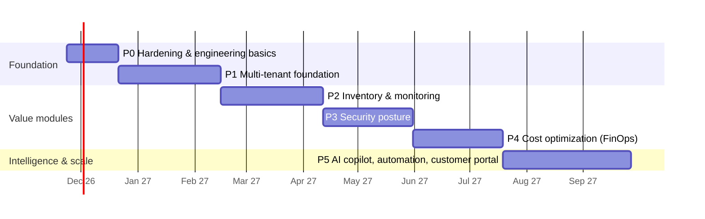

# Development Roadmap

> **Note (2026-11-16):** Sequencing and scope for the next phases are now governed by [MSP_UTVIDELSESPLAN.md](MSP_UTVIDELSESPLAN.md), which extends the existing helpdesk step by step (customers → RBAC → audit → service catalog → SLA → assets, then M365, then Azure). This roadmap remains the long-term reference.

| | |
|---|---|
| Status | Draft v0.1 (2026-11-16) |
| Horizon | About 12 months, in six phases |
| Assumed team | 2–3 .NET/React developers, 1 Azure/M365 engineer (part time), 1 product owner from operations. Durations scale with team size. |
| Related | [TARGET_ARCHITECTURE.md](TARGET_ARCHITECTURE.md), [DATABASE_DESIGN.md](DATABASE_DESIGN.md), [GRAPH_API_INTEGRATIONS.md](GRAPH_API_INTEGRATIONS.md), [AZURE_INTEGRATIONS.md](AZURE_INTEGRATIONS.md) |

---

## Overview

| Phase | Outcome | Pilot customers |
|---|---|---|
| **P0** | Current helpdesk is secure, tested, deployable to Azure | Antire internal |
| **P1** | Platform knows customers and tenants, connects securely, keeps an audit trail | Antire + sandbox tenant |
| **P2** | One view of every customer's Azure and M365 estate + unified alert queue | 2 friendly customers |
| **P3** | Security baseline scoring and remediation per customer | same 2 + 2 more |
| **P4** | Cost visibility, anomalies, savings recommendations with realized-savings tracking | all onboarded |
| **P5** | AI assistant, governed automation at scale, customer-facing reporting | general availability |

Each phase ends with a demo for the operations team and a go/no-go against its exit criteria.

---

## Phase 0: Hardening and engineering basics (≈ 4 weeks)

**Goal:** fix the gaps found in the code review (G1–G10) and set up the delivery pipeline everything else depends on.

| # | Work item | Fixes |
|---|---|---|
| 0.1 | Add role-based authorization on all controllers (`Helpdesk.Admin`, `EmployeeSync.Admin`, new `Ops.*` roles). Only the reporter or admins can read a ticket. Approval endpoints require an approver role. | G1 |
| 0.2 | Migration that creates `employee_number_seq` | G8 |
| 0.3 | Graph: `PageIterator` for users, `checkMemberGroups` instead of full transitive listing, singleton client | G3, G4, G5 |
| 0.4 | Replace the client secret with a certificate (local) or managed identity + FIC (Azure). Remove `ClientSecret` from configuration. | G2 |
| 0.5 | Merge `Ticket.AssignedTo` into `AssignedToEmployeeId`; `PATCH /assign` takes an employee id | G7 |
| 0.6 | Introduce English enum codes in the API and DB with a mapping migration. The SPA shows Norwegian labels through a small i18n layer. | G6 |
| 0.7 | Batch `SyncEmployees` (one lookup query, one `SaveChanges`) | G5 |
| 0.8 | Configuration: API base URL from Vite env (`VITE_API_URL`); CORS origins and redirect URIs from config | G9 |
| 0.9 | Remove `WeatherForecast*`; clean up `.gitignore`; add `README.md` with local setup | G10 |
| 0.10 | Test projects: xUnit + Testcontainers (PostgreSQL) for the API, Vitest for the SPA. Target: assignment service, controllers' auth rules, migrations apply on an empty DB. | G9 |
| 0.11 | Restructure into the solution layout (`src/Ops.Api`, `Ops.Core`, `Ops.Persistence`, …) without changing behaviour | — |
| 0.12 | Bicep for the **dev** environment in the sandbox tenant (`8d320841-…`): Container Apps, PostgreSQL, Key Vault, Log Analytics | G9 |
| 0.13 | GitHub Actions: build + test on PR; deploy to dev on `main` with OIDC | G9 |
| 0.14 | OpenTelemetry → Application Insights; structured logging with correlation ids | — |

**Exit criteria**

- [ ] Penetration-style check: a non-admin user gets 403 on every write endpoint except creating their own ticket
- [ ] Fresh database: `dotnet ef database update` + app start works with no manual SQL
- [ ] Sync of a tenant with more than 100 users imports all users
- [ ] No secrets in the repo or in appsettings; `git log` checked for leaked secrets (rotate if found)
- [ ] App runs in Azure dev from the pipeline; tests green

---

## Phase 1: Multi-tenant foundation (≈ 8 weeks)

**Goal:** the platform can represent customers, connect to their tenants securely, and govern and audit every action.

| # | Work item |
|---|---|
| 1.1 | `tenancy` schema: customers, tenant connections, customer assignments, settings. Antire is migrated as customer #0. |
| 1.2 | EF global query filter + PostgreSQL RLS + `TenantContext` middleware; route shape `/api/customers/{customerId}/…` |
| 1.3 | Authorization handler: app role × customer assignment; staff ↔ customer admin UI |
| 1.4 | ITSM migration: `itsm.staff`, `itsm.tickets`, `itsm.access_requests` with `customer_id` (DATABASE_DESIGN §8, steps M2–M5) |
| 1.5 | Multi-tenant Entra apps "Antire Ops – Reader" and "Operator"; FIC to managed identities; `IGraphClientFactory.ForTenant` |
| 1.6 | **Customer onboarding wizard:** create customer → generate admin-consent links → GDAP relationship request (Graph `tenantRelationships`) → Lighthouse offer download/deploy link → connectivity health check |
| 1.7 | `audit.events` (append-only) + audit writing for all commands; audit viewer in the UI |
| 1.8 | Action Pipeline v1: action type registry, policies (global defaults), proposal → approval → execution, Service Bus queue, `ops-automation` worker |
| 1.9 | First action types: `m365.group.add_member` / `remove_member`. Wire **access requests** end to end: approval → group membership → fulfilled. |
| 1.10 | Teams notifications with Adaptive Card approvals |
| 1.11 | Transactional outbox + Service Bus dispatcher |
| 1.12 | Portal shell: customer switcher, role-aware navigation, i18n (nb/en) |
| 1.13 | Bicep: Service Bus, App Configuration, managed identities, test environment |

**Exit criteria**

- [ ] Two tenants (Antire + sandbox) onboarded through the wizard. The health check is green for Graph Reader and Lighthouse.
- [ ] Automated test proves a technician assigned only to customer A cannot read customer B's data, even with a crafted request (RLS test at the DB level).
- [ ] An access request in the sandbox tenant results in a real group membership after approval, with a full audit trail.
- [ ] No secrets used for any cross-tenant call.

---

## Phase 2: Inventory and monitoring (≈ 8 weeks)

**Goal:** one continuously updated picture of each customer's estate and one alert/incident queue.

| # | Work item |
|---|---|
| 2.1 | Collector framework: schedules, `ingest.sync_state`, `ingest.runs`, raw-to-ADLS, per-tenant rate limiting (Redis), Service Bus sessions per customer |
| 2.2 | M365 inventory: users (delta), groups, role assignments, subscribed SKUs, license assignments, Intune devices, CA policies |
| 2.3 | Azure inventory via Resource Graph: subscriptions, resources, resource changes |
| 2.4 | Event Grid change capture from customer subscriptions (webhook → ops-api → Service Bus) |
| 2.5 | Alert ingestion: Azure Monitor action-group webhook (Common Alert Schema), M365 Service Health, Resource Health, Defender XDR `alerts_v2`, Entra risk detections |
| 2.6 | Correlation v1: fingerprint dedup + time-window grouping → incidents; incident → ticket rules |
| 2.7 | Deploy the Antire monitoring baseline to customers (`azure.monitoring.ensure_baseline` with what-if) |
| 2.8 | SLA clocks per customer tier; on-call assignment, which reuses today's category-based assignment logic generalized to incidents |
| 2.9 | **AI v0:** alert summarization and ticket classification (single calls via Foundry, structured output), shown as suggestions only |
| 2.10 | Portal: customer overview dashboard, inventory explorer, incident queue (SignalR live updates) |
| 2.11 | Platform SLO dashboards (ingestion freshness, failures per tenant) |

**Exit criteria**

- [ ] Inventory freshness: M365 objects < 30 min, Azure resources < 1 h, alerts < 5 min, for all pilot tenants
- [ ] A test alert fired in a customer subscription shows up as an incident in the portal and as a Teams message within 5 minutes
- [ ] Re-running any collector is idempotent (no duplicates)
- [ ] Throttling: a full resync of all pilot tenants completes without unhandled 429s
- [ ] Operations team uses the incident queue for pilot customers instead of email/portal-hopping

---

## Phase 3: Security posture management (≈ 7 weeks)

**Goal:** a measurable security baseline per customer, with tracked findings and governed remediation.

| # | Work item |
|---|---|
| 3.1 | `security` schema: findings, score snapshots, baselines, customer baselines, risk acceptances |
| 3.2 | Ingest Secure Score + control profiles, Defender for Cloud assessments and secure score, Azure Policy compliance, risky users |
| 3.3 | Antire baseline engine v1: checks `ID-001…009`, `DEV-001/002`, `M365-001/002`, `AZ-001…009` (see the integration docs) |
| 3.4 | Finding lifecycle: open → resolved (auto-detected) / risk accepted (with expiry) / not applicable |
| 3.5 | Remediation action types: `entra.ca.deploy_baseline` (report-only), `entra.ca.enforce` (2 approvers), `m365.user.revoke_sessions`, `entra.risky_user.confirm_compromised`, `azure.policy.assign` (audit) |
| 3.6 | Security incident playbook: compromised user (revoke sessions → require MFA re-registration → disable if confirmed) as a runbook |
| 3.7 | **AI v1:** finding explanation + remediation plan (workflow: finding → context tools → plan → `propose_action`) |
| 3.8 | Portal: security score trend, findings by severity, baseline compliance matrix across customers |
| 3.9 | Monthly security report per customer (PDF from HTML template) |

**Exit criteria**

- [ ] Baseline score computed daily for every onboarded customer; matches a manual review of one pilot customer
- [ ] CA baseline deployed report-only in the sandbox tenant through the pipeline, enforced after the two-approver flow, and rolled back successfully
- [ ] Break-glass accounts in `protected_principals` are provably never touched (test)
- [ ] First monthly security report delivered to a pilot customer

---

## Phase 4: Cost optimization (≈ 7 weeks)

**Goal:** cost transparency for every customer and a pipeline of savings with measured results.

| # | Work item |
|---|---|
| 4.1 | Set up FOCUS cost exports per customer billing scope (CSP partner scope where Antire is the CSP) → ADLS → `cost.daily_costs` |
| 4.2 | Cost dashboards: by customer / subscription / service / tag, month-to-date vs forecast vs budget |
| 4.3 | Budgets + threshold alerts; optional push of budgets into the customer's Azure |
| 4.4 | Anomaly detection (z-score per service/subscription) + Azure anomaly alerts → incidents |
| 4.5 | Recommendation engine: Advisor + Antire rules `COST-001…010` + reservation/savings plan recommendations |
| 4.6 | M365 license reclaim: inactive/disabled users with paid SKUs (`license_reclaim`), using `subscribedSkus` + usage reports + CSP prices |
| 4.7 | Cost action types: `azure.vm.schedule_shutdown`, `azure.vm.resize`, `azure.disk.snapshot_and_delete`, `azure.publicip.delete`, `m365.license.remove` |
| 4.8 | Realized savings tracking (30 days before vs after) |
| 4.9 | **AI v2:** cost anomaly explanation (agent with cost, inventory, resource-change tools) |
| 4.10 | Partner Center integration (CSP subscriptions, NCE licenses, resale price) |
| 4.11 | Monthly cost report per customer |

**Exit criteria**

- [ ] Daily cost per customer reconciles within ±1 % against Cost Management for pilot scopes
- [ ] At least NOK X/month of identified savings across pilots (set the target with the business); at least 30 % implemented through the pipeline
- [ ] License reclaim run executed for at least one customer with approval and rollback tested
- [ ] Anomaly alert with AI explanation reviewed as useful by FinOps in at least 4 of 5 sampled cases

---

## Phase 5: AI copilot, automation at scale, customer portal (≈ 10 weeks)

**Goal:** turn the platform's data and actions into an operations assistant, scale runbooks, and open read-only access for customers.

| # | Work item |
|---|---|
| 5.1 | `Ops.Ai` service: tool runner loop (Claude Opus 5.5 on Foundry), tenant-pinned conversations, strict tool schemas, token metering per customer, prompt caching |
| 5.2 | Read tools: inventory, Resource Graph (validated KQL), Log Analytics (validated KQL), advanced hunting, findings, cost, tickets/incidents, runbook KB search |
| 5.3 | Write tool: `propose_action` only, through the Action Pipeline |
| 5.4 | RAG: pgvector over runbooks, postmortems and customer docs; citations in answers |
| 5.5 | AI safety: prompt-injection test suite (malicious ticket text, tags, alert descriptions), refusal-fallback handling, red-team review |
| 5.6 | Offline eval set (historical incidents with known root cause and correct action); eval run gates prompt/model changes in CI |
| 5.7 | Automatic incident triage: on new high/critical incidents the agent investigates and attaches `ai_triage` (cause hypothesis, evidence, proposed actions) |
| 5.8 | Runbooks as YAML in Git: onboarding, offboarding, monthly license reclaim, non-prod shutdown schedules, compromised-user response |
| 5.9 | Per-customer policies UI (auto-approve windows, approver roles) |
| 5.10 | Customer portal (read-only): security score, cost, open tickets, reports. Separate app registration, Entra External ID / B2B. |
| 5.11 | NetSuite integration for monthly service lines/usage (optional) |
| 5.12 | Production hardening: prod Bicep, DR test (restore PostgreSQL to the paired region), load test with 50 simulated tenants, external pen test |

**Exit criteria**

- [ ] Copilot answers 80 % of the eval set correctly with cited evidence; zero cross-tenant data leaks in the test suite
- [ ] No action executed from AI output without passing policy + approval (verified from audit)
- [ ] AI triage attached to at least 90 % of high/critical incidents within 10 minutes
- [ ] Offboarding runbook used in production for real offboardings
- [ ] Pen test: no high/critical findings open
- [ ] DR drill meets RTO 4 h / RPO 15 min

---

## Cross-phase workstreams

| Workstream | Ongoing work |
|---|---|
| **Security and compliance** | Threat model per phase; DPA template for customers; record of processing (GDPR art. 30); data minimization review before each new Graph permission |
| **Quality** | Unit + integration tests in every PR; nightly E2E against the sandbox tenant; contract tests for Graph/ARM |
| **Observability** | SLOs per module; on-call for the platform itself from P2 |
| **Documentation** | ADRs in `docs/adr/`; runbook docs; customer-facing onboarding guide (permissions explained in plain language) |
| **Commercial** | Service tiers (Monitor / Manage / Optimize) mapped to feature flags and consent scope; pricing per user/subscription |

---

## Risks

| Risk | Likelihood | Impact | Mitigation |
|---|---|---|---|
| Customers are reluctant to grant Operator consent or GDAP roles | High | Medium | Start read-only (Monitor tier); show audit transparency; explain permissions per module |
| Graph/ARM throttling at scale | Medium | Medium | Delta queries, `$select`, batching, per-tenant token buckets, spread schedules |
| Beta Graph endpoints change | Medium | Low | Isolate beta behind interfaces and feature flags; avoid them on write paths |
| AI suggests a harmful action | Medium | High | Write tools only propose; policy + human approval; protected principals; evals and prompt-injection tests |
| Cross-tenant data leak due to a bug | Low | Very high | RLS as a second line, tenant-pinned clients and AI sessions, automated isolation tests in CI |
| Cost data scope differs per agreement (CSP/MCA/EA) | High | Medium | Support CSP partner scope first (Antire's own customers), then subscription-scope exports |
| Small team, wide scope | High | High | Strict phase exit criteria; pilot with 2 customers; defer the customer portal and NetSuite if needed |
| Tenant confusion (several tenants in use today: app config `3af5c92b-…`, company `94f56205-…`, sandbox `8d320841-…`) | Medium | Medium | Document tenant roles in the README; per-environment configuration; decide on the prod tenant for app registrations in P0 |

---

## Immediate next steps (next 2 weeks)

1. Decide which tenant owns the production app registrations, and reconcile with `3af5c92b-…`, which the code uses today.
2. Set up the sandbox tenant `8d320841-…` with an M365 E5 trial/developer licence and test users, groups and devices.
3. Start Phase 0: items 0.1 (authorization), 0.2 (sequence migration) and 0.3 (Graph paging) first. They are small, high-risk fixes.
4. Create the GitHub project board with the work items above as issues.
5. Choose 2 pilot customers for P2, ideally one Azure-heavy and one M365-heavy.
