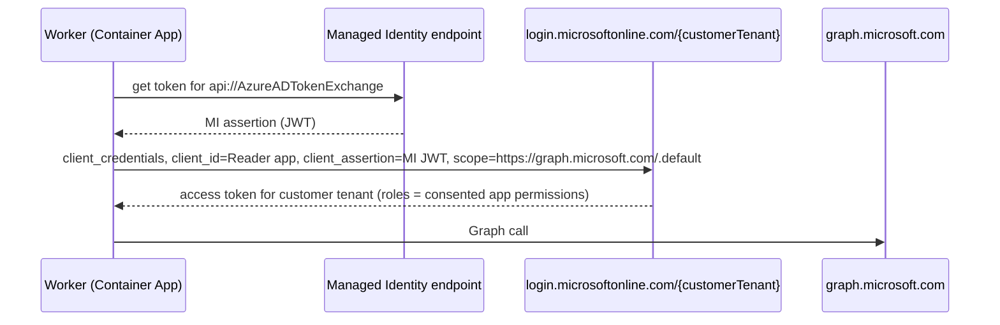

# Microsoft Graph & Microsoft 365 Integrations

> **⚠ Product model changed (2026-11-16).** This document assumes an MSP accessing customer tenants through GDAP and separate Reader and Operator apps. That model has been **dropped**. The product calls Graph **in the tenant the user is signed in to** (one of the organization's own tenants, e.g. test and prod), using the API app with admin consent in each tenant (`GraphService` keeps one client per tenant). **[UTVIDELSESPLAN.md](UTVIDELSESPLAN.md) is the governing plan.**
>
> **No longer applies:** §2.1 GDAP layers, §2.3 GDAP automation, and the split into Reader and Operator apps (may be revisited for least privilege).
> **Still useful as reference:** §1 baseline fixes (done), §3 permission catalog, §4 endpoint catalog by domain, §5 change notifications, §6 throttling, §7 write actions.

| | |
|---|---|
| Status | Draft v0.1 (2026-11-13) |
| SDK | `Microsoft.Graph` (v1.0) — existing v6.x; `Microsoft.Graph.Beta` only where noted and isolated behind an interface |
| Related | [TARGET_ARCHITECTURE.md §3.1, §6.2](TARGET_ARCHITECTURE.md), [DATABASE_DESIGN.md §5.2–5.4](DATABASE_DESIGN.md) |

---

## 1. Current usage (baseline)

| Call | Used for | Permission (application) | Issues |
|---|---|---|---|
| `GET /users?$select=…&$top=100` | Employee list + sync | `User.Read.All` | No paging → max 100 users (G3); filters out users without department/title client-side |
| `GET /users/{id}/transitiveMemberOf` | Ticket auto-assignment verification | `GroupMember.Read.All` (or `Directory.Read.All`) | Called per candidate per ticket (G5); could use `checkMemberGroups` |

Credential: `ClientSecretCredential` single tenant, constructed per request.

Immediate fixes (Phase 0):

```csharp
// Paging: use PageIterator
var page = await client.Users.GetAsync(r => { r.QueryParameters.Select = [...]; r.QueryParameters.Top = 999; });
var it = PageIterator<User, UserCollectionResponse>.CreatePageIterator(client, page!, u => { users.Add(u); return true; });
await it.IterateAsync(ct);

// Membership check: one call instead of full transitive enumeration
var body = new Microsoft.Graph.Users.Item.CheckMemberGroups.CheckMemberGroupsPostRequestBody { GroupIds = allowedGroupIds };
var hits = await client.Users[oid].CheckMemberGroups.PostAsCheckMemberGroupsPostResponseAsync(body);
```

Register `GraphServiceClient` (or the new factory) as **singleton**.

---

## 2. Multi-tenant access model

### 2.1 Three layers

| Layer | Purpose | Set up by |
|---|---|---|
| **GDAP relationship** (Partner Center) | Gives Antire *human* operators time-bound, least-privilege Entra roles in the customer tenant (e.g. Helpdesk Administrator, User Administrator, Security Reader, Intune Administrator) via security groups in Antire's tenant | Antire sends relationship request → customer Global Admin approves |
| **Multi-tenant app – "Antire Ops – Reader"** | App-only read access for collectors | Customer admin grants admin consent (link from onboarding wizard) |
| **Multi-tenant app – "Antire Ops – Operator"** | App-only write access for the Action Pipeline; consented only when customer buys managed operations | Customer admin consent; can be withdrawn independently |

Splitting reader/operator lets a customer start with monitoring-only and makes the blast radius of a compromised collector read-only.

### 2.2 Credential flow (no secrets)



```csharp
public sealed class GraphClientFactory(IOptions<GraphAppOptions> opts, IMemoryCache cache) : IGraphClientFactory
{
    public GraphServiceClient ForTenant(Guid tenantId, AccessLevel level) =>
        cache.GetOrCreate((tenantId, level), _ =>
        {
            var app = level == AccessLevel.Write ? opts.Value.Operator : opts.Value.Reader;
            var mi = new ManagedIdentityCredential(ManagedIdentityId.FromUserAssignedClientId(app.ManagedIdentityClientId));
            var cred = new ClientAssertionCredential(
                tenantId.ToString(), app.ClientId,
                async ct => (await mi.GetTokenAsync(new(["api://AzureADTokenExchange/.default"]), ct)).Token);
            return new GraphServiceClient(CreateHttpClient(tenantId), cred, ["https://graph.microsoft.com/.default"]);
        })!;
}
```

`CreateHttpClient` adds the throttling handler (§6), OpenTelemetry, and a `client-request-id` correlated to the ingest run.

### 2.3 GDAP automation (Graph `tenantRelationships`)

GDAP relationships are managed through Graph (`/tenantRelationships/delegatedAdminRelationships`) in Antire's partner tenant:

| Operation | Endpoint | Permission (delegated, partner tenant) |
|---|---|---|
| List / read relationships | `GET /tenantRelationships/delegatedAdminRelationships` | `DelegatedAdminRelationship.Read.All` |
| Create relationship request (onboarding wizard) | `POST /tenantRelationships/delegatedAdminRelationships` + `POST …/{id}/requests` (lockForApproval) | `DelegatedAdminRelationship.ReadWrite.All` |
| Assign Antire security groups to roles | `POST …/{id}/accessAssignments` | same |
| Expiry monitoring | `endDateTime`, `autoExtendDuration` on relationship | read |

GDAP ops run in an **operator-initiated, delegated** context (Platform Admin signs in), not by background workers — this is a partner-tenant control-plane action.

Standard GDAP role template (adjust per service tier):

| Antire group | Entra roles in customer tenant |
|---|---|
| `GDAP-L1-Helpdesk` | Helpdesk Administrator, Service Support Administrator, Directory Readers |
| `GDAP-L2-Operations` | User Administrator, License Administrator, Groups Administrator, Exchange Administrator, Teams Administrator, SharePoint Administrator, Intune Administrator |
| `GDAP-Security` | Security Administrator, Security Reader, Conditional Access Administrator, Authentication Policy Administrator |
| `GDAP-Escalation` (PIM-eligible in Antire tenant) | Privileged Role Administrator — **never** Global Administrator by default |

---

## 3. Permissions catalog

Application permissions per app. Request only what the enabled modules need; the onboarding wizard shows the list to the customer.

### 3.1 "Antire Ops – Reader"

| Permission | Module | Used for |
|---|---|---|
| `User.Read.All` | Inventory | Users, attributes |
| `AuditLog.Read.All` | Inventory/Security | `signInActivity` on users, sign-in & directory audit logs |
| `GroupMember.Read.All` / `Group.Read.All` | Inventory/ITSM | Groups, memberships, assignment verification |
| `Directory.Read.All` | Inventory | Org info, domains, subscribed SKUs, devices (broad — prefer narrower where possible) |
| `RoleManagement.Read.Directory` | Security | Role assignments + PIM eligibility |
| `Policy.Read.All` | Security | Conditional Access, auth methods policy, authorization policy |
| `UserAuthenticationMethod.Read.All` | Security | MFA methods (via reports) |
| `Reports.Read.All` | Inventory/Cost | M365 usage reports, `userRegistrationDetails` |
| `IdentityRiskyUser.Read.All`, `IdentityRiskEvent.Read.All` | Security | Entra ID Protection |
| `SecurityEvents.Read.All` | Security | Secure Score + control profiles |
| `SecurityAlert.Read.All`, `SecurityIncident.Read.All` | Monitoring | Defender XDR alerts & incidents |
| `ThreatHunting.Read.All` | AI/Security | Advanced hunting (KQL) — optional, high value for AI investigations |
| `DeviceManagementManagedDevices.Read.All` | Inventory | Intune devices |
| `DeviceManagementConfiguration.Read.All` | Security | Intune compliance/config policies |
| `ServiceHealth.Read.All` | Monitoring | M365 service health & message center |
| `Sites.Read.All` *(optional)* | Security | SharePoint sharing/storage posture — only if customer opts in |
| `Organization.Read.All` | Tenancy | Tenant info, verified domains, `subscribedSkus` |

### 3.2 "Antire Ops – Operator"

| Permission | Action types enabled |
|---|---|
| `User.ReadWrite.All` | Create/update/disable users, reset attributes (onboarding/offboarding) |
| `User.RevokeSessions.All` | Revoke sign-in sessions (incident response) |
| `UserAuthenticationMethod.ReadWrite.All` | Require MFA re-registration, remove compromised methods (high risk) |
| `GroupMember.ReadWrite.All` | Grant/revoke access via group (access requests) |
| `LicenseAssignment.ReadWrite.All` | Assign/remove licenses (license reclaim) |
| `Policy.ReadWrite.ConditionalAccess` *(+ `Policy.Read.All`, `Application.Read.All`)* | Deploy baseline CA policies (always report-only first) |
| `DeviceManagementManagedDevices.PrivilegedOperations.All` | Wipe/retire/sync device (high risk) |
| `IdentityRiskyUser.ReadWrite.All` | Confirm compromised / dismiss risk |
| `SecurityIncident.ReadWrite.All` | Update Defender incident status/assignment |
| `MailboxSettings.ReadWrite` *(optional)* | Auto-reply / forwarding on offboarding |

Explicitly **not requested**: `Mail.Read`, `Files.Read.All`, `Chat.Read.All`, `RoleManagement.ReadWrite.Directory`. Content access and role escalation stay human-only via GDAP + PIM.

---

## 4. Integration catalog by domain

Legend — **Mode**: `S` scheduled pull, `D` delta query, `N` change notification, `O` on-demand (UI/AI tool), `W` write (Operator app, via Action Pipeline).

### 4.1 Identity & directory

| Data | Endpoint (v1.0 unless noted) | Mode | Frequency | Target table |
|---|---|---|---|---|
| Users | `/users/delta?$select=id,displayName,givenName,surname,userPrincipalName,mail,department,jobTitle,employeeId,accountEnabled,userType,createdDateTime,onPremisesSyncEnabled,assignedLicenses` | D | 15 min | `inventory.directory_users` |
| Sign-in activity | `/users?$select=id,signInActivity` (separate pass; not available in delta) | S | 6 h | `directory_users.last_sign_in_at` |
| Groups + members | `/groups/delta?$select=…,members` | D | 15 min | `inventory.directory_groups` |
| Directory roles (active) | `/roleManagement/directory/roleAssignments?$expand=principal` | S | 1 h | `inventory.directory_role_assignments` |
| PIM eligibility | `/roleManagement/directory/roleEligibilitySchedules` | S | 1 h | same, `assignment_type='eligible'` |
| MFA registration | `/reports/authenticationMethods/userRegistrationDetails` | S | 6 h | `directory_users.mfa_*` |
| Guest users / external | via users delta (`userType eq 'Guest'`) | D | 15 min | `directory_users` |
| App registrations & SPs (credential expiry, risky consent) | `/applications?$select=id,appId,displayName,passwordCredentials,keyCredentials`, `/servicePrincipals` + `/oauth2PermissionGrants` | S | 24 h | `security.findings` (expiring secrets, over-privileged consents) |
| Directory audit | `/auditLogs/directoryAudits?$filter=activityDateTime ge {watermark}` | S | 15 min | ADLS raw + `inventory.resource_changes`-like M365 change log |
| Sign-in logs | `/auditLogs/signIns?$filter=createdDateTime ge {watermark}` | O (AI/investigation) — not bulk-copied | — | queried live |

### 4.2 Licensing (cost)

| Data | Endpoint | Mode | Frequency | Target |
|---|---|---|---|---|
| License pool | `/subscribedSkus` | S | 6 h | `inventory.subscribed_skus` |
| Assignments | users delta `assignedLicenses` + `/users/{id}/licenseDetails` when needed | D | 15 min | `inventory.license_assignments` |
| Activity per user | `/reports/getOffice365ActiveUserDetail(period='D30')`, `getMailboxUsageDetail`, `getTeamsUserActivityUserDetail` | S | 24 h | feeds `cost.recommendations` (license reclaim) |
| Assign / remove | `POST /users/{id}/assignLicense` | W | — | action `m365.license.assign/remove` |

> Usage reports return obfuscated names if the tenant has "conceal user details" enabled. The onboarding check flags this; join on UPN only when unobfuscated, otherwise use object id from `userRegistrationDetails`-style endpoints.

License reclaim rule (example): user `accountEnabled=false` **or** no sign-in for 60 days **and** no M365 activity for 60 days **and** has paid SKU → recommendation `license_reclaim` with monthly saving = SKU price.

### 4.3 Devices (Intune)

| Data | Endpoint | Mode | Frequency |
|---|---|---|---|
| Managed devices | `/deviceManagement/managedDevices?$select=id,deviceName,operatingSystem,osVersion,complianceState,managementState,managedDeviceOwnerType,userId,lastSyncDateTime,isEncrypted,azureADDeviceId` | S | 1 h |
| Compliance policies + states | `/deviceManagement/deviceCompliancePolicies`, `…/deviceStatuses` | S | 6 h |
| Configuration profiles | `/deviceManagement/deviceConfigurations`, `/deviceManagement/configurationPolicies` (Settings Catalog) | S | 24 h (drift) |
| Entra devices (stale) | `/devices?$select=id,displayName,approximateLastSignInDateTime,operatingSystem,trustType` | S | 24 h |
| Actions | `POST /deviceManagement/managedDevices/{id}/syncDevice`, `/retire`, `/wipe` | W | — |

### 4.4 Security

| Data | Endpoint | Mode | Frequency | Target |
|---|---|---|---|---|
| Secure Score | `/security/secureScores?$top=1`, `/security/secureScoreControlProfiles` | S | 24 h | `security.score_snapshots`, `security.findings` |
| Defender XDR alerts | `/security/alerts_v2?$filter=lastUpdateDateTime ge {wm}` | S (5 min) + N where supported | 5 min | `monitoring.alerts` |
| Defender XDR incidents | `/security/incidents?$expand=alerts` | S | 5 min | `monitoring.incidents` (linked) |
| Risky users | `/identityProtection/riskyUsers?$filter=riskState eq 'atRisk'` | S | 15 min | `security.risky_identities` + alert |
| Risk detections | `/identityProtection/riskDetections?$filter=detectedDateTime ge {wm}` | S | 15 min | `monitoring.alerts` |
| Conditional Access | `/identity/conditionalAccess/policies`, `/namedLocations` | S | 1 h | `inventory.policies` → baseline evaluation |
| Auth methods policy | `/policies/authenticationMethodsPolicy` | S | 24 h | `inventory.policies` |
| Authorization policy (guest settings, user consent) | `/policies/authorizationPolicy` | S | 24 h | `inventory.policies` |
| Advanced hunting | `POST /security/runHuntingQuery` | O (AI tool, read-only KQL validator) | — | not stored |
| Actions | `POST /users/{id}/revokeSignInSessions`, `POST /identityProtection/riskyUsers/confirmCompromised`, `PATCH /security/incidents/{id}` | W | — | actions |

**Antire baseline checks** (evaluated by `security` processor against `inventory.policies` & directory data) — initial set:

| Code | Check |
|---|---|
| `ID-001` | MFA required for all users via CA (not per-user MFA / security defaults only) |
| `ID-002` | MFA required for admin roles with phishing-resistant strength |
| `ID-003` | Legacy authentication blocked |
| `ID-004` | ≥ 2 break-glass accounts exist, excluded from CA, sign-ins monitored |
| `ID-005` | ≤ 4 permanent Global Administrators; others PIM-eligible |
| `ID-006` | User consent to apps restricted to verified publishers / low-risk perms |
| `ID-007` | Guest invite restricted; guest access reviewed |
| `ID-008` | No enabled accounts inactive > 90 days |
| `ID-009` | App secrets/certs expiring < 30 days flagged |
| `DEV-001` | Device compliance required for M365 access (CA) |
| `DEV-002` | BitLocker/FileVault enforced; non-compliant devices < 5 % |
| `M365-001` | SharePoint external sharing not "Anyone" by default |
| `M365-002` | Mailbox auditing on; external auto-forwarding blocked |

### 4.5 Service health

| Data | Endpoint | Mode | Frequency | Target |
|---|---|---|---|---|
| Health overview | `/admin/serviceAnnouncement/healthOverviews` | S | 5 min | `monitoring.service_health_events` |
| Issues | `/admin/serviceAnnouncement/issues?$filter=lastModifiedDateTime ge {wm}` | S | 5 min | same → alert if `isResolved=false` and classification `incident` |
| Message center | `/admin/serviceAnnouncement/messages` | S | 24 h | AI summarization → weekly customer digest |

### 4.6 Collaboration (opt-in)

| Data | Endpoint | Purpose |
|---|---|---|
| SharePoint sites & storage | `/sites/getAllSites` (or `/sites?search=*`), `/reports/getSharePointSiteUsageDetail` | Storage cost, inactive sites |
| Teams inventory | `/teams` via `/groups?$filter=resourceProvisioningOptions/Any(x:x eq 'Team')` | Ownerless teams, guest-enabled teams |
| Sharing links | not bulk-scanned in v1 | Privacy — only via Defender/Purview signals |

### 4.7 Platform-tenant integrations (Antire's own tenant)

| Purpose | API | Notes |
|---|---|---|
| Notifications & approvals | Teams: Bot Framework / incoming workflow webhook with **Adaptive Cards** (Approve/Reject buttons call ops-api) | Delegated identity of approver captured from card action |
| Email notifications | Azure Communication Services Email (preferred) or Graph `POST /users/{svc}/sendMail` with `Mail.Send` scoped by **RBAC for Applications in Exchange Online** to one mailbox | Avoid tenant-wide `Mail.Send` |
| On-call / staff sync | existing users sync (Antire tenant) → `itsm.staff` | Keeps current employee functionality |

---

## 5. Change notifications

Use where latency matters; fall back to delta polling everywhere (notifications are best-effort).

| Resource | Subscription | Delivery |
|---|---|---|
| `users`, `groups` | `changeType=updated,deleted` | **Event Hubs** delivery (`EventHub:https://…`) — no public webhook needed, scales across tenants |
| `security/alerts_v2` | where supported for app-only; otherwise poll 5 min | Event Hubs |
| `communications/…`, mail | not used | — |

- Subscriptions expire (users/groups ≈ max ~29 days); `ops-collectors` runs a renewal job daily and recreates on `lifecycleNotifications` (`reauthorizationRequired`, `subscriptionRemoved`, `missed`).
- On `missed` → trigger a delta sync for that tenant.
- Notifications carry only IDs (no rich data) → processor fetches/uses delta.

---

## 6. Throttling, batching, resilience

| Concern | Approach |
|---|---|
| Throttling (429/503) | Honour `Retry-After`; Graph SDK `RetryHandler` + Polly circuit breaker per (tenant, workload). Redis token bucket per tenant to stay under limits proactively (Identity & access ≈ per-app-per-tenant limits; Intune and reports have tighter limits) |
| Batching | `$batch` (max 20 requests) for per-user lookups (license details, membership checks). Use SDK `BatchRequestContentCollection` |
| Paging | Always `PageIterator`; `$top=999` where allowed |
| Payload size | Always `$select`; never fetch full user objects |
| Consistency | Advanced queries (`$count`, `endsWith`, etc.) need `ConsistencyLevel: eventual` + `$count=true` |
| Delta tokens | Stored in `ingest.sync_state`; on `410 Gone` (token expired) → full resync + mark-and-sweep |
| Fan-out | Collector work is partitioned: one Service Bus session per `customer_id` → strict per-tenant ordering, parallel across tenants |
| Consent failures | `403 Authorization_RequestDenied` / `AADSTS65001` → mark `tenant_connections.health_status='consent_missing'`, alert account manager, skip module |
| Beta endpoints | Isolated in `Ops.Integrations.Graph.Beta`, feature-flagged, contract-tested; never on critical write paths |

---

## 7. Write operations (via Action Pipeline)

Every Graph write is an `IActionType` implementation in `Ops.Modules.Automation`:

| Action code | Graph call(s) | Risk | Dry run | Compensation |
|---|---|---|---|---|
| `m365.user.create` | `POST /users`, `assignLicense`, group adds | medium | validate UPN/domain/license availability | disable + delete (soft) |
| `m365.user.offboard` | `PATCH accountEnabled=false`, `revokeSignInSessions`, remove licenses, remove from groups, set auto-reply/forward (Exchange), convert mailbox (Exchange PS — out of Graph scope) | high | list everything that will change | re-enable + restore snapshot |
| `m365.user.revoke_sessions` | `POST /users/{id}/revokeSignInSessions` | medium | — | n/a |
| `m365.group.add_member` / `remove_member` | `POST /groups/{id}/members/$ref` / `DELETE …/$ref` | low–medium (depends on group sensitivity) | check current membership | inverse |
| `m365.license.assign` / `remove` | `POST /users/{id}/assignLicense` | low | check available units | inverse |
| `entra.ca.deploy_baseline` | `POST /identity/conditionalAccess/policies` with `state=enabledForReportingButNotEnforced` | high | diff vs existing | delete created policy |
| `entra.ca.enforce` | `PATCH state=enabled` | critical (2 approvers) | report-only impact summary from sign-in logs | set back to report-only |
| `intune.device.sync` / `retire` / `wipe` | device actions | low / high / critical | — | n/a (wipe irreversible → 2 approvers + customer confirmation) |
| `entra.risky_user.confirm_compromised` | `POST /identityProtection/riskyUsers/confirmCompromised` | high | — | `dismiss` |

Guards common to all writes: `customer_settings.protected_principals` (break-glass) are never targets; before/after snapshot stored; per-tenant concurrency 1 for identity writes.

This also delivers the existing **access request** flow end-to-end: approval → `m365.group.add_member` against `access_requests.target_group_id` → `fulfilled`.

---

## 8. Testing

- **Contract tests** against recorded Graph responses (Kiota `IRequestAdapter` mock or WireMock.Net).
- **Integration tests** against a dedicated **M365 developer/test tenant** (E5 trial) with seeded users/groups/devices; nightly in `test` env.
- **Consent matrix test**: Reader-only tenant must not break any module; missing optional permissions degrade gracefully.
