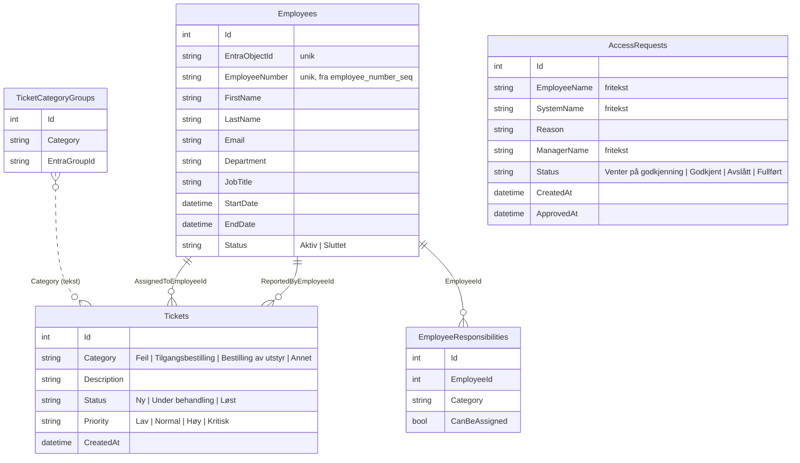

# Fra helpdesk til MSP-plattform: analyse og utvidelsesplan

| | |
|---|---|
| Status | Utkast v0.1 (2026-11-16) |
| Utgangspunkt | `main` @ `a33d4ac` (helpdesk + fase 0-rettinger) |
| Prinsipp | Helpdesken er fundamentet. Vi bygger videre på eksisterende modeller, kontrollere, tjenester og skjermbilder. Ingen ny arkitektur fra bunnen av. |
| Forhold til andre dokumenter | `TARGET_ARCHITECTURE.md` og de andre arkitekturdokumentene beskriver et langsiktig mål. **Dette dokumentet styrer rekkefølgen og måten vi bygger på.** Der de er uenige, gjelder dette dokumentet: vi beholder én .NET-backend, én `AppDbContext`, `int`-nøkler og dagens kontrollerstil. |

---

## 1. Dagens løsning

### 1.1 Teknisk oppbygging

| Lag | Teknologi | Merknad |
|---|---|---|
| Frontend | React 19 + Vite + TypeScript, MSAL React | Én side (`App.tsx`) med meny og `activePage`-tilstand, uten ruter-bibliotek. Komponentene `Helpdesk`, `AccessRequests` og `Employees`. API-URL er hardkodet til `http://localhost:5086`. |
| Backend | ASP.NET Core (.NET 10), kontrollere | `Program.cs` registrerer EF Core (PostgreSQL), Microsoft.Identity.Web (JWT), tilgangsregler og tjenester |
| Database | PostgreSQL via EF Core-migreringer | 14 migreringer, tabeller i `public` med PascalCase-navn |
| Identitet | Entra ID, én tenant (`3af5c92b-…`) | SPA-app `73962775-…` og API-app `e33710da-…` (*Antire IT Operations API - Dev*) med app-rollene `Helpdesk.Admin` og `EmployeeSync.Admin` |
| Graph | `GraphService` (singleton, klienthemmelighet) | Leser brukere (med paging) og gruppemedlemskap |

### 1.2 Datamodell



### 1.3 API-oversikt

| Kontroller | Endepunkter | Tilgang |
|---|---|---|
| `TicketsController` | `GET /api/tickets` (admin ser alle, andre bare egne), `POST`, `PATCH {id}/status`, `{id}/priority`, `{id}/assign`, `GET me` | Innlogget; endringer krever `Helpdesk.Admin` |
| `EmployeesController` | `GET`, `POST`, `PUT {id}`, `PATCH {id}/terminate` | Lesing for alle innloggede; endringer krever `EmployeeSync.Admin` |
| `AccessRequestsController` | `GET`, `POST`, `PATCH {id}/approval`, `PATCH {id}/complete` | Godkjenning og fullføring krever `Helpdesk.Admin` |
| `GraphController` | `GET employees`, `POST sync-employees`, `GET employees/{oid}/groups` | `EmployeeSync.Admin` |
| `TicketCategoryGroupsController` | `GET`, `POST`, `DELETE {id}` | `Helpdesk.Admin` |
| `WeatherForecastController` | Rest fra malen | Kan fjernes |

### 1.4 Arbeidsflyter

| Flyt | Slik fungerer den i dag |
|---|---|
| **Sak** | En bruker oppretter en sak med kategori og beskrivelse. `TicketAssignmentService` finner en aktiv ansatt med ansvarsområde for kategorien som også er medlem av en godkjent Entra-gruppe (`checkMemberGroups`), og tildeler saken. Admin endrer status, prioritet og ansvarlig. |
| **Tilgangsbestilling** | En bruker fyller ut ansatt, system, begrunnelse og leder (alt fritekst). Admin godkjenner eller avslår, og IT markerer som fullført. Ingen kobling til sak, ansatt eller Entra-gruppe, og selve tildelingen av tilgang gjøres manuelt. |
| **Ansatte** | «Synkroniser fra Entra» henter brukere med avdeling og stilling, kobler dem på `EntraObjectId` eller e-post, og tildeler ansattnummer. Sluttdato registreres manuelt. |
| **Dashboard** | Teller nye, pågående, løste og kritiske åpne saker. |

### 1.5 Svakheter som påvirker utvidelsen

| Svakhet | Konsekvens for MSP |
|---|---|
| Ingen kunde-dimensjon | Alt må få et kundebegrep før noe annet |
| Status, prioritet og kategori er norske strenger brukt som nøkler | SLA og rapportering blir skjøre. Bør ryddes når SLA innføres. |
| Ansvarsområder (`EmployeeResponsibilities`) og kategorigrupper (`TicketCategoryGroups`) har ikke noe skjermbilde | Konfigurasjon gjøres i databasen |
| Tilgangsbestillinger er fritekst | Kan ikke automatiseres eller knyttes til kunde eller tjeneste |
| Ingen revisjonslogg | Kreves for MSP-drift og kundetillit |
| Graph er knyttet til én tenant og bruker klienthemmelighet | Må kunne velge kunde-tenant |
| Hardkodede URL-er i frontend | Hindrer utrulling i Azure |
| Ingen tester | Høyere risiko ved hver utvidelse |

---

## 2. Utvidelsespunkter

Dette er stedene i koden der MSP-funksjonaliteten kobles inn. Hver utvidelse i fase 1–3 bruker disse i stedet for å lage nye strukturer.

| # | Utvidelsespunkt | Fil | Brukes til |
|---|---|---|---|
| U1 | `AppDbContext` | `backend/Data/AppDbContext.cs` | Nye entiteter; **globalt kundefilter** (`HasQueryFilter`) på kundeeide tabeller; revisjons-interceptor |
| U2 | Tilgangsregler | `backend/Services/AuthPolicies.cs`, `Program.cs` | Nye roller (`Helpdesk.Agent`, `Customer.Admin` …) og kundebaserte regler |
| U3 | Innlogget bruker | `TicketsController.GetCallerEmployeeIdAsync`, `GET /api/tickets/me` | Trekkes ut til en `CurrentUserService` som også gir hvilke kunder brukeren har tilgang til |
| U4 | Sakstildeling | `backend/Services/TicketAssignmentService.cs` | Utvides fra kategori til kunde + tjeneste, og setter SLA-frister |
| U5 | Graph | `backend/Services/GraphService.cs` | Blir per kunde-tenant (`ForTenant(tenantId)`); nye metoder for grupper, lisenser, Secure Score, CA og Intune |
| U6 | Synk fra Entra | `GraphController.SyncEmployees` | Gjenbrukes per kunde: brukere i kundens tenant blir personer på kunden |
| U7 | Ansattnummer | `backend/Services/EmployeeNumberService.cs` | Uendret; gjelder alle personer |
| U8 | Kategorier | Hardkodet liste i `Helpdesk.tsx`, `Ticket.Category` | Erstattes av tjenestekatalogen; `Category` beholdes for bakoverkompatibilitet |
| U9 | Meny og sider | `frontend/src/App.tsx` (`menu`, `activePage`) | Plassholderne **IT-utstyr** og **Innstillinger** tas i bruk; nye sider for Kunder, M365 og Azure |
| U10 | Roller i frontend | `frontend/src/useCurrentUser.ts` | Utvides med kundeliste og valgt kunde (kundevelger i toppfeltet) |
| U11 | Migreringer | `backend/Migrations` | Hver utvidelse er én migrering med datamigrering av eksisterende rader |

---

## 3. Fase 0-rest (forutsetninger)

Dette gjøres før eller sammen med første del av fase 1.

| # | Arbeid | Hvorfor nå |
|---|---|---|
| 0.8 | API-URL fra `VITE_API_URL`, samlet i én `apiClient.ts` som også håndterer token | Alle nye skjermbilder bruker den. Fjerner duplisert `getAuthHeaders` i hver komponent. |
| 0.10 | Testprosjekt (xUnit + Testcontainers PostgreSQL) med tester for tilgang og kundefilter | Kundeisolasjon må testes automatisk fra første dag |
| 0.6 | Engelske koder for status og prioritet (`new`, `in_progress`, `resolved`; `low` … `critical`) med norske visningsnavn | Tas sammen med SLA (1.5), som er avhengig av stabile koder |

---

## 4. Fase 1: MSP-fundament

Rekkefølgen er valgt slik at hvert steg kan settes i drift alene, og slik at revisjonsloggen er på plass før de store dataendringene.

### 1.1 Kundeorganisasjoner og flere kunder

**Modell (ny):**
```csharp
public class Customer
{
    public int Id { get; set; }
    public string Name { get; set; } = "";
    public string ShortCode { get; set; } = "";      // unik, f.eks. "ANT"
    public string? OrganizationNumber { get; set; }
    public string Status { get; set; } = "active";   // onboarding | active | inactive
    public string? EntraTenantId { get; set; }       // fylles i fase 2
    public int? SlaPolicyId { get; set; }            // fylles i 1.5
    public DateTime CreatedAt { get; set; } = DateTime.UtcNow;
}
```

**Endringer i eksisterende modeller:** `CustomerId` (int, påkrevd) legges til på `Employee`, `Ticket` og `AccessRequest`.

- `Employee` blir dermed «person hos en kunde». Antires egne ansatte er personer hos kunden **Antire**. Teknikere er personer hos Antire med ansvarsområder.
- `Ticket.CustomerId` settes fra innmelder. Admin kan velge kunde ved opprettelse.

**Migrering:** opprett `Customers`, legg inn `Antire` (Id 1, `EntraTenantId = 3af5c92b-…`), legg til `CustomerId` med standardverdi 1 på eksisterende rader, og gjør feltet påkrevd med fremmednøkkel og indeks.

**API:** `CustomersController` (`GET`, `POST`, `PUT`, `PATCH {id}/status`). `GET /api/tickets`, `/employees` og `/accessrequests` får valgfri `?customerId=`.

**Frontend:** ny menyside **Kunder** (liste og skjema), og en kundevelger i toppfeltet som filtrerer Helpdesk, Ansatte og Tilgangsbestillinger.

**Ferdig når:** eksisterende data ligger på kunden Antire, en ny kunde kan opprettes, og saker kan registreres og filtreres per kunde.

### 1.2 Roller og rettigheter (RBAC)

To nivåer, der begge gjenbruker det som finnes:

1. **Hva** du kan gjøre: app-roller i Entra (finnes i dag).

| App-rolle | Status | Kan |
|---|---|---|
| `Helpdesk.Admin` | finnes | Alt i helpdesk for kundene man har tilgang til, og konfigurasjon |
| `EmployeeSync.Admin` | finnes | Synk og vedlikehold av personer |
| `Helpdesk.Agent` | ny | Behandle saker (status, prioritet, ansvarlig), men ikke konfigurasjon |
| `Platform.Admin` | ny | Opprette kunder, gi kundetilgang, se revisjonslogg for alle |

2. **Hvilke kunder** du har tilgang til: ny tabell.
```csharp
public class CustomerAccess
{
    public int Id { get; set; }
    public int EmployeeId { get; set; }   // Antire-tekniker
    public int CustomerId { get; set; }
    public bool AllCustomers { get; set; } // for f.eks. vakt og ledere
}
```

**Håndheving:**
- `CurrentUserService` (U3) slår opp innlogget bruker og hvilke kunder hen har tilgang til, én gang per forespørsel.
- `AppDbContext` får et **globalt query filter** på `CustomerId` for kundeeide entiteter, slik at en glemt `Where` aldri lekker data.
- Brukere uten admin- eller agent-rolle beholder dagens regel om at de bare ser egne saker.

**Frontend:** `useCurrentUser` returnerer roller og kundeliste, og kundevelgeren viser bare tillatte kunder.

**Ferdig når:** en automatisk test viser at en tekniker med tilgang til kunde A får 404 eller tom liste for data på kunde B.

### 1.3 Revisjonslogg (Audit Log)

**Modell:**
```csharp
public class AuditEvent
{
    public long Id { get; set; }
    public DateTime OccurredAt { get; set; }
    public int? CustomerId { get; set; }
    public string ActorObjectId { get; set; } = "";  // Entra oid
    public string ActorName { get; set; } = "";
    public string EntityType { get; set; } = "";     // Ticket, Employee, Customer …
    public string EntityId { get; set; } = "";
    public string Action { get; set; } = "";         // created | updated | deleted | approved | synced …
    public string? Changes { get; set; }             // jsonb: { felt: [før, etter] }
}
```

**Mekanisme:** en `SaveChangesInterceptor` (U1) logger automatisk opprettelse, endring og sletting for entiteter merket med `IAudited`, med før- og etterverdier. Forretningshendelser som godkjenning og synk logges eksplisitt med `IAuditLogger.LogAsync(...)`. Applikasjonen har ingen endepunkter som endrer eller sletter rader i tabellen.

**API og frontend:** `GET /api/audit?customerId=&entityType=&entityId=` (Platform.Admin, eller Helpdesk.Admin for egne kunder). Historikk vises i hver sak, og det kommer en side for revisjonslogg under **Innstillinger**.

**Ferdig når:** endring av status, prioritet og ansvarlig på en sak synes i sakens historikk med hvem og når.

### 1.4 Tjenestekatalog

Katalogen erstatter den hardkodede kategorilisten (U8) og gir struktur til tilgangsbestillinger.

```csharp
public class ServiceCatalogItem
{
    public int Id { get; set; }
    public int? CustomerId { get; set; }          // null = gjelder alle kunder
    public string Name { get; set; } = "";        // "Ny bruker", "Tilgang til system", "Bærbar PC" …
    public string Category { get; set; } = "";    // kobler til dagens TicketCategoryGroups og ansvarsområder
    public string? Description { get; set; }
    public string Type { get; set; } = "incident";// incident | request | access
    public string DefaultPriority { get; set; } = "normal";
    public bool RequiresApproval { get; set; }
    public string? EntraGroupId { get; set; }     // for type=access: gruppen som gir tilgangen
    public bool IsActive { get; set; } = true;
}
```

- `Ticket.ServiceCatalogItemId` (valgfri). `Ticket.Category` settes fra katalogen, slik at `TicketAssignmentService` virker uendret.
- `AccessRequest.ServiceCatalogItemId` erstatter fritekst-`SystemName` for nye bestillinger. Fritekstfeltet beholdes for gamle rader.
- Startinnhold: dagens fire kategorier blir katalogelementer.
- Skjermbilde under **Innstillinger → Tjenestekatalog**, med de manglende skjermbildene for ansvarsområder og kategorigrupper.

**Ferdig når:** Helpdesk viser katalogen for valgt kunde, og automatisk tildeling virker som før.

### 1.5 SLA-håndtering

```csharp
public class SlaPolicy
{
    public int Id { get; set; }
    public string Name { get; set; } = "";               // "Standard", "Premium"
    public string BusinessHoursJson { get; set; } = "";  // f.eks. man–fre 08–16, Europe/Oslo
    public List<SlaTarget> Targets { get; set; } = new();
}
public class SlaTarget
{
    public int Id { get; set; }
    public int SlaPolicyId { get; set; }
    public string Priority { get; set; } = "";       // low | normal | high | critical
    public int ResponseMinutes { get; set; }
    public int ResolutionMinutes { get; set; }
    public bool TwentyFourSeven { get; set; }        // kritisk kan gå døgnet rundt
}
```

**Nye felter på `Ticket`:** `ResponseDueAt`, `ResolutionDueAt`, `FirstRespondedAt`, `ResolvedAt`.

**Regler:**
- Fristene beregnes ved opprettelse og ved endring av prioritet, fra kundens SLA-policy med arbeidstid og helligdager. Beregningen ligger i en ny `SlaCalculator`-tjeneste med enhetstester.
- `FirstRespondedAt` settes første gang en tekniker endrer status eller ansvarlig.
- `ResolvedAt` settes når status blir løst, og nullstilles hvis saken gjenåpnes.
- En `BackgroundService` sjekker hvert 5. minutt og logger brudd og fare for brudd. Varsling på e-post eller Teams kommer senere.

**Frontend:** frist og SLA-status (grønn, gul, rød) per sak, filter for «SLA i fare», og dashboard-kortene «Brudd» og «I fare» per kunde.

**Avhengighet:** 0.6 (engelske koder) gjøres i samme leveranse.

**Ferdig når:** en kritisk sak hos en kunde med Premium-SLA får riktig frist, og brudd vises i dashboard.

### 1.6 IT-utstyr og ressursoversikt

Tar i bruk menyplassholderen **IT-utstyr** (U9).

```csharp
public class Asset
{
    public int Id { get; set; }
    public int CustomerId { get; set; }
    public string AssetTag { get; set; } = "";       // unik per kunde
    public string Type { get; set; } = "";           // laptop | desktop | mobile | monitor | license | other
    public string? Manufacturer { get; set; }
    public string? Model { get; set; }
    public string? SerialNumber { get; set; }
    public string Status { get; set; } = "in_use";   // in_stock | in_use | repair | retired
    public int? AssignedToEmployeeId { get; set; }
    public DateTime? PurchaseDate { get; set; }
    public DateTime? WarrantyEndsAt { get; set; }
    public string Source { get; set; } = "manual";   // manual | intune (fase 2)
    public string? ExternalId { get; set; }          // Intune device id
    public string? Notes { get; set; }
}
```

- `Ticket.AssetId` (valgfri): en sak kan gjelde et utstyr.
- Katalogelementet «Bestilling av utstyr» kan fullføres ved å tildele et `Asset` på lager.
- Ved offboarding (sluttdato) vises utstyret personen har, som en sjekkliste.
- Skjermbilde med liste, filter per kunde, status og person, detaljside med sakshistorikk, og CSV-import for førstegangsregistrering.

**Ferdig når:** utstyr kan registreres og tildeles personer hos en kunde, og vises på personens side og i saken.

---

## 5. Fase 2: Microsoft 365

Fase 2 utvider `GraphService` (U5) og synken (U6) fra én tenant til kundens tenant.

| # | Leveranse | Bygger på | Innhold |
|---|---|---|---|
| 2.1 | **Innlogging med Entra ID** | Finnes (MSAL + JWT) | API-appen gjøres multi-tenant for Graph-tilgang. Antire-teknikere logger fortsatt inn i Antire-tenanten. `Customer.EntraTenantId` settes når kunden har gitt admin-samtykke. |
| 2.2 | **Graph-integrasjon per kunde** | `GraphService` | `GraphService.ForTenant(tenantId)` med bufrede klienter per tenant. Onboardingsiden på kunden lager lenke for admin-samtykke og viser tilkoblingsstatus. Klienthemmeligheten erstattes etter hvert av sertifikat eller managed identity med federert legitimasjon. |
| 2.3 | **Brukeroversikt** | `SyncEmployees` | Synk per kunde, med filter på avdeling og stilling som valg per kunde. Viser i tillegg kontostatus, siste pålogging, MFA-registrering og lisenser per person. |
| 2.4 | **Gruppeoversikt** | `GetUserGroupIdsAsync`, `TicketCategoryGroups` | Grupper med medlemmer per kunde. Tilgangsbestillinger av typen `access` (1.4) kan legge brukeren til i gruppen etter godkjenning, med revisjonslogg (1.3). |
| 2.5 | **Lisensoversikt** | — | `subscribedSkus` (kjøpt og brukt) og lisenser per bruker. Markerer ubrukte lisenser på deaktiverte eller inaktive brukere. |
| 2.6 | **Secure Score** | — | Daglig øyeblikksbilde lagret per kunde for trend, med de viktigste anbefalingene. |
| 2.7 | **Conditional Access-oversikt** | — | Liste over CA-policyer med tilstand. Enkle sjekker: MFA for alle, blokkering av eldre autentisering, unntak for nødtilgangskontoer. |
| 2.8 | **Intune-status** | `Asset` (1.6) | Administrerte enheter synkes inn i `Assets` med `Source = intune`, med etterlevelse, OS-versjon, siste synk og kryptering. Ikke-etterlevende enheter kan gi automatisk sak. |

**Nye Graph-rettigheter (applikasjon, per kunde):** `User.Read.All`, `GroupMember.Read.All`, `AuditLog.Read.All` (siste pålogging), `Reports.Read.All` (MFA), `Organization.Read.All` (lisenser), `SecurityEvents.Read.All` (Secure Score), `Policy.Read.All` (CA), `DeviceManagementManagedDevices.Read.All` (Intune). Skrivetilgang (`GroupMember.ReadWrite.All`) legges til først når 2.4 skal kunne tildele tilgang.

**Nye tabeller:** `CustomerTenants` hvis en kunde har flere tenanter (ellers holder `Customer.EntraTenantId`), `SecureScoreSnapshots`, og `M365License`/`M365LicenseAssignment` for 2.5. Grupper og CA hentes direkte fra Graph med kort cache. De lagres ikke før det er behov for historikk.

Detaljer om endepunkter, struping (throttling) og paging finnes i `GRAPH_API_INTEGRATIONS.md`.

---

## 6. Fase 3: Azure

| # | Leveranse | Innhold |
|---|---|---|
| 3.1 | **Azure tenant-onboarding** | Fra kundesiden: Azure Lighthouse-mal (ARM/Bicep) som kunden ruller ut, eller Reader-rolle til plattformens app i kundens abonnement. Status lagres på kunden. |
| 3.2 | **Abonnementsoversikt** | Ny tabell `AzureSubscriptions` (CustomerId, SubscriptionId, navn, tilstand, sist sett), synket med ARM. Skjermbilde per kunde. |
| 3.3 | **Ressursoversikt** | Resource Graph-spørring på tvers av kundens abonnementer: type, navn, region, ressursgruppe og tagger, med filter og søk. Lagres ikke i første versjon. |

Kostnader, Defender for Cloud og overvåking er ikke med i briefen og er derfor utsatt. De er beskrevet i `AZURE_INTEGRATIONS.md`.

---

## 7. Gjennomføring

| Steg | Innhold | Estimat (1–2 utviklere) |
|---|---|---|
| A | 0.8 API-klient og konfig + 0.10 testprosjekt | 1 uke |
| B | 1.1 Kunder | 1–1,5 uker |
| C | 1.3 Revisjonslogg | 1 uke |
| D | 1.2 RBAC med kundetilgang og query filter | 1,5 uker |
| E | 1.4 Tjenestekatalog + skjermbilder for ansvarsområder og kategorigrupper | 1,5 uker |
| F | 0.6 Engelske koder + 1.5 SLA | 2 uker |
| G | 1.6 IT-utstyr | 1,5 uker |
| H | Fase 2 (2.1–2.8) | 6–8 uker |
| I | Fase 3 (3.1–3.3) | 3–4 uker |

Revisjonsloggen (C) kommer før RBAC (D) slik at endringer i kundetilganger blir logget fra start.

**Arbeidsmåte per steg:** én migrering, backend med tester, frontend, en demo for driftsteamet, og deretter commit til `main`.

---

## 8. Avklaringer

1. **Skal kundenes sluttbrukere logge inn selv** og melde saker (kundeportal), eller registrerer Antire saker på vegne av dem i fase 1? Planen forutsetter det siste. Selvbetjening kan komme etter fase 2.
2. **SLA-nivåer:** hvilke nivåer (for eksempel Standard og Premium) og hvilke responstider og løsningstider per prioritet?
3. **Arbeidstid og helligdager:** norske helligdager og 08–16, eller per kunde?
4. **Briefen slutter ved fase 3 «Ressursoversikt».** Kommer det flere faser, for eksempel kostnader eller sikkerhet i Azure?
5. **Tenant for produksjon:** appregistreringene ligger i dag i en personlig tenant (`3af5c92b-…`). Hvor skal de ligge før første kunde kobles på?
