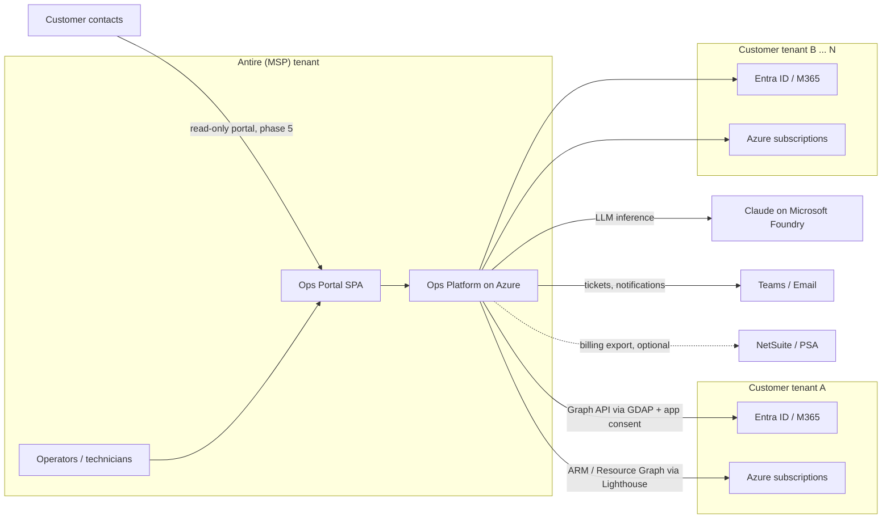
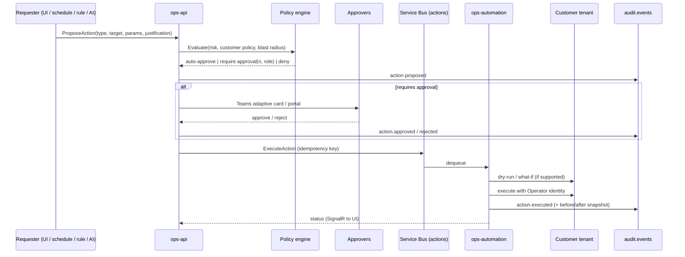
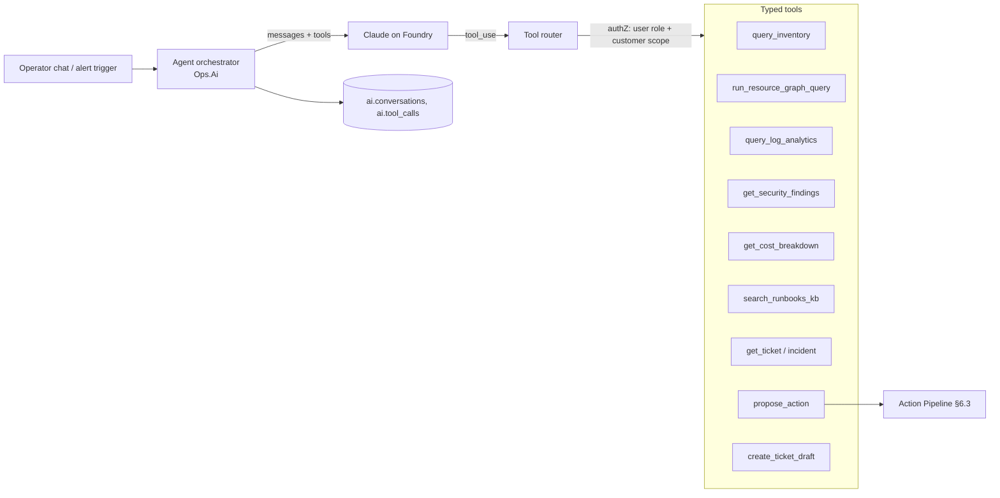

# Target Architecture: Antire IT Operations Platform

> **⚠ Product model changed (2026-11-16).** This document describes an **MSP platform** serving many customer tenants. That model has been **dropped**. The product is run by **one organization** in its **own** Entra tenants (e.g. test and prod). The tenant follows the login, and data is kept separate per tenant (`TenantId` + EF query filters, `Tenants:Allowed`). **[UTVIDELSESPLAN.md](UTVIDELSESPLAN.md) is the governing plan.**
>
> **No longer applies:** customers and customer assignments, GDAP, Azure Lighthouse, partner/CSP billing, customer portal, multi-tenant MSP onboarding (§3.1, parts of §5–6).
> **Still useful as reference:** gap list G1–G10 (mostly fixed), Action Pipeline (§6.3), AI agent design (§6.5), observability and platform security (§6.6–6.7), ADRs on hosting and messaging.

> AI-driven MSP platform for automated operations, monitoring, security management and cost optimization across customer Azure and Microsoft 365 tenants.

| | |
|---|---|
| Status | Draft v0.1 (2026-11-13) |
| Scope | Target state plus migration path from the current codebase |
| Companion docs | [DATABASE_DESIGN.md](DATABASE_DESIGN.md), [GRAPH_API_INTEGRATIONS.md](GRAPH_API_INTEGRATIONS.md), [AZURE_INTEGRATIONS.md](AZURE_INTEGRATIONS.md), [DEVELOPMENT_ROADMAP.md](DEVELOPMENT_ROADMAP.md) |

---

## 1. Current state

### 1.1 What exists today

The repository is an internal IT helpdesk for a single tenant (Antire's own).

| Layer | Technology | Contents |
|---|---|---|
| Frontend | React 19, Vite 8, TypeScript 7, MSAL React 5 | Dashboard, Helpdesk (tickets), access requests (*Tilgangsbestillinger*), employees. Menu placeholders for IT equipment, on/offboarding, GDPR and settings. |
| API | ASP.NET Core on .NET 10, controllers | `TicketsController`, `EmployeesController`, `AccessRequestsController`, `GraphController`, `TicketCategoryGroupsController` |
| Auth | Microsoft.Identity.Web (JWT bearer), MSAL popup in SPA | Single tenant `3af5c92b-…`. App roles `EmployeeSync.Admin` and `Helpdesk.Admin` are used on two controllers. |
| Graph | Microsoft.Graph SDK 6.9, `ClientSecretCredential` | Reads users (`/users`) and transitive group membership (`/users/{id}/transitiveMemberOf`) |
| Data | EF Core 10 + Npgsql (PostgreSQL) | `Tickets`, `Employees`, `EmployeeResponsibilities`, `AccessRequests`, `TicketCategoryGroups`; 12 migrations |
| Domain logic | `TicketAssignmentService` | Assigns a ticket automatically by category: candidate employee → verified Entra group membership via Graph |

### 1.2 What to keep

- **.NET 10 + EF Core + PostgreSQL.** This is a sound base for the platform. There is no reason to change stack.
- **Entra ID + MSAL for the operator portal.** It extends naturally to multi-tenant and to app roles.
- **The ticket auto-assignment pattern** (rules in the database, verified against live Entra membership) is the seed of the platform's policy and automation engine.
- **The ticketing and access-request flows** become the ITSM module of the platform.

### 1.3 Gaps to close before building on it

These are findings from the code review. Phase 0 of the roadmap closes them.

| # | Finding | Where | Risk |
|---|---|---|---|
| G1 | `EmployeesController`, `AccessRequestsController` and `TicketsController` only require *some* authenticated user; any user in the tenant can create or terminate employees and approve access requests (see the `TODO` comments). | Controllers | **High**: privilege escalation |
| G2 | The Graph client uses a client secret from configuration. | `GraphService` | Secret sprawl; no rotation |
| G3 | `GetEmployeesAsync` reads `Top = 100` and does not follow `@odata.nextLink`. Tenants with more than 100 users are synced only in part. | `GraphService.cs` | Silent data loss |
| G4 | `GraphService` is scoped, so it builds a new credential and `GraphServiceClient` per request, and the token cache is lost. | `Program.cs` | Throttling, latency |
| G5 | Ticket assignment calls Graph once per candidate, in sequence. Sync runs one DB query per user (N+1). | `TicketAssignmentService`, `SyncEmployees` | Does not scale |
| G6 | Statuses and priorities are free-text Norwegian strings (`"Ny"`, `"Aktiv"`, `"Venter på godkjenning"`) used as logic keys. | Models | Localization and refactoring are fragile |
| G7 | `Ticket` has two assignee fields (`AssignedTo` string and `AssignedToEmployeeId`). `PATCH /assign` writes only the string. | `Ticket`, `TicketsController` | Inconsistent data |
| G8 | `employee_number_seq` is used in raw SQL but is not created by any migration. | `EmployeesController` | A fresh database fails |
| G9 | No tenant or customer concept, no audit log, no background processing, no tests, no IaC or CI/CD. API URL and CORS origin are hard-coded to `localhost`. | Global | Blocks MSP use |
| G10 | `WeatherForecastController` template leftovers; `.gitignore` contains a stray URL line. | Repo | Hygiene |

---

## 2. Goals and principles

### 2.1 Business capabilities

1. **Multi-tenant operations.** One operator console across N customer tenants (Azure and M365), with per-customer access control.
2. **Inventory and configuration.** A continuously refreshed inventory of Azure resources, M365 users, licenses, devices, groups and policies, with drift detection.
3. **Monitoring and incidents.** Normalize alerts from Azure Monitor, Defender, Entra ID Protection, M365 Service Health and Intune into one incident queue linked to ITSM tickets.
4. **Security posture management.** Secure Score, Defender for Cloud recommendations, Conditional Access baseline compliance, MFA coverage, privileged role hygiene, stale accounts and external sharing.
5. **Cost optimization (FinOps).** Daily cost by customer, subscription and tag; anomaly detection; rightsizing, reservation and savings plan advice; unused license detection; budgets and forecasts.
6. **Automation.** Versioned runbooks (onboarding, offboarding, license reclaim, VM shutdown schedules, baseline remediation) with approval gates, dry-run and full audit.
7. **AI operations assistant.** Natural-language investigation across all of the above, alert triage and summarization, proposed remediation plans executed through the same governed automation pipeline.
8. **Reporting.** Monthly customer reports (security, cost, SLA), plus a read-only customer portal later.

### 2.2 Architecture principles

| Principle | Consequence |
|---|---|
| **Evolve, don't rewrite** | Grow the existing .NET solution into a modular monolith with separate worker processes. Split out microservices only when a module has its own scaling or release need. |
| **Tenant isolation by design** | Every row carries `customer_id`. PostgreSQL row-level security (RLS) is a second line of defence behind application filters. Every external call runs with credentials scoped to one customer tenant. |
| **No secrets** | Managed identity everywhere. Cross-tenant Graph and ARM access uses a multi-tenant app whose credential is a *federated identity credential* backed by the platform's managed identity. Where a secret is unavoidable, it lives in Key Vault. |
| **Least privilege, delegated by the customer** | Azure through Azure Lighthouse; M365 through GDAP plus admin consent to a multi-tenant app. Read and write permissions are split into separate apps and roles. |
| **Read is cheap, write is governed** | All write actions (human, scheduled or AI) go through one Action Pipeline: policy check → approval if required → execution → audit. |
| **AI proposes, policy disposes** | The LLM never holds credentials. It calls typed tools; write tools only create *proposed actions*. |
| **Event-driven ingestion, idempotent processing** | Collectors publish to Service Bus; processors upsert by natural keys. Every job can be re-run safely. |
| **Everything as code** | Bicep for infrastructure, EF migrations for schema, runbooks and policies versioned in Git. |

---

## 3. Context view



### 3.1 Tenant access model

| Target | Mechanism | Why |
|---|---|---|
| Customer Azure | **Azure Lighthouse** delegation (ARM template offer) to Antire security groups and to the platform's managed identity | Native cross-tenant ARM. The customer can see and revoke it, and its activity log shows Antire's actions. |
| Customer M365 (human operators) | **GDAP** relationships with time-bound, role-scoped access assignments to Antire security groups | Microsoft's required partner model; replaces DAP |
| Customer M365 (platform automation) | **Multi-tenant Entra app** (`Antire Ops – Reader`, `Antire Ops – Operator`) consented by a customer admin, credential = federated identity credential to the platform's user-assigned managed identity | App-only Graph calls without secrets. Consent is explicit and auditable per customer. |
| Antire's own tenant | Same model. The internal tenant is "customer #0". | One code path. The existing helpdesk keeps working. |

Detail in [GRAPH_API_INTEGRATIONS.md §2](GRAPH_API_INTEGRATIONS.md) and [AZURE_INTEGRATIONS.md §2](AZURE_INTEGRATIONS.md).

---

## 4. Container view

```mermaid
flowchart TB
    subgraph Edge
        FD[Azure Front Door + WAF]
    end

    subgraph Apps["Azure Container Apps environment (VNet-integrated)"]
        WEB[ops-portal<br/>React SPA, static]
        API[ops-api<br/>ASP.NET Core .NET 10<br/>REST + SignalR]
        COLL[ops-collectors<br/>.NET Worker<br/>scheduled + event ingestion]
        PROC[ops-processors<br/>.NET Worker<br/>normalize, correlate, score]
        AUTO[ops-automation<br/>.NET Worker<br/>Action Pipeline executor]
        AGENT[ops-ai<br/>.NET service<br/>agent loop + tool router]
    end

    subgraph Data
        PG[(PostgreSQL Flexible Server<br/>system of record + pgvector)]
        ADLS[(ADLS Gen2<br/>raw snapshots, cost exports)]
        REDIS[(Azure Managed Redis<br/>cache, rate-limit buckets)]
    end

    subgraph Messaging
        SB[[Service Bus<br/>topics + queues]]
        EG[[Event Grid<br/>system topics]]
        EH[[Event Hubs<br/>Graph change notifications]]
    end

    subgraph Platform
        KV[Key Vault]
        APPCFG[App Configuration<br/>+ feature flags]
        MI[User-assigned<br/>managed identities]
        LAW[Log Analytics +<br/>Application Insights]
        FOUNDRY[Microsoft Foundry<br/>Claude models]
    end

    FD --> WEB
    FD --> API
    API --> PG
    API --> SB
    API --> REDIS
    API <--> AGENT
    COLL --> SB
    COLL --> ADLS
    EG --> SB
    EH --> COLL
    SB --> PROC --> PG
    SB --> AUTO --> PG
    AGENT --> FOUNDRY
    AGENT --> PG
    AGENT -->|proposed actions| SB
    COLL & AUTO -.-> MI
    API & COLL & PROC & AUTO & AGENT -.-> LAW
```



### 4.1 Deployable units

| Unit | Responsibility | Scaling | Grows from |
|---|---|---|---|
| **ops-portal** | Operator SPA: tenant switcher, dashboards, incident queue, tickets, cost, security, automation, AI chat | Static (Front Door / Static Web Apps or Container App with nginx) | `frontend/` |
| **ops-api** | REST API, authZ, SignalR push, OpenAPI. Thin: validates, authorizes, writes commands to Service Bus | HTTP-based KEDA scaling, min 2 replicas | `backend/` |
| **ops-collectors** | Pulls from Graph, ARM, Resource Graph, Cost Management, Defender, Log Analytics on schedules; receives webhooks/Event Grid/Graph notifications; writes raw to ADLS and envelopes to Service Bus | KEDA on queue length + cron; partitioned by customer | `GraphService` |
| **ops-processors** | Normalizes raw envelopes into domain tables; correlates alerts into incidents; computes posture scores, cost anomalies and recommendations | KEDA on Service Bus | new |
| **ops-automation** | Executes approved actions and runbooks with the *Operator* identity; dry-run, retries, compensation, audit | KEDA on queue; concurrency per customer = 1 by default | `TicketAssignmentService` |
| **ops-ai** | Agent orchestration: prompt assembly, tool routing, RAG, conversation memory, cost metering | HTTP + queue (async triage jobs) | new |

All .NET units share one solution and a set of class libraries (see §6) and ship as separate container images from the same repo.

### 4.2 Why Container Apps

- Runs both HTTP APIs and KEDA-scaled queue workers, with scale to zero for low-traffic workers.
- Managed identity, VNet integration, Dapr optional, revisions for blue/green.
- Cheaper and simpler to run than AKS for a team this size. AKS stays the escape hatch if workloads outgrow it.
- Azure Functions was considered for collectors. It was rejected to keep one programming model, one DI setup and one deployment pipeline. It can be revisited for webhook endpoints.

---

## 5. Logical modules (bounded contexts)

```
Antire.Ops.sln
├─ src/
│  ├─ Ops.Api                  # ASP.NET Core host (from backend/)
│  ├─ Ops.Workers.Collectors   # Worker host
│  ├─ Ops.Workers.Processors   # Worker host
│  ├─ Ops.Workers.Automation   # Worker host
│  ├─ Ops.Ai                   # Agent host
│  ├─ Ops.Core                 # Shared kernel: Customer, TenantContext, Result, clock, IDs
│  ├─ Ops.Persistence          # EF Core DbContext(s), migrations, RLS interceptor
│  ├─ Ops.Integrations.Graph   # Graph client factory, per-tenant credentials, throttling, delta
│  ├─ Ops.Integrations.Azure   # ARM, Resource Graph, Cost Mgmt, Monitor, Defender clients
│  ├─ Ops.Modules.Tenancy      # Customers, tenant connections, onboarding wizard
│  ├─ Ops.Modules.Inventory    # Resources, M365 objects, licenses, devices, snapshots
│  ├─ Ops.Modules.Monitoring   # Signals, alerts, incidents, SLA
│  ├─ Ops.Modules.Security     # Findings, baselines, posture scores
│  ├─ Ops.Modules.Cost         # Cost facts, budgets, anomalies, recommendations
│  ├─ Ops.Modules.Automation   # Runbooks, actions, approvals, schedules
│  ├─ Ops.Modules.Itsm         # Tickets, access requests, staff (existing domain)
│  └─ Ops.Modules.Reporting    # Report definitions, rendering, delivery
├─ tests/
├─ infra/                      # Bicep
└─ frontend/
```

Rules:

- A module owns its tables (one PostgreSQL schema per module) and exposes a C# interface plus integration events. Modules don't query each other's tables directly.
- Cross-module reactions use in-process domain events within a transaction, and Service Bus integration events (via a transactional outbox) across processes.
- `Ops.Core.TenantContext` is mandatory in every handler. It is set from the route (`/api/customers/{customerId}/…`) after authorization, or from the message envelope in workers.

### 5.1 Mapping the existing code

| Existing | Target |
|---|---|
| `Ticket`, `TicketsController`, `TicketCategoryGroup`, `TicketAssignmentService` | `Ops.Modules.Itsm`. Tickets get `customer_id`, an optional `incident_id` link, and enum-coded status and priority. Assignment becomes a rule in the Automation policy engine. |
| `Employee`, `EmployeeResponsibility`, `EmployeesController` | Split: **Antire staff** (technicians, skills, on-call) → `itsm.staff`. **Customer users** → `inventory.directory_users` (synced from Graph, not edited by hand). The HR-like fields (start and end date, employee number) stay for Antire's internal tenant only. |
| `AccessRequest`, `AccessRequestsController` | `Ops.Modules.Itsm` service request type `access`. Approval moves to the Action Pipeline: approval → automated group or license assignment via Graph → completion. |
| `GraphService`, `GraphController.SyncEmployees` | `Ops.Integrations.Graph` (per-tenant client factory) + `Inventory` collector with delta queries |

---

## 6. Cross-cutting design

### 6.1 Identity and authorization (operator portal)

- The portal app registration becomes **multi-tenant-aware but restricted to Antire's tenant** for sign-in. Operators are Antire employees. Customer portal users (phase 5) sign in through a separate app with B2B guest or Entra External ID.
- **App roles** (in the token) give *what* you can do:

| Role | Can |
|---|---|
| `Ops.Reader` | Read all modules for assigned customers |
| `Ops.Technician` | + create and update tickets and incidents, run read-only AI tools, request actions |
| `Ops.Operator` | + approve low-risk actions, run approved runbooks |
| `Ops.SecurityAdmin` | + approve security-sensitive actions (CA policies, role assignments) |
| `Ops.FinOps` | + cost module write (budgets, commitments advice) |
| `Ops.PlatformAdmin` | + onboard customers, manage platform configuration |

- **Customer scoping** (*which* customers) lives in the database (`tenancy.customer_assignments`: staff ↔ customer ↔ role). It is checked by an authorization handler on every `customerId` route and enforced again by PostgreSQL RLS.
- The existing `EmployeeSync.Admin` and `Helpdesk.Admin` roles map to `Ops.PlatformAdmin` and `Ops.Operator`.

### 6.2 Outbound credentials

```
Platform user-assigned managed identity (uami-ops-collector)
   └── federated identity credential on multi-tenant app "Antire Ops – Reader"
          └── token for customer tenant X  (consented: Graph read scopes)
uami-ops-automation
   └── FIC on "Antire Ops – Operator"
          └── token for customer tenant X  (consented: Graph write scopes)
Azure: both UAMIs are principals in each customer's Lighthouse delegation
       (Reader / Monitoring Reader / Cost Management Reader vs. scoped Contributor roles)
```

`Ops.Integrations.Graph.IGraphClientFactory.ForTenant(tenantId, AccessLevel.Read|Write)` returns a cached `GraphServiceClient` per (tenant, level). The credential is `ClientAssertionCredential`, with the assertion taken from `ManagedIdentityCredential` for audience `api://AzureADTokenExchange`. This replaces `ClientSecretCredential` (G2) and the per-request construction (G4).

### 6.3 Action Pipeline (governed writes)

Every change to a customer environment goes through it, whether a person, a schedule, a rule or the AI agent starts it.



- **Action types** are code-defined C# classes (`DisableUserAction`, `RemoveLicenseAction`, `StopVmAction`, `ApplyTagAction`, `RevokeSessionsAction`, …). Each has a JSON schema, a risk level, a declared required permission, an optional `DryRunAsync` and an optional `CompensateAsync`.
- **Policies** are data per customer: for example, "auto-approve VM stop in non-prod outside business hours", "two approvers for any Conditional Access change", or "never act on break-glass accounts".
- **Runbooks** are ordered, parameterized lists of actions with conditions (onboarding, offboarding, monthly license reclaim). They are versioned in the database and authored as YAML in Git.

### 6.4 Ingestion pattern

```
Schedule / webhook / Event Grid / Graph notification
   → Collector (customer-partitioned, rate-limited)
       → raw JSON to ADLS: raw/{source}/{customerId}/{yyyy}/{MM}/{dd}/{runId}.json.gz
       → envelope to Service Bus topic "ingest.{source}" { customerId, source, runId, blobUri | inline payload, watermark }
   → Processor: parse → upsert domain tables (natural keys) → emit domain events
       (e.g. resource.changed, finding.opened, cost.anomaly.detected, alert.raised)
   → Correlator: signals → incidents; incidents → tickets (rules)
```

- **Watermarks and delta tokens** are stored per (customer, source) in `ingest.sync_state`.
- **Throttling:** a token bucket per (tenant, API family) in Redis; honour `Retry-After`; Polly retry with jittered backoff.
- **Idempotency:** the processor dedups on `(source, external_id, version/etag)`.

### 6.5 AI architecture

#### Model and hosting

- **Claude via Microsoft Foundry**, deployed in Antire's Azure subscription. Inference is billed through Azure and governed under the Microsoft agreement; access goes through managed identity and private networking where supported.
- Default model: **Claude Opus 5.5** (`claude-opus-5-5`) for investigation, triage and remediation planning. Set `output_config.effort` per route: `low` for summaries and classification, `medium` (the default) for triage, `high` for multi-step investigation.
- High-volume classification and summarization (for example, labelling thousands of alerts) can be routed to **Claude Haiku 5.5** (`claude-haiku-5-5`) after measuring that quality holds. Measure cost per completed task, not per request.
- SDK: the official Anthropic C# SDK with its Foundry client (`Anthropic.Foundry` package, `AnthropicFoundryClient`). Check model and feature availability per region on Foundry before you pick a region. Server-side refusal fallbacks are not available on Foundry; use the SDK's client-side refusal fallback middleware.

#### Agent design



| Design rule | Detail |
|---|---|
| **Tool runner loop in-process** | Use the SDK's tool runner (or a manual loop) inside `Ops.Ai`, so the platform owns tool execution, per-turn hooks for authorization and logging, and data residency. Anthropic-hosted Managed Agents is not used: it is not available on Foundry, and tool execution must stay inside Antire's network boundary. |
| **Tenant-pinned sessions** | A conversation is bound to one `customer_id` at creation. Every tool call is executed with that customer's context and the *calling user's* permissions. The model cannot switch tenant. |
| **Read tools are safe, write tools propose** | The only write-capable tool is `propose_action`. It creates a proposed action that goes through policy and approval like any human request. |
| **Strict schemas** | All tools use `strict: true` JSON schemas. KQL and Resource Graph tools accept queries but run them through an allow-list validator (read-only operators, row limits, time-range caps). |
| **Grounding** | RAG over runbooks, customer documentation, past incident resolutions and Microsoft docs snippets, stored in `pgvector` (`ai.documents`). Every answer cites the inventory, finding or document IDs it used. |
| **Untrusted data** | Tool results (ticket text, email subjects, resource tags) are treated as data. The system prompt says so explicitly. Instructions found in tool output are never followed, and write proposals always require human approval when they derive from free-text input. |
| **Prompt caching** | Stable system prompt and tool definitions first, customer context next, conversation last, so cache hits stay high across a session. |
| **Metering** | Token usage is stored per call in `ai.tool_calls` / `ai.llm_calls` with `customer_id` for chargeback and budget alerts. |
| **Evaluation** | An offline eval set (historical incidents with known root cause and correct action) gates prompt or model changes. |

#### AI use cases by phase

| Phase | Use case | Pattern |
|---|---|---|
| 2 | Alert summarization and deduplication | Single call, `low` effort, Haiku candidate |
| 2 | Ticket classification and routing suggestion (extends current category assignment) | Single call + structured output |
| 3 | Security finding explanation and remediation plan | Workflow: fetch finding → fetch context → plan |
| 4 | Cost anomaly explanation ("why did customer X's spend jump 40 %?") | Agent with cost + inventory + activity log tools |
| 5 | Interactive ops copilot | Full agent with all read tools + `propose_action` |
| 5 | Monthly customer report narrative | Batch, structured input |

### 6.6 Observability

- OpenTelemetry in all .NET services → Azure Monitor (Application Insights + Log Analytics workspace `law-ops-platform`).
- Correlation: `traceparent` propagated through Service Bus application properties; `customer_id` and `run_id` as span attributes.
- Platform SLOs: API p95 < 400 ms; ingestion freshness per source (for example, inventory < 1 h, cost < 24 h, security alerts < 5 min); action execution success > 99 %.
- Platform alerts are routed to Antire's own on-call (dogfooding the incident module).

### 6.7 Security of the platform itself

| Control | Implementation |
|---|---|
| Network | Container Apps environment in a VNet; PostgreSQL, Key Vault, Service Bus, Storage and Foundry behind private endpoints; public ingress only via Front Door + WAF |
| Identity | No secrets in config. Managed identities, FIC for cross-tenant, Key Vault references for the rest. Entra PIM for human admin access to the platform subscription. |
| Data | Encryption at rest (platform-managed keys, with CMK as an option), TLS 1.2+, RLS by customer, PII minimization (no mailbox content stored) |
| Audit | Append-only `audit.events` (no UPDATE/DELETE grants) + export to immutable storage (WORM) |
| Supply chain | GitHub Actions with OIDC to Azure, Dependabot, CodeQL, container image scanning (Defender for Containers), signed images |
| Compliance | GDPR: Antire is processor for customer data; DPA per customer; EU regions (Norway East / West Europe / Sweden Central); data retention per §DATABASE_DESIGN |

---

## 7. Deployment topology

| Environment | Subscription | Purpose |
|---|---|---|
| `dev` | `sub-ops-nonprod` | Developer integration; sandbox tenant `8d320841-6abc-4e05-bfd3-ef710a0a0177` doubles as the test customer tenant (M365 + Azure) |
| `test` | `sub-ops-nonprod` | Automated E2E; synthetic customer tenants |
| `prod` | `sub-ops-prod` | Production; Antire tenant + customer tenants |

- Primary region: **Norway East** (data residency for Norwegian customers). Paired / DR: **Norway West** for backups; or West Europe if a service is unavailable in Norway.
- PostgreSQL Flexible Server: zone-redundant HA in prod, geo-redundant backups.
- RTO 4 h / RPO 15 min for prod (target; validate against cost).

---

## 8. Key decisions (ADR summary)

| ID | Decision | Alternatives considered |
|---|---|---|
| ADR-001 | Modular monolith + worker hosts in one .NET solution | Microservices (premature), Functions-only (split programming model) |
| ADR-002 | PostgreSQL remains system of record; ADLS for raw/large; ADX deferred | Cosmos DB (weak for relational/reporting), SQL DB (no gain over existing Postgres) |
| ADR-003 | Lighthouse + GDAP + multi-tenant app with FIC | Per-customer service principals with secrets (operational burden, risk) |
| ADR-004 | Azure Container Apps | AKS (ops overhead), App Service (weak for workers) |
| ADR-005 | Service Bus as backbone; Event Grid/Event Hubs only at edges | Kafka/Event Hubs everywhere (overkill for command semantics) |
| ADR-006 | Claude on Microsoft Foundry with in-process tool runner | Hosted agent services (tools must run inside Antire boundary) |
| ADR-007 | All writes via Action Pipeline with policy + approval | Direct writes from UI/AI (no governance) |
| ADR-008 | English enum codes in DB/API; Norwegian/English display via i18n in SPA | Keep Norwegian strings as keys (G6) |
