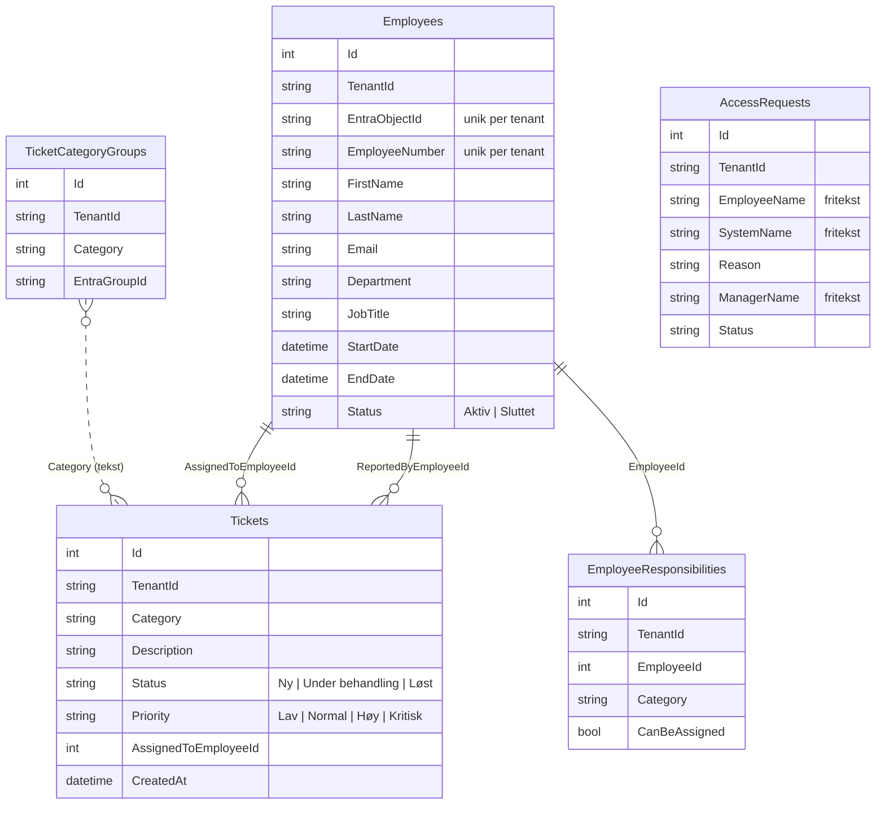

# Utvidelsesplan: fra helpdesk til IT-driftsplattform

| | |
|---|---|
| Status | v0.3 (2026-11-16): fase 4 lagt til (varsler blir saker, Teams). v0.2: skrevet om fra MSP-modell til én organisasjon med egne tenanter |
| Utgangspunkt | `main` @ `2208729` |
| Prinsipp | Helpdesken er fundamentet. Vi bygger videre på eksisterende modeller, kontrollere, tjenester og skjermbilder, uten ny arkitektur fra bunnen av. |
| Forhold til andre dokumenter | Dette dokumentet er **hovedplanen**. `TARGET_ARCHITECTURE.md`, `DATABASE_DESIGN.md`, `GRAPH_API_INTEGRATIONS.md`, `AZURE_INTEGRATIONS.md` og `DEVELOPMENT_ROADMAP.md` ble skrevet for en MSP-modell med mange kunder. De brukes bare som teknisk referanse for Graph-endepunkter, Azure-API-er og sikkerhetssjekker. Se merknaden øverst i hvert av dem. |

---

## 1. Produktmodell

**Løsningen er et produkt som én organisasjon kjører selv.** Antire drifter ikke IT for andre. Andre organisasjoner kan kjøpe løsningen og kjøre den i sitt eget miljø.

| Prinsipp | Betydning |
|---|---|
| **Én organisasjon per installasjon** | Ingen kundeorganisasjoner, ingen kundevelger, ingen Lighthouse eller GDAP |
| **Organisasjonens egne tenanter** | Én installasjon kan brukes i flere av organisasjonens egne Entra-tenanter, f.eks. **test** og **prod** |
| **Tenant følger innloggingen** | Du jobber i den tenanten du logger inn i (`tid`-claimet). For å bytte tenant logger du inn med kontoen i den andre tenanten. |
| **Data adskilt per tenant** | Saker, ansatte, bestillinger og konfigurasjon i én tenant er aldri synlige fra en annen |
| **Tillatte tenanter i oppsettet** | `Tenants:Allowed` i `appsettings.json`; andre tenanter avvises |

### 1.1 Tenanter i utviklingen nå

| Tenant | Bruk |
|---|---|
| `3af5c92b-…` (agkservicesknutsenhotmail) | **Utvikling.** Appregistreringene ligger her, og dette er den eneste tillatte tenanten nå. |
| `94f56205-…` (Antire) | Mulig produksjon senere. **Røres ikke** før utviklingen er ferdig. |

---

## 2. Dagens løsning

### 2.1 Teknisk oppbygging

| Lag | Teknologi | Merknad |
|---|---|---|
| Frontend | React 19 + Vite + TypeScript, MSAL React | Én side (`App.tsx`) med meny og `activePage`. Felles `apiClient.ts` (`VITE_API_URL`), `useCurrentUser` for roller og tenant. Innlogging styres av `VITE_AUTHORITY`. |
| Backend | ASP.NET Core (.NET 10), kontrollere | EF Core (PostgreSQL), Microsoft.Identity.Web, tilgangsregler i `AuthPolicies.cs`, tenant-kontekst i `TenantContext.cs` |
| Database | PostgreSQL via EF Core-migreringer | Alle helpdesk-tabeller har `TenantId` og globalt tenant-filter |
| Identitet | Entra ID | API-appen *Antire IT Operations API - Dev* med rollene `Helpdesk.Admin` og `EmployeeSync.Admin`; SPA-appen *Antire IT Operations Frontend - Dev*. Begge er foreløpig satt til én tenant. |
| Graph | `GraphService` | Én klient per tenant, kaller Graph i innlogget tenant |
| Tester | xUnit + WebApplicationFactory | 308 tester: tilgang og tenant, SLA-beregning og CSV, og revisjonslogg, tjenestekatalog, tildeling, SLA, IT-utstyr, tilgang via gruppe, Microsoft 365, Azure, varsler fra Defender og Azure Monitor med Teams (falsk Graph, Azure og Teams) mot SQLite i minnet (også gjennom API-et); ingen PostgreSQL-tester ennå (Docker mangler) |

### 2.2 Datamodell



### 2.3 API

| Kontroller | Endepunkter | Tilgang |
|---|---|---|
| `TicketsController` | `GET /api/tickets` (admin ser alle i tenanten, andre bare egne), `POST`, `PATCH {id}/status`, `{id}/priority`, `{id}/assign`, `GET me` (roller og tenant) | Endringer krever `Helpdesk.Admin` |
| `EmployeesController` | `GET`, `POST`, `PUT {id}`, `PATCH {id}/terminate` | Endringer krever `EmployeeSync.Admin` |
| `AccessRequestsController` | `GET`, `POST`, `PATCH {id}/approval`, `PATCH {id}/complete` | Godkjenning krever `Helpdesk.Admin` |
| `GraphController` | `GET employees`, `POST sync-employees`, `GET employees/{oid}/groups` | `EmployeeSync.Admin` |
| `TicketCategoryGroupsController` | `GET`, `POST`, `DELETE {id}` | `Helpdesk.Admin` |

Alle endepunkter krever innlogging fra en tillatt tenant.

### 2.4 Arbeidsflyter

| Flyt | Slik fungerer den |
|---|---|
| **Sak** | Brukeren oppretter en sak med kategori og beskrivelse. `TicketAssignmentService` finner en aktiv ansatt med ansvarsområde for kategorien som er medlem av en godkjent Entra-gruppe, og tildeler saken. Admin endrer status, prioritet og ansvarlig (nedtrekksliste). |
| **Tilgangsbestilling** | Fritekst (ansatt, system, begrunnelse, leder). Admin godkjenner eller avslår, og IT markerer som fullført. Ingen kobling til ansatt, gruppe eller sak. |
| **Ansatte** | «Synkroniser fra Entra» henter brukere med avdeling og stilling fra innlogget tenant og tildeler ansattnummer. Sluttdato registreres manuelt. |
| **Dashboard** | Teller nye, pågående, løste og kritiske åpne saker i tenanten |

### 2.5 Gjenstående svakheter

| Svakhet | Tas i |
|---|---|
| Godkjent tilgang må fortsatt gis manuelt i Entra | 2.4 |
| Revisjonslogg, katalog og SLA er ikke testet mot PostgreSQL (bare SQLite) | 0.10b |
| Klienthemmelighetene ligger fortsatt på app-registreringen (appen bruker sertifikat) | Fjernes når sertifikatet er bekreftet i bruk |
| Ingen databasetester (tenant-filteret er bare testet via tilgang) | 0.10b |

---

## 3. Utvidelsespunkter

| # | Utvidelsespunkt | Fil | Brukes til |
|---|---|---|---|
| U1 | `AppDbContext` | `backend/Data/AppDbContext.cs` | Nye entiteter implementerer `ITenantOwned` og får tenant-filter og automatisk `TenantId`. Revisjons-interceptor (1.2). |
| U2 | Tilgangsregler | `backend/Services/AuthPolicies.cs`, `Program.cs` | Nye app-roller (`Helpdesk.Agent` …) |
| U3 | Tenant og bruker | `backend/Services/TenantContext.cs`, `GET /api/tickets/me` | En `CurrentUserService` (innlogget person + roller) i tillegg til tenant |
| U4 | Sakstildeling | `backend/Services/TicketAssignmentService.cs` | Utvides med tjenestekatalog og SLA-frister |
| U5 | Graph | `backend/Services/GraphService.cs` | Nye metoder for grupper, lisenser, Secure Score, CA og Intune, alltid i innlogget tenant |
| U6 | Synk fra Entra | `GraphController.SyncEmployees` | Gjenbrukes for M365-brukeroversikt (2.2) |
| U7 | Kategorier | Hardkodet liste i `Helpdesk.tsx` | Erstattes av tjenestekatalogen (1.3) |
| U8 | Meny og sider | `frontend/src/App.tsx` | Plassholderne **IT-utstyr** og **Innstillinger** tas i bruk; nye sider for M365 og Azure |
| U9 | Roller i frontend | `frontend/src/useCurrentUser.ts` | Nye roller vises og skjules her |
| U10 | Migreringer | `backend/Migrations` | Én migrering per steg, med datamigrering av eksisterende rader |

---

## 4. Status for fase 0

| # | Arbeid | Status |
|---|---|---|
| 0.1 | Rollesjekk på alle endepunkter | Ferdig |
| 0.2 | Migrering for `employee_number_seq` | Ferdig |
| 0.3 | Graph: paging, `checkMemberGroups`, singleton | Ferdig |
| 0.5 | Ett felt for ansvarlig på saker | Ferdig |
| 0.7 | Synk fra Entra med ansattnummer | Ferdig |
| 0.8 | API-URL og CORS fra konfigurasjon | Ferdig |
| 0.10a | Testprosjekt med tilgangstester | Ferdig (71 tester) |
| T | Tenant-isolasjon (test og prod) | Ferdig |
| 0.6 | Engelske koder for status og prioritet | Ferdig (steg E) |
| 0.9 | Fjerne malrester og rydde `.gitignore` | Ferdig |
| 0.10b | Databasetester (Testcontainers) for tenant-filter | Gjenstår (krever Docker Desktop eller CI) |
| 0.12–0.13 | Bicep og GitHub Actions | Gjenstår (kan vente til utrulling) |

---

## 5. Fase 1: Fundament for drift

### 1.1 Roller og rettigheter (RBAC)

App-roller i Entra, tildelt i hver tenant:

| App-rolle | Status | Kan |
|---|---|---|
| `Helpdesk.Admin` | finnes | Alt i helpdesk, konfigurasjon (kategorier, katalog, SLA) |
| `EmployeeSync.Admin` | finnes | Synk og vedlikehold av ansatte |
| `Helpdesk.Agent` | finnes | Behandle saker (status, prioritet, ansvarlig) og fullføre tilgangsbestillinger, men ikke konfigurasjon |
| `Approver` | finnes | Godkjenne tilgangsbestillinger (`Helpdesk.Admin` kan også) |
| *(ingen rolle)* | — | Melde inn og følge egne saker og bestillinger |

**Endringer:**
- `CurrentUserService` (U3) gir innlogget person og roller ett sted.
- Tilgangsbestillinger begrenses for vanlige brukere til egne bestillinger, slik saker allerede er.
- Rollene opprettes i app-registreringen med et skript, slik at test og prod får de samme rollene.

**Ferdig når:** de nye rollene finnes i dev-tenanten og tilgangstestene dekker dem.

**Status (2026-11-16): ferdig.** Rollene finnes i dev-tenanten (`scripts/Set-AppRoles.ps1`), og tilgangsbestillinger har fått `RequestedByObjectId`, så vanlige brukere bare ser egne bestillinger. Rollesjekkene ligger foreløpig som `IsHelpdeskAgent()` og `IsAccessApprover()` i `AuthPolicies.cs`. En egen `CurrentUserService` lages når revisjonsloggen (1.2) trenger innlogget person.

### 1.2 Revisjonslogg (Audit Log)

```csharp
public class AuditEvent : ITenantOwned
{
    public long Id { get; set; }
    public string TenantId { get; set; } = "";
    public DateTime OccurredAt { get; set; }
    public string ActorObjectId { get; set; } = "";
    public string ActorName { get; set; } = "";
    public string EntityType { get; set; } = "";   // Ticket, Employee, AccessRequest …
    public string EntityId { get; set; } = "";
    public string Action { get; set; } = "";       // created | updated | deleted | approved | synced …
    public string? Changes { get; set; }           // jsonb: { felt: [før, etter] }
}
```

**Mekanisme:**
- En `SaveChangesInterceptor` logger opprettelse, endring og sletting automatisk for entiteter merket med `IAudited`.
- Forretningshendelser som godkjenning og synk logges eksplisitt.
- Det finnes ingen endepunkter som endrer eller sletter revisjonsrader.

**Skjermbilder:** historikk på hver sak, og en side for revisjonslogg under **Innstillinger** (`Helpdesk.Admin`).

**Ferdig når:** endring av status, prioritet og ansvarlig synes i sakens historikk med hvem og når.

**Status (2026-11-17): ferdig.** Migreringen `AddAuditLog` er kjørt i dev-databasen.
- Loggingen ligger i `AuditInterceptor` (`Data/AuditInterceptor.cs`), en `SaveChangesInterceptor` som registreres i `Program.cs`. Tenant-logikken ligger fortsatt i `AppDbContext`. Nye rader får ID først ved lagring, så hendelsene lagres i en andre runde (fra `SavedChanges`) i samme transaksjon.
- `IAudited` på `Ticket`, `AccessRequest`, `Employee`, `EmployeeResponsibility` og `TicketCategoryGroup`. Lagring uten faktiske endringer gir ingen hendelse.
- Forretningshendelser: `SetAuditAction` (approved, rejected, completed på tilgangsbestillinger) og `AddAuditEvent` (én `synced`-hendelse per synk fra Entra).
- Innlogget person kommer fra `ICurrentUser` (`Services/CurrentUser.cs`); uten innlogget bruker logges `system`.
- API: `GET /api/tickets/{id}/history` (samme tilgang som til saken) og `GET /api/audit` (`Helpdesk.Admin`, filter og bla bakover).
- Endring eller sletting av revisjonsrader stoppes i `AuditInterceptor`, og det finnes ingen endepunkter for det.
- Tester mot SQLite i minnet: `AuditTests` (9, interceptoren) og `HistoryEndpointTests` (9, gjennom API-et). Ferdig-kriteriet testes ende til ende: endring av status, prioritet og ansvarlig vises i `GET /api/tickets/{id}/history` med hvem og når. Tilgangstester for begge endepunktene ligger i `AuthorizationTests` og `TenantTests`.

### 1.3 Tjenestekatalog

```csharp
public class ServiceCatalogItem : ITenantOwned
{
    public int Id { get; set; }
    public string TenantId { get; set; } = "";
    public string Name { get; set; } = "";        // "Ny bruker", "Tilgang til system", "Bærbar PC" …
    public string Category { get; set; } = "";    // kobler til ansvarsområder og kategorigrupper
    public string? Description { get; set; }
    public string Type { get; set; } = "incident";// incident | request | access
    public string DefaultPriority { get; set; } = "normal";
    public bool RequiresApproval { get; set; }
    public string? EntraGroupId { get; set; }     // type=access: gruppen som gir tilgangen
    public bool IsActive { get; set; } = true;
}
```

- `Ticket.ServiceCatalogItemId` er valgfri. `Ticket.Category` settes fra katalogen, så automatisk tildeling virker uendret.
- `AccessRequest.ServiceCatalogItemId` erstatter fritekst-`SystemName` for nye bestillinger.
- Startinnhold: dagens fire kategorier.
- Under **Innstillinger** kommer skjermbilder for tjenestekatalog, ansvarsområder og kategorigrupper. De to siste mangler i dag.

**Ferdig når:** Helpdesk viser katalogen, og automatisk tildeling virker som før.

**Status (2026-11-17): ferdig.** Migreringen `AddServiceCatalog` er kjørt i dev-databasen.
- Startinnhold: første gang en tenant henter katalogen (eller en admin legger til en tjeneste), opprettes de fire sakskategoriene og de fem systemene fra det gamle tilgangsskjemaet (Microsoft 365, Teams, SharePoint, Azure, «Annet system») som `access`-tjenester (`ServiceCatalogService`). Tjenester slettes aldri, bare deaktiveres, så gamle saker beholder koblingen.
- `DefaultPriority` bruker foreløpig de norske verdiene (`Normal` osv.). Engelske koder kommer med 0.6 i steg E.
- Sak med `ServiceCatalogItemId` får kategori og prioritet fra tjenesten; `Ticket.Category` brukes fortsatt av `TicketAssignmentService`, så tildelingen er uendret. Uten tjeneste virker API-et som før (kategori påkrevd).
- Tilgangsbestillinger krever en aktiv `access`-tjeneste; `SystemName` settes fra navnet. `RequiresApproval` og `EntraGroupId` lagres, men tas i bruk først i 2.4.
- API: `GET /api/servicecatalog` (alle innloggede, aktive tjenester; `?type=` og `?includeInactive=true` for admin), `POST`/`PUT /api/servicecatalog` og `/api/employeeresponsibilities` (GET, POST, PATCH, DELETE) for `Helpdesk.Admin`.
- Innstillinger har faner for tjenestekatalog, ansvarsområder, kategorigrupper og revisjonslogg.
- Tester: `ServiceCatalogTests` (17) mot SQLite gjennom API-et, med falsk Graph. Ferdig-kriteriet testes ende til ende: en sak meldt inn på en tjeneste får kategori og prioritet fra katalogen og tildeles automatisk ansatt med ansvarsområdet som er medlem av kategorigruppen.

### 1.4 SLA-håndtering (+ 0.6 engelske koder)

```csharp
public class SlaTarget : ITenantOwned
{
    public int Id { get; set; }
    public string TenantId { get; set; } = "";
    public string Priority { get; set; } = "";       // low | normal | high | critical
    public int ResponseMinutes { get; set; }
    public int ResolutionMinutes { get; set; }
    public bool TwentyFourSeven { get; set; }        // f.eks. kritisk døgnet rundt
}
```

**Nye felter på `Ticket`:** `ResponseDueAt`, `ResolutionDueAt`, `FirstRespondedAt`, `ResolvedAt`.

**Regler:**
- Fristene beregnes ved opprettelse og ved endring av prioritet. `SlaCalculator` tar hensyn til arbeidstid og norske helligdager og har enhetstester.
- `FirstRespondedAt` settes første gang en agent endrer status eller ansvarlig. `ResolvedAt` settes ved løst og nullstilles ved gjenåpning.
- En bakgrunnsjobb markerer brudd og fare for brudd.
- Status og prioritet går over til engelske koder (`new`, `in_progress`, `resolved`; `low` … `critical`) med norske visningsnavn.

**Skjermbilder:** frist og SLA-status per sak, filteret «SLA i fare», og dashboardkortene «Brudd» og «I fare».

**Ferdig når:** en kritisk sak får riktig frist, og brudd vises i dashboard.

**Status (2026-11-17): ferdig.** Migreringen `AddSlaAndTicketCodes` er kjørt i dev-databasen.
- **Koder (0.6):** saker bruker `new`, `in_progress`, `resolved` og `low` … `critical`, også `DefaultPriority` i tjenestekatalogen. Migreringen konverterer eksisterende rader (og setter tom prioritet til `normal`). Revisjonsloggen beholder de gamle norske verdiene, og frontend viser begge. Tilgangsbestillinger og ansatte beholder norske statuser.
- **Arbeidstid:** 08:00–16:00 norsk tid på virkedager, uten helligdager (påske, Kristi himmelfart og pinse beregnes per år). Ligger i `Services/Sla.cs` (`NorwegianHolidays`, `SlaCalculator`, `SlaEvaluator`).
- **Standard SLA-mål** (opprettes per tenant første gang de trengs, kan endres under Innstillinger → SLA): kritisk 30 min / 4 t døgnet rundt, høy 1 t / 1 arbeidsdag, normal 4 t / 3 arbeidsdager, lav 1 / 5 arbeidsdager.
- **SLA-status** (`ok`, `at_risk`, `breached`, `met`, `none`) beregnes når sakene hentes og lagres ikke. «I fare» betyr at under 25 % av tiden er igjen til en frist som ikke er nådd.
- **Bakgrunnsjobb:** `SlaMonitorService` markerer brudd hvert 5. minutt i alle tillatte tenanter (`ResponseBreachedAt`, `ResolutionBreachedAt`, to felt i tillegg til planen) og logger `sla_breached` i sakens historikk med aktør `system`. Slås av med `Sla:MonitorEnabled=false`.
- **Avgrensning:** eksisterende saker får ingen frist (de kan ikke beregnes i ettertid). Endrede SLA-mål gjelder nye saker og saker som får ny prioritet.
- **Skjermbilder:** SLA-merke og frister per sak, filteret «SLA i fare», dashboardkortene «Brudd» og «I fare», og fanen SLA under Innstillinger.
- **Tester:** `SlaCalculatorTests` (13: helligdager, arbeidstid, helg, påske, 24/7, status) og `SlaEndpointTests` (13: frister, respons, løst og gjenåpning, prioritetsendring, gamle verdier avvises, bruddjobben, tenant-skille, SLA-mål). Ferdig-kriteriet testes ende til ende: en kritisk sak får frist 30 min / 4 t, og en sak over fristen markeres og vises som brudd.

### 1.5 IT-utstyr

Tar i bruk menyplassholderen **IT-utstyr**.

```csharp
public class Asset : ITenantOwned
{
    public int Id { get; set; }
    public string TenantId { get; set; } = "";
    public string AssetTag { get; set; } = "";       // unik per tenant
    public string Type { get; set; } = "";           // laptop | desktop | mobile | monitor | other
    public string? Manufacturer { get; set; }
    public string? Model { get; set; }
    public string? SerialNumber { get; set; }
    public string Status { get; set; } = "in_use";   // in_stock | in_use | repair | retired
    public int? AssignedToEmployeeId { get; set; }
    public DateTime? PurchaseDate { get; set; }
    public DateTime? WarrantyEndsAt { get; set; }
    public string Source { get; set; } = "manual";   // manual | intune (fase 2)
    public string? ExternalId { get; set; }          // Intune device id
    public string? Notes { get; set; }
}
```

- `Ticket.AssetId` er valgfri, slik at en sak kan gjelde et utstyr.
- Ved sluttdato vises personens utstyr som sjekkliste for innlevering.
- Skjermbilder: liste med filter, detaljside med sakshistorikk, og CSV-import.

**Ferdig når:** utstyr kan registreres og tildeles ansatte, og vises på ansatt og sak.

**Status (2026-11-17): ferdig.** Migreringen `AddAssets` er kjørt i dev-databasen.
- `Asset` (`ITenantOwned`, `IAudited`) med koder for type og status, og `Ticket.AssetId`. Utstyrsnummeret er unikt i tenanten, uten hensyn til store og små bokstaver. Utstyr slettes ikke, men får status `retired`.
- **Regler** (`AssetService`): tildelt utstyr er `in_use`, og utstyr uten ansatt kan ikke være i bruk. Utstyr kan bare tildeles aktive ansatte, og tildelt utstyr kan ikke kasseres.
- **Tilgang:** Helpdesk.Agent og Helpdesk.Admin registrerer, endrer, tildeler og importerer. Andre ser bare utstyr tildelt dem selv, og kan bare knytte egne saker til eget utstyr.
- **API:** `GET /api/assets` (filter på status, type, ansatt og søk), `GET /api/assets/{id}` (med saker), `POST`, `PUT`, `PATCH /api/assets/{id}/assign` (`null` = innlevert) og `POST /api/assets/import`.
- **CSV-import:** semikolon eller komma, norske eller engelske overskrifter, norske eller engelske verdier for type og status, og datoer som `åååå-mm-dd` eller `dd.mm.åååå`. Ansatt angis med e-post. Eksisterende utstyrsnummer oppdateres med kolonnene i filen. Én feil stopper hele importen, og svaret lister radene som feiler.
- **Skjermbilder:** siden IT-utstyr (liste med filter, detaljer med saker, skjema og CSV-import med mal), «Gjelder utstyr» når en sak meldes inn, utstyrsnummer på saken, og utstyr på den ansatte. Har den ansatte sluttdato, vises utstyret som sjekkliste med knappen «Mottatt».
- **Tester:** `AssetTests` (10) og `CsvReaderTests` (2). Ferdig-kriteriet testes ende til ende: utstyr registreres, tildeles en ansatt, vises på den ansatte og på saken det gjelder, og leveres inn.

---

## 6. Fase 2: Microsoft 365 (innlogget tenant)

| # | Leveranse | Bygger på | Innhold |
|---|---|---|---|
| 2.1 | **Innlogging og tilkobling** | Finnes | Klienthemmeligheten byttes til sertifikat (eller managed identity i Azure). Når en ny tenant (prod) tas i bruk, settes app-registreringene til flere organisasjoner, det gis admin-samtykke der, og tenanten legges i `Tenants:Allowed`. |
| 2.2 | **Brukeroversikt** | `SyncEmployees` | Alle brukere, også uten avdeling og stilling: kontostatus, siste pålogging, MFA-registrering og lisenser |
| 2.3 | **Gruppeoversikt** | `GetUserGroupIdsAsync` | Grupper og medlemmer |
| 2.4 | **Tilgang via gruppe** | 1.3 og 1.2 | Godkjent tilgangsbestilling av typen `access` legger brukeren i Entra-gruppen automatisk, med revisjonslogg |
| 2.5 | **Lisensoversikt** | — | Kjøpte og brukte lisenser (`subscribedSkus`) og lisenser per bruker; markerer ubrukte lisenser på deaktiverte eller inaktive brukere |
| 2.6 | **Secure Score** | — | Daglig øyeblikksbilde for trend, og de viktigste anbefalingene |
| 2.7 | **Conditional Access** | — | Policyer med tilstand og enkle sjekker: MFA for alle, eldre autentisering blokkert, nødtilgangskontoer unntatt |
| 2.8 | **Intune-status** | `Asset` (1.5) | Enheter synkes inn i IT-utstyr (`Source = intune`) med etterlevelse, OS, siste synk og kryptering. Ikke-etterlevende enheter kan gi automatisk sak. |

**Graph-rettigheter (applikasjon), gitt med admin-samtykke i hver tenant:** `User.Read.All`, `GroupMember.Read.All`, `AuditLog.Read.All`, `Reports.Read.All`, `Organization.Read.All`, `SecurityEvents.Read.All`, `Policy.Read.All`, `DeviceManagementManagedDevices.Read.All`. Skrivetilgangen `GroupMember.ReadWrite.All` legges til først ved 2.4.

**Lagring:** grupper og CA hentes direkte fra Graph med kort cache. Bare det som trenger historikk lagres: Secure Score-trend, lisensforbruk og Intune-enheter i IT-utstyr. Nye tabeller implementerer `ITenantOwned`.

Detaljer om endepunkter, paging og struping (throttling) finnes i `GRAPH_API_INTEGRATIONS.md` (kapittel 3–6).

**Status (2026-11-17): delvis ferdig (2.2, 2.3 og 2.4).** Dev-tenanten (`3af5c92b`) har ingen lisenser, så delene som krever Entra ID P1, Microsoft 365 eller Intune venter. Migreringen `AddAccessRequestEmployee` er kjørt i dev-databasen.
- **2.2 Brukeroversikt** (`GET /api/m365/users`): alle brukere med kontostatus, medlem eller gjest, avdeling, stilling og lisenser. Siste pålogging og MFA hentes for seg og vises som «krever lisens» når rettighet (`AuditLog.Read.All`) eller lisens (Entra ID P1) mangler, i stedet for at oversikten feiler.
- **2.3 Grupper** (`GET /api/m365/groups` og `/groups/{id}/members`): type (Microsoft 365, sikkerhet, distribusjon), dynamisk medlemskap og medlemmer. Gruppene foreslås også der en gruppe-ID skal fylles inn (tjenestekatalog og kategorigrupper).
- **2.4 Tilgang via gruppe** (`AccessGrantService`): tilgangsbestillinger peker nå på en ansatt (`AccessRequest.EmployeeId`). Når en bestilling på et system med Entra-gruppe godkjennes, legges den ansatte i gruppen og bestillingen blir «Fullført». Revisjonsloggen får `access_granted`. Feiler Graph, står godkjenningen, `access_grant_failed` logges, og IT kan prøve igjen (`POST /api/accessrequests/{id}/grant`) eller fullføre manuelt. Systemer uten krav om godkjenning gir tilgang med en gang, men bare når du bestiller til deg selv.
- **Tilgang og cache:** oversiktene er for `Helpdesk.Admin` og caches i 5 minutter per tenant (knappen Oppdater henter på nytt). Manglende rettighet gir en lesbar melding (502) i stedet for en feil i appen.
- **Graph-rettigheter:** appen har `User.Read.All` og `GroupMember.Read.All`. 2.4 krever `GroupMember.ReadWrite.All` med admin-samtykke; til den er gitt, ender godkjente bestillinger på systemer med gruppe som «Godkjent» med en forklaring.
- **2.1 Sertifikat (2026-11-17): ferdig.** `AppCredentials` velger innlogging mot Graph og Azure: managed identity (`MicrosoftGraph:UseManagedIdentity`), sertifikat fra sertifikatlageret (`CertificateThumbprint`) eller .pfx-fil (`CertificatePath`), og til slutt klienthemmeligheten. Et sertifikat som er konfigurert men ikke finnes, gir en tydelig feil i stedet for å falle tilbake til hemmeligheten. `scripts/New-AppCertificate.ps1` lager et selvsignert sertifikat (privat nøkkel kan ikke eksporteres), legger den offentlige delen til på app-registreringen og setter tommelavtrykket i user secrets. Kjørt i dev-tenanten: appen logger nå inn med sertifikat mot både Graph og Azure. Klienthemmelighetene ligger fortsatt på app-registreringen og i user secrets til de fjernes. Når appen tas i bruk for flere tenanter (prod), settes app-registreringene til flere organisasjoner, det gis admin-samtykke der, og tenanten legges i `Tenants:Allowed`.
- **Gjenstår:** 2.5 lisensoversikt, 2.6 Secure Score, 2.7 Conditional Access og 2.8 Intune. De krever lisens i tenanten for å kunne testes.
- **Tester:** `AccessGrantTests` (8) og `M365Tests` (4) med falsk Graph, pluss tilgangstester for de nye endepunktene.

---

## 7. Fase 3: Azure (innlogget tenant)

| # | Leveranse | Innhold |
|---|---|---|
| 3.1 | **Tilkobling** | Appens tjenestekonto (service principal) i tenanten får rollen **Reader** på abonnementene som skal vises, med en enkel veiledning eller et skript. Ingen Lighthouse. |
| 3.2 | **Abonnementsoversikt** | Ny tabell `AzureSubscriptions` (`ITenantOwned`) synket med ARM: navn, tilstand og sist sett |
| 3.3 | **Ressursoversikt** | Resource Graph-spørring på tvers av abonnementene: type, navn, region, ressursgruppe og tagger, med filter og søk. Lagres ikke i første versjon. |

Kostnader og Defender for Cloud-anbefalinger kan komme senere. Varsler fra Azure Monitor og Defender er beskrevet i fase 4. Detaljene er beskrevet i `AZURE_INTEGRATIONS.md` (del A, kapittel 2), men der må «Lighthouse» leses som «Reader-rolle til appen i egen tenant».

**Status (2026-11-17): ferdig.** Migreringen `AddAzureSubscriptions` er kjørt i dev-databasen, og appen har Reader på de tre abonnementene i dev-tenanten (Aitrening, Aitrening2 og az-700), gitt med skriptet. Synk og ressursoversikt er testet mot ekte Azure.
- **3.1 Tilkobling:** `scripts/Grant-AzureReader.ps1` gir appens tjenestekonto rollen Reader på ett eller flere abonnementer. Skriptet stopper hvis Azure CLI står i feil tenant, og hopper over tildelinger som finnes. Appen bruker samme app-registrering og hemmelighet som for Graph (`AzureService`).
- **3.2 Abonnementer** (`AzureSubscription`, `ITenantOwned`, `IAudited`): `POST /api/azure/subscriptions/sync` henter abonnementene appen ser fra Azure Resource Manager. Nye legges til, eksisterende oppdateres, og de appen ikke lenger ser, får `IsVisible = false` i stedet for å slettes. Hver synk logges.
- **3.3 Ressurser** (`GET /api/azure/resources`): Resource Graph på tvers av synlige abonnementer (maks 5000), cachet i 5 minutter. Filter på abonnement, type, region og ressursgruppe, og søk i navn, ressursgruppe og tagger, gjøres i backend på listen, slik at brukerens tekst aldri blir en del av spørringen mot Azure. Lagres ikke.
- **Tilgang:** `Helpdesk.Admin`. Mangler appen Reader, gir API-et en lesbar melding (502) med henvisning til skriptet.
- **Skjermbilder:** siden Azure med fanene Abonnementer (liste og knappen Synk fra Azure) og Ressurser (filter, søk og tagger).
- **Tester:** `AzureTests` (4) med falsk Azure, pluss tilgangstester for de nye endepunktene.

---

## 8. Fase 4: Varsler blir saker, og Teams-integrasjon

Varsler fra Azure og Microsoft Defender blir helpdesk-saker automatisk, og IT får beskjed i Teams. Fasen bygger på saker (`Ticket`), revisjonsloggen (1.2), tjenestekatalogen (1.3), SLA (1.4), Graph-tilkoblingen (2.1) og Azure-tilkoblingen (3.1).

### 4.1 Varselmottak (felles fundament)

| Del | Innhold |
|---|---|
| **Ny tabell `Alerts`** (`ITenantOwned`, `IAudited`) | `Source` (`azure-monitor`, `defender`), `ExternalId` (varselets ID hos kilden), `Title`, `Severity`, `ResourceId`, `State` (`fired`/`resolved`), `FirstSeenAt`, `LastSeenAt`, `Occurrences`, `RawPayload` (jsonb) og `TicketId`. Unik indeks på (`TenantId`, `Source`, `ExternalId`). |
| **Nye felt på `Ticket`** | `Source` (`manual` som standard, ellers `alert`) og `AlertId`. Eksisterende saker får `manual` i migreringen. |
| **`AlertIngestionService`** | Ett felles inngangspunkt for alle kilder: finn eller opprett `Alert` → opprett sak hvis ingen åpen sak finnes for varselet → send til Teams (4.4). |
| **Deduplisering** | Samme varsel på nytt (samme `ExternalId`) gir ikke ny sak, men øker `Occurrences` og `LastSeenAt` og logges i revisjonsloggen. Fyrer varselet etter at saken er **Løst**, gjenåpnes saken (status **Ny**) i stedet for at det lages en ny. |
| **Når varselet løses hos kilden** | `State` settes til `resolved`, og det logges på saken. Saken lukkes **ikke** automatisk i første versjon (se avklaring 6). |
| **Regler** (Innstillinger) | Ny tabell `AlertRules`: kilde, minste alvorlighetsgrad som gir sak, kategori og ansvarsgruppe fra tjenestekatalogen, og om Teams skal varsles. Standard: Azure Sev0–2 og Defender høy/middels gir sak. Lavere alvorlighetsgrad lagres som varsel uten sak. |
| **Prioritet** | Azure Sev0 → **Kritisk**, Sev1 → **Høy**, Sev2 → **Normal**, Sev3–4 → **Lav**. Defender høy → **Høy**, middels → **Normal**, lav/informasjon → **Lav**. Kan overstyres per regel. |
| **Sakstekst** | Tittel, alvorlighetsgrad, berørt ressurs, tidspunkt og lenke til varselet i Azure-portalen eller Defender-portalen. Saken meldes inn av **system**, og tildeling skjer via `TicketAssignmentService` med kategori fra regelen. |
| **Bakgrunnsjobb** | En `BackgroundService` som henter varsler for hver tenant i `Tenants:Allowed`. Den kjører uten innlogget bruker, så `ITenantContext` må kunne settes eksplisitt per tenant i et eget scope (revisjonsloggen bruker da aktøren **system**). |
| **Skjermbilde** | Ny side **Varsler** med alle mottatte varsler, filter på kilde, alvorlighetsgrad og tilstand, og lenke til saken. På saken vises et merke «Fra varsel» med kilde og antall forekomster. |

### 4.2 Azure Alert → sak

| Del | Innhold |
|---|---|
| **Henting (første versjon)** | Alerts Management API (`Microsoft.AlertsManagement/alerts`) for hvert abonnement fra 3.2, hvert 5. minutt. Krever bare **Reader** (3.1), og virker også når backend kjører lokalt. |
| **Webhook (når appen kjører i Azure)** | Action group med *secure webhook* og Common Alert Schema → `POST /api/hooks/azure-monitor`. Endepunktet krever et Entra-token utstedt til action group-ens app og en tillatt tenant. Hentingen hvert 5. minutt beholdes som avstemming, slik at ingen varsler går tapt. |
| **Hva som fanges** | Metrikkvarsler, loggvarsler, aktivitetsloggvarsler, Service Health og Resource Health, altså alt som fyrer i Azure Monitor. |
| **Grunnoppsett (valgfritt)** | Et Bicep-skript som oppretter action group og noen standardvarsler (Service Health, Resource Health, VM nede, disk nesten full). Kjøres bare i dev-tenanten til du sier fra. |

### 4.3 Defender Alert → sak

| Del | Innhold |
|---|---|
| **Kilde** | Graph Security API `GET /security/alerts_v2`, som samler varsler fra Defender for Endpoint, Office 365, Identity, Cloud Apps og Defender for Cloud (når det er koblet til Defender XDR). |
| **Henting** | Hvert 5. minutt med filter på `lastUpdateDateTime`, slik at bare nye og endrede varsler hentes. |
| **Rettighet** | Graph-applikasjonsrettigheten `SecurityAlert.Read.All` med admin-samtykke. Skrivetilgang (`SecurityAlert.ReadWrite.All`) for å sette varselet til «løst» i Defender når saken lukkes, kommer eventuelt senere. |
| **Lisens** | Krever Defender-lisens i tenanten (f.eks. Microsoft 365 Business Premium eller E5). Uten lisens er listen bare tom. |
| **Kategori** | Defender-varsler går til en egen kategori **Sikkerhet** i tjenestekatalogen, slik at de kan tildeles en egen ansvarsgruppe. |

### 4.4 Teams-integrasjon

| Del | Innhold |
|---|---|
| **Kanal** | En Teams-kanal for IT-drift (per tenant) som mottar meldinger via en **Workflows-webhook** («Post to a channel when a webhook request is received»). De gamle Office 365-connectorene er avviklet av Microsoft og brukes ikke. |
| **Oppsett** | Webhook-URL-en lagres per tenant i Innstillinger (kun **Helpdesk.Admin**) og behandles som en hemmelighet: den vises maskert og lagres utenfor koden (user secrets lokalt, Key Vault i Azure). Knappen **Send testmelding** bekrefter oppsettet. |
| **Hva som sendes** | Adaptive Card ved ny sak fra varsel, ved varsel som gjenåpner en sak, og (valgfritt) ved nye manuelle saker med prioritet **Kritisk**. Kortet viser tittel, alvorlighetsgrad, ressurs og en knapp **Åpne sak** som lenker til saken i appen. |
| **Feil** | Sending skjer etter at saken er lagret. Feiler Teams, beholdes saken, feilen logges, og meldingen forsøkes på nytt ved neste kjøring av bakgrunnsjobben. |
| **Senere** | Knapper som gjør noe i selve kortet (f.eks. **Ta saken**, **Godkjenn tilgang**) krever en Teams-bot (Bot Framework) og kommer eventuelt i en senere fase. |

### 4.5 Tester

Tester for deduplisering, gjenåpning, prioritetsmapping, regler, tenant-separasjon (et varsel fra én tenant gir aldri sak i en annen), webhook-autentisering og at Teams-feil ikke stopper saksopprettelsen. Azure, Graph og Teams byttes ut med falske implementasjoner i testene.

**Ferdig når:** et testvarsel som fyres i dev-tenanten (`3af5c92b`), både fra Azure Monitor og fra Defender (eller simulert), blir én sak med riktig prioritet og ansvarlig, vises i Teams-kanalen innen 5 minutter, og et nytt varsel av samme type gir ikke en ny sak.

**Status steg I (2026-11-17): bygget, uten ekte Teams og Defender.** Dev-tenanten har verken Teams eller Defender (ingen lisenser), så begge er testet mot falske tjenester og med simulerte varsler. Migreringen `AddAlertsAndTeams` er kjørt i dev-databasen.
- **4.1 Varselmottak** (`AlertIngestionService`): `Alerts`, `AlertRules`, `Ticket.Source` og `Ticket.AlertId` som beskrevet. Bare saken peker på varselet med fremmednøkkel (`Alert.TicketId` er en vanlig kolonne), slik at begge kan lagres i samme flyt. En ny forekomst er et nytt tidspunkt for når varselet fyrte: samme varsel hentet på nytt endrer ingenting og logges ikke. Ny forekomst på en åpen sak logges på saken (`alert_recurred`), en løst sak gjenåpnes (`reopened_by_alert`), og «løst hos kilden» logges (`alert_resolved`) uten at saken lukkes. Standardregler: Azure Sev0–2 og Defender høy/middels gir sak, med kategoriene Feil og Sikkerhet.
- **Bakgrunnsjobb** (`AlertMonitorService`, hvert 5. minutt, `Alerts:MonitorEnabled`): henter Defender-varsler og prøver Teams-meldinger på nytt for hver tillatt tenant. Jobbene setter tenanten i sitt eget DI-scope (`CreateTenantScope`), så SLA, tildeling og revisjonslogg (aktør `system`) virker som i API-et. SLA-jobben bruker nå samme mønster.
- **4.3 Defender** (`GraphService.GetDefenderAlertsAsync`, `alerts_v2` filtrert på `lastUpdateDateTime`): krever `SecurityAlert.Read.All` og lisens. Mangler de, vises årsaken under Varsler → Kilder.
- **Simulert varsel** (`POST /api/alerts/simulate`, `Helpdesk.Admin`): sender et testvarsel gjennom hele flyten, slik at ferdig-kriteriet kan prøves uten Defender.
- **4.4 Teams**: webhook-adressen legges inn under Innstillinger → Teams og lagres kryptert i databasen med ASP.NET Data Protection (ikke i user secrets eller Key Vault, siden admin legger den inn i appen). Bare Workflows-adresser over https godtas, adressen vises maskert, og revisjonsloggen viser bare at den er endret. Adaptive Card ved ny sak fra varsel, gjenåpning og (valgfritt) nye kritiske manuelle saker, med knappen «Åpne sak» (`?sak=…` åpner Helpdesk med saken). Meldinger legges i en kø (`TeamsNotifications`) og prøves på nytt inntil 5 ganger; feil i Teams stopper aldri saken.
- **Når appen kjører i Azure:** nøklene til Data Protection må lagres felles (f.eks. Blob Storage og Key Vault), ellers kan ikke adressen leses etter omstart på en annen instans.
- **Skjermbilder:** siden Varsler (kilder, liste med filter og lenke til saken, simulering), merket «Fra varsel» med kilde og forekomster på saken, og fanene Varselregler og Teams under Innstillinger.
- **Tester:** `AlertTests` (20) med falsk Graph og Teams: prioritet, terskel, deduplisering, gjenåpning, løst hos kilden, tenant-skille, regler, bakgrunnsjobben, Teams-kort, kø og nytt forsøk, adressekontroll og maskering.
- **Gjenstår for ferdig-kriteriet:** ekte Teams-kanal og Defender-varsel krever lisens. 4.2 (Azure Monitor) er steg J.

**Status steg J (2026-11-17): henting ferdig og testet mot ekte Azure; webhook venter til appen kjører i Azure.** Ingen ny migrering. Et aktivitetsloggvarsel i abonnementet Aitrening (6 forekomster) ble ett varsel og én sak.
- **Henting** (`AzureService.ListMonitorAlertsAsync`): Alerts Management API for hvert synket og synlig abonnement, varsler fra de siste 7 dagene, hvert 5. minutt i `AlertMonitorService`. Krever bare Reader. Abonnementer appen ikke har tilgang til, hoppes over.
- **Samme varsel = samme regel på samme ressurs** (`ExternalId` = `alertRule|targetResource`). Azure gir ofte en ny varsel-ID når et varsel fyrer igjen etter å ha vært løst; med regel og ressurs som nøkkel gjenåpnes saken i stedet for at det lages en ny, som planen sier.
- **Bare siste forekomst per varsel** brukes i hver henting, og «løst» for en eldre forekomst enn den siste ignoreres. Ellers ville et varsel med én løst og én ny forekomst veksle mellom løst og fyrt ved hver henting.
- **Webhook** (`POST /api/hooks/azure-monitor` med secure webhook) er ikke bygget: Azure kan ikke nå appen mens den kjører lokalt. Hentingen virker uansett og blir avstemming når webhooken kommer.
- **Tester:** `AzureMonitorAlertTests` (3) og `AzureMonitorParseTests` (2): sak og gjenåpning, ingen veksling, status uten abonnementer og uten tilgang, tolkning av svaret og lange ID-er.

---

## 9. Gjennomføring

| Steg | Innhold | Estimat (1–2 utviklere) |
|---|---|---|
| A | Felles API-klient, CORS og testprosjekt | Ferdig |
| T | Tenant-isolasjon | Ferdig |
| B | 0.9 opprydding + 1.1 RBAC | Ferdig |
| C | 1.2 Revisjonslogg | Ferdig |
| D | 1.3 Tjenestekatalog og skjermbilder for konfigurasjon | Ferdig |
| E | 0.6 Engelske koder + 1.4 SLA | Ferdig |
| F | 1.5 IT-utstyr | Ferdig |
| G | Fase 2 (2.1–2.8) | Delvis: 2.1–2.4 ferdig; 2.5–2.8 venter på lisens |
| H | Fase 3 (3.1–3.3) | Ferdig |
| I | 4.1 Varselmottak + 4.3 Defender → sak + 4.4 Teams | Bygget; ekte Teams og Defender venter på lisens |
| J | 4.2 Azure Alert → sak (henting, deretter webhook når appen kjører i Azure) | Henting ferdig; webhook venter til appen kjører i Azure |

**Arbeidsmåte per steg:** én migrering, backend med tester, frontend, test i dev-tenanten (`3af5c92b`), og deretter commit til `main`. Produksjonstenanten tas først i bruk når du sier fra.

---

## 10. Avklaringer

1. **SLA:** hvilke responstider og løsningstider per prioritet? Skal noe gå døgnet rundt?
2. **Arbeidstid:** 08–16 mandag–fredag med norske helligdager?
3. **Godkjenning av tilgang:** skal leder godkjenne (rollen `Approver`), eller holder det med IT?
4. **Test-tenant:** skal en egen test-tenant tas i bruk i tillegg til dev-tenanten før prod?
5. **Teams:** hvilken kanal skal motta varsler, og skal kritiske manuelle saker også varsles der?
6. **Løste varsler:** skal saken lukkes automatisk når varselet løses i Azure eller Defender, eller skal IT alltid lukke den selv?
7. **Terskel:** gir Azure Sev0–2 og Defender høy/middels sak, eller skal flere (eller færre) varsler bli saker?
8. **Rekkefølge:** steg I trenger bare en ny Graph-rettighet og kan flyttes foran fase 2 og 3 hvis varsler er viktigere enn M365- og Azure-oversiktene.
