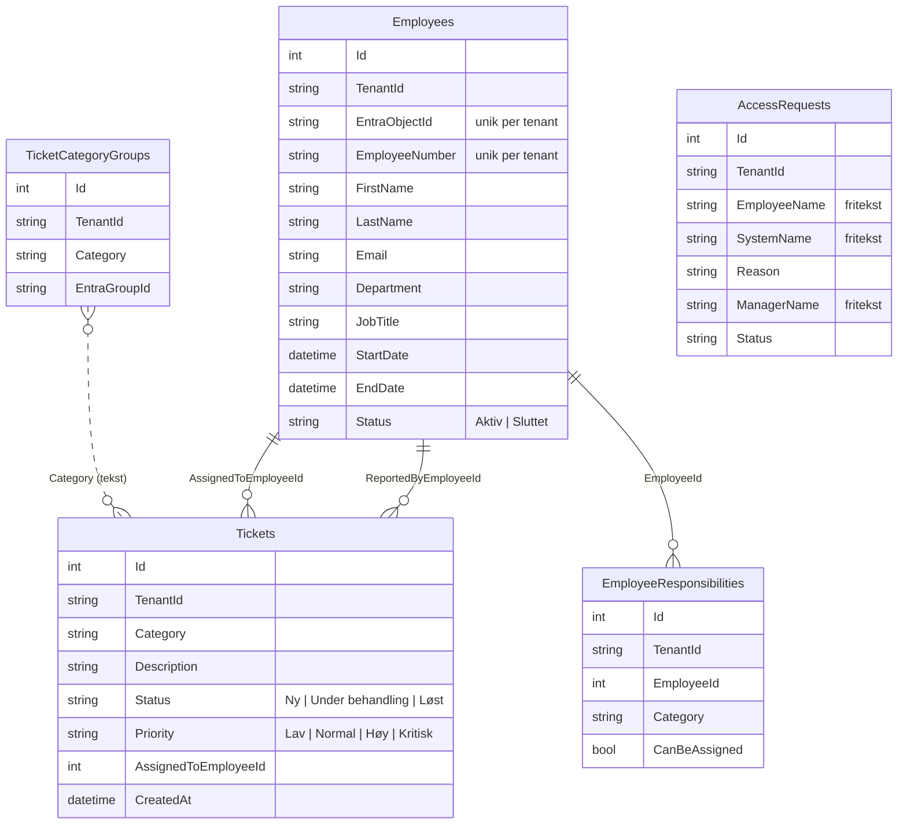

# Utvidelsesplan: fra helpdesk til IT-driftsplattform

| | |
|---|---|
| Status | v0.2 (2026-11-16): skrevet om fra MSP-modell til én organisasjon med egne tenanter |
| Utgangspunkt | `main` @ `2208729` |
| Prinsipp | Helpdesken er fundamentet. Vi bygger videre på eksisterende modeller, kontrollere, tjenester og skjermbilder, uten ny arkitektur fra bunnen av. |
| Forhold til andre dokumenter | Dette dokumentet er **hovedplanen**. `TARGET_ARCHITECTURE.md`, `DATABASE_DESIGN.md`, `GRAPH_API_INTEGRATIONS.md`, `AZURE_INTEGRATIONS.md` og `DEVELOPMENT_ROADMAP.md` ble skrevet for en MSP-modell med mange kunder. De brukes bare som teknisk referanse for Graph-endepunkter, Azure-API-er og sikkerhetssjekker. Se merknaden øverst i hvert av dem. |

---

## 1. Produktmodell

**Løsningen er et produkt som én organisasjon kjører selv.** Antire drifter ikke IT for andre. Andre organisasjoner kan kjøpe løsningen og kjøre den i sitt eget miljø.

| Prinsipp | Betydning |
|---|---|
| **Én organisasjon per installasjon** | Ingen kundeorganisasjoner, ingen kundevelger, ingen Lighthouse eller GDAP |
| **Organisasjonens egne tenanter** | Én installasjon kan brukes i flere av organisasjonens egne Entra-tenanter, f.eks. **test** og **prod** |
| **Tenant følger innloggingen** | Du jobber i den tenanten du logger inn i (`tid`-claimet). For å bytte tenant logger du inn med kontoen i den andre tenanten. |
| **Data adskilt per tenant** | Saker, ansatte, bestillinger og konfigurasjon i én tenant er aldri synlige fra en annen |
| **Tillatte tenanter i oppsettet** | `Tenants:Allowed` i `appsettings.json`; andre tenanter avvises |

### 1.1 Tenanter i utviklingen nå

| Tenant | Bruk |
|---|---|
| `3af5c92b-…` (agkservicesknutsenhotmail) | **Utvikling.** Appregistreringene ligger her, og dette er den eneste tillatte tenanten nå. |
| `94f56205-…` (Antire) | Mulig produksjon senere. **Røres ikke** før utviklingen er ferdig. |

---

## 2. Dagens løsning

### 2.1 Teknisk oppbygging

| Lag | Teknologi | Merknad |
|---|---|---|
| Frontend | React 19 + Vite + TypeScript, MSAL React | Én side (`App.tsx`) med meny og `activePage`. Felles `apiClient.ts` (`VITE_API_URL`), `useCurrentUser` for roller og tenant. Innlogging styres av `VITE_AUTHORITY`. |
| Backend | ASP.NET Core (.NET 10), kontrollere | EF Core (PostgreSQL), Microsoft.Identity.Web, tilgangsregler i `AuthPolicies.cs`, tenant-kontekst i `TenantContext.cs` |
| Database | PostgreSQL via EF Core-migreringer | Alle helpdesk-tabeller har `TenantId` og globalt tenant-filter |
| Identitet | Entra ID | API-appen *Antire IT Operations API - Dev* med rollene `Helpdesk.Admin` og `EmployeeSync.Admin`; SPA-appen *Antire IT Operations Frontend - Dev*. Begge er foreløpig satt til én tenant. |
| Graph | `GraphService` | Én klient per tenant, kaller Graph i innlogget tenant |
| Tester | xUnit + WebApplicationFactory | 41 tester for tilgang og tenant; ingen databasetester ennå (Docker mangler) |

### 2.2 Datamodell



### 2.3 API

| Kontroller | Endepunkter | Tilgang |
|---|---|---|
| `TicketsController` | `GET /api/tickets` (admin ser alle i tenanten, andre bare egne), `POST`, `PATCH {id}/status`, `{id}/priority`, `{id}/assign`, `GET me` (roller og tenant) | Endringer krever `Helpdesk.Admin` |
| `EmployeesController` | `GET`, `POST`, `PUT {id}`, `PATCH {id}/terminate` | Endringer krever `EmployeeSync.Admin` |
| `AccessRequestsController` | `GET`, `POST`, `PATCH {id}/approval`, `PATCH {id}/complete` | Godkjenning krever `Helpdesk.Admin` |
| `GraphController` | `GET employees`, `POST sync-employees`, `GET employees/{oid}/groups` | `EmployeeSync.Admin` |
| `TicketCategoryGroupsController` | `GET`, `POST`, `DELETE {id}` | `Helpdesk.Admin` |

Alle endepunkter krever innlogging fra en tillatt tenant.

### 2.4 Arbeidsflyter

| Flyt | Slik fungerer den |
|---|---|
| **Sak** | Brukeren oppretter en sak med kategori og beskrivelse. `TicketAssignmentService` finner en aktiv ansatt med ansvarsområde for kategorien som er medlem av en godkjent Entra-gruppe, og tildeler saken. Admin endrer status, prioritet og ansvarlig (nedtrekksliste). |
| **Tilgangsbestilling** | Fritekst (ansatt, system, begrunnelse, leder). Admin godkjenner eller avslår, og IT markerer som fullført. Ingen kobling til ansatt, gruppe eller sak. |
| **Ansatte** | «Synkroniser fra Entra» henter brukere med avdeling og stilling fra innlogget tenant og tildeler ansattnummer. Sluttdato registreres manuelt. |
| **Dashboard** | Teller nye, pågående, løste og kritiske åpne saker i tenanten |

### 2.5 Gjenstående svakheter

| Svakhet | Tas i |
|---|---|
| Status og prioritet er norske strenger brukt som nøkler | 0.6 (sammen med SLA) |
| Ansvarsområder og kategorigrupper har ikke noe skjermbilde | 1.3 |
| Tilgangsbestillinger er fritekst | 1.3 og 2.4 |
| Ingen revisjonslogg | 1.2 |
| Graph bruker klienthemmelighet | 2.1 |
| Ingen databasetester (tenant-filteret er bare testet via tilgang) | 0.10b |
| `WeatherForecastController`; feil linje i `.gitignore` | 0.9 |

---

## 3. Utvidelsespunkter

| # | Utvidelsespunkt | Fil | Brukes til |
|---|---|---|---|
| U1 | `AppDbContext` | `backend/Data/AppDbContext.cs` | Nye entiteter implementerer `ITenantOwned` og får tenant-filter og automatisk `TenantId`. Revisjons-interceptor (1.2). |
| U2 | Tilgangsregler | `backend/Services/AuthPolicies.cs`, `Program.cs` | Nye app-roller (`Helpdesk.Agent` …) |
| U3 | Tenant og bruker | `backend/Services/TenantContext.cs`, `GET /api/tickets/me` | En `CurrentUserService` (innlogget person + roller) i tillegg til tenant |
| U4 | Sakstildeling | `backend/Services/TicketAssignmentService.cs` | Utvides med tjenestekatalog og SLA-frister |
| U5 | Graph | `backend/Services/GraphService.cs` | Nye metoder for grupper, lisenser, Secure Score, CA og Intune, alltid i innlogget tenant |
| U6 | Synk fra Entra | `GraphController.SyncEmployees` | Gjenbrukes for M365-brukeroversikt (2.2) |
| U7 | Kategorier | Hardkodet liste i `Helpdesk.tsx` | Erstattes av tjenestekatalogen (1.3) |
| U8 | Meny og sider | `frontend/src/App.tsx` | Plassholderne **IT-utstyr** og **Innstillinger** tas i bruk; nye sider for M365 og Azure |
| U9 | Roller i frontend | `frontend/src/useCurrentUser.ts` | Nye roller vises og skjules her |
| U10 | Migreringer | `backend/Migrations` | Én migrering per steg, med datamigrering av eksisterende rader |

---

## 4. Status for fase 0

| # | Arbeid | Status |
|---|---|---|
| 0.1 | Rollesjekk på alle endepunkter | Ferdig |
| 0.2 | Migrering for `employee_number_seq` | Ferdig |
| 0.3 | Graph: paging, `checkMemberGroups`, singleton | Ferdig |
| 0.5 | Ett felt for ansvarlig på saker | Ferdig |
| 0.7 | Synk fra Entra med ansattnummer | Ferdig |
| 0.8 | API-URL og CORS fra konfigurasjon | Ferdig |
| 0.10a | Testprosjekt med tilgangstester | Ferdig (41 tester) |
| T | Tenant-isolasjon (test og prod) | Ferdig |
| 0.6 | Engelske koder for status og prioritet | Tas med SLA (1.4) |
| 0.9 | Fjerne malrester og rydde `.gitignore` | Gjenstår |
| 0.10b | Databasetester (Testcontainers) for tenant-filter | Gjenstår (krever Docker Desktop eller CI) |
| 0.12–0.13 | Bicep og GitHub Actions | Gjenstår (kan vente til utrulling) |

---

## 5. Fase 1: Fundament for drift

### 1.1 Roller og rettigheter (RBAC)

App-roller i Entra, tildelt i hver tenant:

| App-rolle | Status | Kan |
|---|---|---|
| `Helpdesk.Admin` | finnes | Alt i helpdesk, konfigurasjon (kategorier, katalog, SLA) |
| `EmployeeSync.Admin` | finnes | Synk og vedlikehold av ansatte |
| `Helpdesk.Agent` | ny | Behandle saker (status, prioritet, ansvarlig) og tilgangsbestillinger, men ikke konfigurasjon |
| `Approver` | ny | Godkjenne tilgangsbestillinger (erstatter midlertidig bruk av `Helpdesk.Admin`) |
| *(ingen rolle)* | — | Melde inn og følge egne saker og bestillinger |

**Endringer:**
- `CurrentUserService` (U3) gir innlogget person og roller ett sted.
- Tilgangsbestillinger begrenses for vanlige brukere til egne bestillinger, slik saker allerede er.
- Rollene opprettes i app-registreringen med et skript, slik at test og prod får de samme rollene.

**Ferdig når:** de nye rollene finnes i dev-tenanten og tilgangstestene dekker dem.

### 1.2 Revisjonslogg (Audit Log)

```csharp
public class AuditEvent : ITenantOwned
{
    public long Id { get; set; }
    public string TenantId { get; set; } = "";
    public DateTime OccurredAt { get; set; }
    public string ActorObjectId { get; set; } = "";
    public string ActorName { get; set; } = "";
    public string EntityType { get; set; } = "";   // Ticket, Employee, AccessRequest …
    public string EntityId { get; set; } = "";
    public string Action { get; set; } = "";       // created | updated | deleted | approved | synced …
    public string? Changes { get; set; }           // jsonb: { felt: [før, etter] }
}
```

**Mekanisme:**
- En `SaveChangesInterceptor` logger opprettelse, endring og sletting automatisk for entiteter merket med `IAudited`.
- Forretningshendelser som godkjenning og synk logges eksplisitt.
- Det finnes ingen endepunkter som endrer eller sletter revisjonsrader.

**Skjermbilder:** historikk på hver sak, og en side for revisjonslogg under **Innstillinger** (`Helpdesk.Admin`).

**Ferdig når:** endring av status, prioritet og ansvarlig synes i sakens historikk med hvem og når.

### 1.3 Tjenestekatalog

```csharp
public class ServiceCatalogItem : ITenantOwned
{
    public int Id { get; set; }
    public string TenantId { get; set; } = "";
    public string Name { get; set; } = "";        // "Ny bruker", "Tilgang til system", "Bærbar PC" …
    public string Category { get; set; } = "";    // kobler til ansvarsområder og kategorigrupper
    public string? Description { get; set; }
    public string Type { get; set; } = "incident";// incident | request | access
    public string DefaultPriority { get; set; } = "normal";
    public bool RequiresApproval { get; set; }
    public string? EntraGroupId { get; set; }     // type=access: gruppen som gir tilgangen
    public bool IsActive { get; set; } = true;
}
```

- `Ticket.ServiceCatalogItemId` er valgfri. `Ticket.Category` settes fra katalogen, så automatisk tildeling virker uendret.
- `AccessRequest.ServiceCatalogItemId` erstatter fritekst-`SystemName` for nye bestillinger.
- Startinnhold: dagens fire kategorier.
- Under **Innstillinger** kommer skjermbilder for tjenestekatalog, ansvarsområder og kategorigrupper. De to siste mangler i dag.

**Ferdig når:** Helpdesk viser katalogen, og automatisk tildeling virker som før.

### 1.4 SLA-håndtering (+ 0.6 engelske koder)

```csharp
public class SlaTarget : ITenantOwned
{
    public int Id { get; set; }
    public string TenantId { get; set; } = "";
    public string Priority { get; set; } = "";       // low | normal | high | critical
    public int ResponseMinutes { get; set; }
    public int ResolutionMinutes { get; set; }
    public bool TwentyFourSeven { get; set; }        // f.eks. kritisk døgnet rundt
}
```

**Nye felter på `Ticket`:** `ResponseDueAt`, `ResolutionDueAt`, `FirstRespondedAt`, `ResolvedAt`.

**Regler:**
- Fristene beregnes ved opprettelse og ved endring av prioritet. `SlaCalculator` tar hensyn til arbeidstid og norske helligdager og har enhetstester.
- `FirstRespondedAt` settes første gang en agent endrer status eller ansvarlig. `ResolvedAt` settes ved løst og nullstilles ved gjenåpning.
- En bakgrunnsjobb markerer brudd og fare for brudd.
- Status og prioritet går over til engelske koder (`new`, `in_progress`, `resolved`; `low` … `critical`) med norske visningsnavn.

**Skjermbilder:** frist og SLA-status per sak, filteret «SLA i fare», og dashboardkortene «Brudd» og «I fare».

**Ferdig når:** en kritisk sak får riktig frist, og brudd vises i dashboard.

### 1.5 IT-utstyr

Tar i bruk menyplassholderen **IT-utstyr**.

```csharp
public class Asset : ITenantOwned
{
    public int Id { get; set; }
    public string TenantId { get; set; } = "";
    public string AssetTag { get; set; } = "";       // unik per tenant
    public string Type { get; set; } = "";           // laptop | desktop | mobile | monitor | other
    public string? Manufacturer { get; set; }
    public string? Model { get; set; }
    public string? SerialNumber { get; set; }
    public string Status { get; set; } = "in_use";   // in_stock | in_use | repair | retired
    public int? AssignedToEmployeeId { get; set; }
    public DateTime? PurchaseDate { get; set; }
    public DateTime? WarrantyEndsAt { get; set; }
    public string Source { get; set; } = "manual";   // manual | intune (fase 2)
    public string? ExternalId { get; set; }          // Intune device id
    public string? Notes { get; set; }
}
```

- `Ticket.AssetId` er valgfri, slik at en sak kan gjelde et utstyr.
- Ved sluttdato vises personens utstyr som sjekkliste for innlevering.
- Skjermbilder: liste med filter, detaljside med sakshistorikk, og CSV-import.

**Ferdig når:** utstyr kan registreres og tildeles ansatte, og vises på ansatt og sak.

---

## 6. Fase 2: Microsoft 365 (innlogget tenant)

| # | Leveranse | Bygger på | Innhold |
|---|---|---|---|
| 2.1 | **Innlogging og tilkobling** | Finnes | Klienthemmeligheten byttes til sertifikat (eller managed identity i Azure). Når en ny tenant (prod) tas i bruk, settes app-registreringene til flere organisasjoner, det gis admin-samtykke der, og tenanten legges i `Tenants:Allowed`. |
| 2.2 | **Brukeroversikt** | `SyncEmployees` | Alle brukere, også uten avdeling og stilling: kontostatus, siste pålogging, MFA-registrering og lisenser |
| 2.3 | **Gruppeoversikt** | `GetUserGroupIdsAsync` | Grupper og medlemmer |
| 2.4 | **Tilgang via gruppe** | 1.3 og 1.2 | Godkjent tilgangsbestilling av typen `access` legger brukeren i Entra-gruppen automatisk, med revisjonslogg |
| 2.5 | **Lisensoversikt** | — | Kjøpte og brukte lisenser (`subscribedSkus`) og lisenser per bruker; markerer ubrukte lisenser på deaktiverte eller inaktive brukere |
| 2.6 | **Secure Score** | — | Daglig øyeblikksbilde for trend, og de viktigste anbefalingene |
| 2.7 | **Conditional Access** | — | Policyer med tilstand og enkle sjekker: MFA for alle, eldre autentisering blokkert, nødtilgangskontoer unntatt |
| 2.8 | **Intune-status** | `Asset` (1.5) | Enheter synkes inn i IT-utstyr (`Source = intune`) med etterlevelse, OS, siste synk og kryptering. Ikke-etterlevende enheter kan gi automatisk sak. |

**Graph-rettigheter (applikasjon), gitt med admin-samtykke i hver tenant:** `User.Read.All`, `GroupMember.Read.All`, `AuditLog.Read.All`, `Reports.Read.All`, `Organization.Read.All`, `SecurityEvents.Read.All`, `Policy.Read.All`, `DeviceManagementManagedDevices.Read.All`. Skrivetilgangen `GroupMember.ReadWrite.All` legges til først ved 2.4.

**Lagring:** grupper og CA hentes direkte fra Graph med kort cache. Bare det som trenger historikk lagres: Secure Score-trend, lisensforbruk og Intune-enheter i IT-utstyr. Nye tabeller implementerer `ITenantOwned`.

Detaljer om endepunkter, paging og struping (throttling) finnes i `GRAPH_API_INTEGRATIONS.md` (kapittel 3–6).

---

## 7. Fase 3: Azure (innlogget tenant)

| # | Leveranse | Innhold |
|---|---|---|
| 3.1 | **Tilkobling** | Appens tjenestekonto (service principal) i tenanten får rollen **Reader** på abonnementene som skal vises, med en enkel veiledning eller et skript. Ingen Lighthouse. |
| 3.2 | **Abonnementsoversikt** | Ny tabell `AzureSubscriptions` (`ITenantOwned`) synket med ARM: navn, tilstand og sist sett |
| 3.3 | **Ressursoversikt** | Resource Graph-spørring på tvers av abonnementene: type, navn, region, ressursgruppe og tagger, med filter og søk. Lagres ikke i første versjon. |

Kostnader, Defender for Cloud og overvåking kan komme senere. Detaljene er beskrevet i `AZURE_INTEGRATIONS.md` (del A, kapittel 2), men der må «Lighthouse» leses som «Reader-rolle til appen i egen tenant».

---

## 8. Gjennomføring

| Steg | Innhold | Estimat (1–2 utviklere) |
|---|---|---|
| A | Felles API-klient, CORS og testprosjekt | Ferdig |
| T | Tenant-isolasjon | Ferdig |
| B | 0.9 opprydding + 1.1 RBAC | 1 uke |
| C | 1.2 Revisjonslogg | 1 uke |
| D | 1.3 Tjenestekatalog og skjermbilder for konfigurasjon | 1,5 uker |
| E | 0.6 Engelske koder + 1.4 SLA | 2 uker |
| F | 1.5 IT-utstyr | 1,5 uker |
| G | Fase 2 (2.1–2.8) | 5–7 uker |
| H | Fase 3 (3.1–3.3) | 2–3 uker |

**Arbeidsmåte per steg:** én migrering, backend med tester, frontend, test i dev-tenanten (`3af5c92b`), og deretter commit til `main`. Produksjonstenanten tas først i bruk når du sier fra.

---

## 9. Avklaringer

1. **SLA:** hvilke responstider og løsningstider per prioritet? Skal noe gå døgnet rundt?
2. **Arbeidstid:** 08–16 mandag–fredag med norske helligdager?
3. **Godkjenning av tilgang:** skal leder godkjenne (rollen `Approver`), eller holder det med IT?
4. **Test-tenant:** skal en egen test-tenant tas i bruk i tillegg til dev-tenanten før prod?
