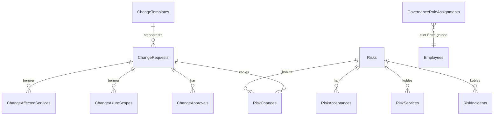

# Datamodell

Alle tabeller har `TenantId` med tenant-filter, og alle unntatt revisjonsloggen logges der ved opprettelse, endring og sletting. Migreringer: `AddChangeAndRiskManagement` (C1) og `AddGovernanceTeamsSetting` (C5).

| Tabell | Viktige felt |
|---|---|
| `ChangeRequests` | `Number` (CHG-000001, unik per tenant), type, prioritet, miljø, status, sannsynlighet og konsekvens med beregnet `RiskScore`, analyser, GDPR-konsekvens (kobling til `ProcessingActivity`), kostnad, backupstatus, planer, planlagt tid, innmelder, implementør, etterkontroll, mal, leveranse (PR, commit, pipeline, plan-hash), `ScopeHash` |
| `ChangeAffectedServices`, `ChangeAzureScopes` | Berørte tjenester og Azure-abonnementer (med ressursgruppe) |
| `ChangeApprovals` | Rolle, beslutning (`approved`, `rejected`, `info_requested`), godkjenner, tidspunkt, kommentar, `ScopeHash`. **Kan ikke endres eller slettes** |
| `ChangeTemplates` | Forhåndsgodkjente maler for standardendringer: planer, tillatte miljøer, maks risikoscore, godkjent av og når |
| `GovernanceRoleAssignments` | Rolle til ansatt **eller** Entra-gruppe, globalt eller per tjeneste |
| `RaciEntries` | Aktivitet × rolle → R, A, C eller I |
| `ApprovalRules` | Type × miljø → påkrevd rolle og antall |
| `Risks` | `Number` (RISK-000001), kategori, sannsynlighet og konsekvens med beregnet `Score`, restrisiko med `ResidualScore`, strategi, status, eier, tiltaksansvarlig, frist, neste vurdering |
| `RiskAcceptances` | `accepted` eller `revoked`, aktør, begrunnelse, score ved beslutning, gyldig til. **Kan ikke endres eller slettes** |
| `RiskChanges`, `RiskServices`, `RiskIncidents` | Koblinger til endringer, tjenester, saker og varsler |
| `GovernanceSettings` | Oppbevaring, påminnelser, simulert leveranse, Teams-kort |

**Kontroller i databasen**

- Sannsynlighet og konsekvens 1–5 (`CHECK`), scorer som beregnede kolonner.
- Rolletildeling: nøyaktig én av ansatt og gruppe. Risikohendelse: nøyaktig én av sak og varsel.
- Løpenumre fra sekvensene `change_number_seq` og `risk_number_seq`.
- Godkjenninger og aksepter stoppes ved endring eller sletting i `AuditInterceptor` (`IAppendOnly`), som revisjonsloggen.
