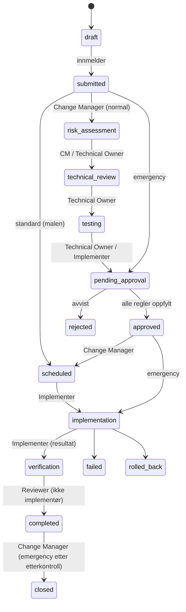

# Endringsprosessen

## Typer

| Type | Bruk | Godkjenning |
|---|---|---|
| **Standard** | Rutineendring med lav risiko fra en forhåndsgodkjent mal | Malen er godkjent av Change Manager; miljø og risiko må være innenfor malen, og planene kan ikke endres |
| **Normal** | Alle andre endringer | Etter godkjenningsreglene for miljøet |
| **Emergency** | Haster | Hurtiggodkjenning (Change Manager og Approver) og **obligatorisk etterkontroll** |

## Statuser og overganger

Avbryting (`cancelled`) er mulig før implementering, for innmelder eller Change Manager.

## Godkjenning låst til innholdet

- Hver beslutning lagrer en SHA-256 av omfang, miljø, beskrivelse, risiko, analyser, implementerings- og rollback-plan, commit og Terraform-plan. Planlagt tidspunkt er ikke med.
- Den som godkjenner, sender hashen den så. Annen hash gir 409.
- Endres godkjent innhold, går endringen tilbake til `pending_approval`, og `approval_invalidated` logges. Gamle beslutninger blir liggende, men gjelder ikke.
- **Ingen implementering uten gyldig godkjenning.** Produksjon krever minst Change Manager, også om reglene er slettet.

## Separasjon av plikter

Innmelder og implementør kan ikke godkjenne. Én person teller for én regel. Den som implementerte, kan ikke verifisere eller gjøre etterkontrollen. Gjelder i alle miljøer.
