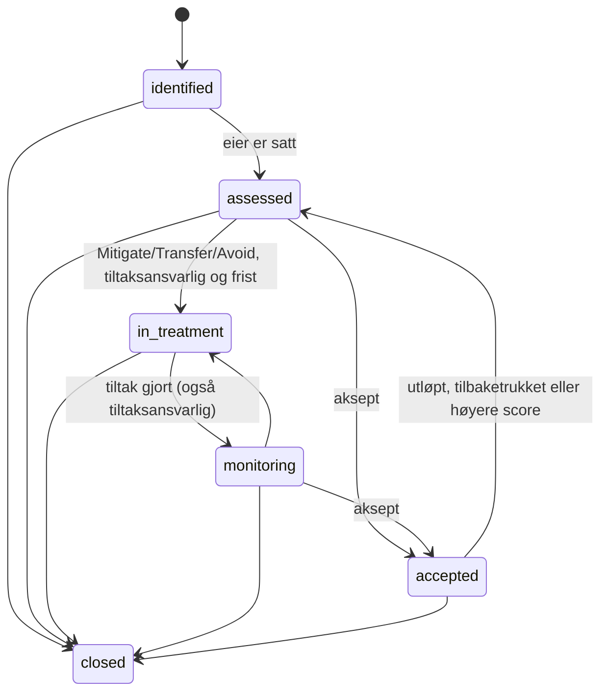

# Risikoprosessen

## Score og nivå

Score = sannsynlighet × konsekvens (1–5 hver), beregnet i databasen. **Lav** 1–4, **middels** 5–9, **høy** 10–14, **kritisk** 15–25. Restrisiko vurderes på samme måte.

## Statuser

Lukking krever en kommentar.

## Risikoaksept

- Strategien må være **Accept**, og personen må være **utpekt risikoeier med rollen Risk Owner**.
- Personen sender scoren den så (annen score gir 409), en begrunnelse og en utløpsdato (maks 12 måneder).
- **Kritiske risikoer** kan ikke aksepteres av den som registrerte dem (sjekkes mot revisjonsloggen).
- Aksept og tilbaketrekking er nye rader som aldri endres. Aksepten gjelder bare så lenge scoren er den samme og den ikke er utløpt.

## Bakgrunnsjobben

`GovernanceMonitorService` kjører hver time per tenant og logger én gang per hendelse: tiltak forbi frist, vurdering forfalt, risiko ikke behandlet (høy/kritisk uten eier, eller identifisert i over 7 dager), aksept som utløper om 14 dager, og utløpt aksept (status tilbake til «vurdert»). Hendelsene gir Teams-kort.

## Kategorier og strategier

Kategorier: Information Security, Backup and Disaster Recovery, GDPR and Compliance, Identity and Access Management, Financial and FinOps, Operational Risk, Technical Debt, Availability, Governance, Supplier Risk. Strategier: Mitigate, Accept, Transfer, Avoid.
